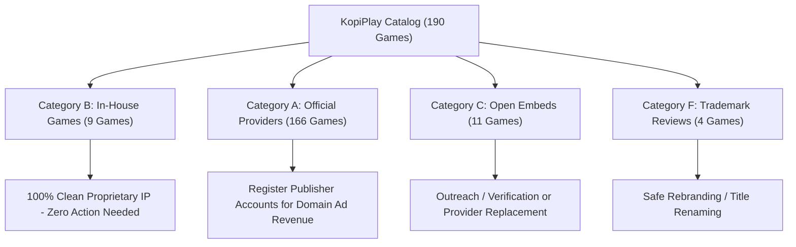

# KOPIPLAY – COPYRIGHT & PERMISSION ACTION PLAN

**Project:** KopiPlay Gaming Website  
**Scope:** Pre-Deployment Commercial Licensing & Publisher Authorization Roadmap  
**Target Architecture:** GitHub Pages / Custom Domain / Ad-Supported Gaming Portal

---

## 1. Executive Summary & Action Priority

This action plan outlines the exact outreach, onboarding, and compliance steps required prior to launching KopiPlay on a custom commercial domain.

---

## 2. Priority 1: Trademark Mitigation & Title Renaming (Immediate)

Four games in the current catalog feature game titles or slugs that closely echo famous registered trademarks. While the underlying gameplay mechanics are non-copyrightable arcade logic, renaming the title strings prevents trademark dilution risks:

| No. | Game Title | Slug / ID | Trademark Flagged | Registered Trademark Owner | Recommended Mitigation |
| :--- | :--- | :--- | :--- | :--- | :--- |
| 1 | **Neon Breaker DX** | `neon-breakout-06` | "Breakout" | Atari Interactive, Inc. | Update slug to `neon-breaker-dx` and ensure all references refer strictly to "Breaker". |
| 2 | **Arkanoid** | `hg-arkanoid` | "Arkanoid" | Taito Corporation (Square Enix) | Rename display title on portal to "Neon Brick Breaker". |
| 3 | **Tetrix / Tetrix Plus** | `hg-tetrix` | "Tetris" similarity | Tetris Holding, LLC | Retain "Tetrix" (Zygomatic variant) but avoid using the word "Tetris" in search tags or metadata. |
| 4 | **Pac-Maze** | `hg-pac-maze` | "Pac" prefix | Bandai Namco Entertainment Inc. | Rename display title to "Star Maze Runner". |

---

## 3. Priority 2: Provider Onboarding & Domain Authorization (Prior to Custom Domain Launch)

### A. GameDistribution (Azerion B.V.) – 47 Games
- **Provider Status:** Official, authorized European HTML5 distribution syndicate.
- **Agreement URL:** [https://gamedistribution.com/publishers](https://gamedistribution.com/publishers)
- **Contact:** `publishers@gamedistribution.com` / `support@gamedistribution.com`
- **Action Steps:**
  1. Once the custom domain is registered, sign up for a free Publisher Account at [gamedistribution.com](https://gamedistribution.com/).
  2. Add the custom domain to the GameDistribution dashboard for domain verification.
  3. Replace generic embed GUIDs with your personal Publisher ID to capture 70% ad revenue share on all video and display impressions.

### B. HTMLGames (Zygomatic B.V.) – 121 Games
- **Provider Status:** Dutch casual games developer and syndication provider.
- **Webmaster Terms:** [https://www.htmlgames.com/html5-games-for-your-site/](https://www.htmlgames.com/html5-games-for-your-site/)
- **Contact:** `info@zygomatic.nl` / `webmaster@htmlgames.com`
- **Action Steps:**
  1. Maintain standard embed code with unmodified Zygomatic pre-roll advertising (authorized for ad-supported portals).
  2. When deploying to a custom domain, add Zygomatic's authorized ad lines to your root `ads.txt` file.
  3. If unbranded, ad-free white-label game builds are desired in the future, contact `info@zygomatic.nl` to request a B2B commercial quote.

### C. GameMonetize Inc. – 12 Games
- **Provider Status:** Open monetization network.
- **Publisher Dashboard:** [https://gamemonetize.com/publishers](https://gamemonetize.com/publishers)
- **Contact:** `info@gamemonetize.com`
- **Action Steps:**
  1. Sign up for a Publisher Account at [gamemonetize.com](https://gamemonetize.com/).
  2. For the 10 community-uploaded titles (*Hand Fight*, *Dream Restaurant 3D*, *Helicopter Battle*, *Magic Block Puzzle*, *Word Connect*, *Fruit Jam*, *Fast Rescue*, *Nut Color Sort*, *Pool Maniya*, *Cross Word Puzzle*), review player metrics. If any title exhibits third-party copyright claims, replace with an equivalent licensed title from GameDistribution.

---

## 4. Priority 3: First-Party Game Commercial Documentation

The 10 locally hosted games in `c:/online game/games/` constitute proprietary intellectual property:
- **Jungle Dash 3D** (`games/jungle-dash-3d/`): Original WebGL/Three.js procedural endless runner.
- **Crazy Bumper Arena** (`games/crazy-bumper-arena/`): Original WebGL/Three.js 3D bumper car battle game.
- **Tower Builder** (`games/tower-builder/`): Original WebGL/Three.js 3D stacking game.
- **Neon Horizon: Cyber Racer** (`games/neon-racer/`): In-house HTML5 Canvas racer.
- **Space Nebula Defender** (`games/space-defender/`): In-house HTML5 Canvas space shooter.
- **Pulse 2048: Cyber Edition** (`games/pulse-2048/`): In-house HTML5 Canvas math puzzle.
- **Cyber Snake: Neon Overdrive** (`games/cyber-snake/`): In-house HTML5 Canvas snake arcade.
- **Neon Breaker DX** (`games/neon-breakout/`): In-house HTML5 Canvas brick breaker.
- **Hyper Hoops: Street Dunk** (`games/slam-dunk/`): In-house HTML5 Canvas basketball shooter.
- **Chrono Dungeon: Crystal Quest** (`games/dungeon-quest/`): In-house HTML5 Canvas dungeon crawler.

**Action Steps:**
1. Maintain all first-party source code in the primary Git repository.
2. In the site footer, include clear copyright attribution: *© 2026 KopiPlay. First-party games developed by KopiPlay Studios & Arcade. Third-party titles licensed via authorized syndication partners.*

---

## 5. Summary Checklist Before Public Commercial Launch

| Task | Responsible Party | Verification Target | Status |
| :--- | :--- | :--- | :--- |
| **Domain Registration** | Website Owner | Purchase custom .com / .play domain | Pending |
| **GameDistribution Onboarding** | Website Owner | Register domain at `gamedistribution.com/publishers` | Ready for setup |
| **GameMonetize Onboarding** | Website Owner | Obtain Publisher ID at `gamemonetize.com` | Ready for setup |
| **ads.txt Integration** | Website Owner | Place authorized provider lines in root `ads.txt` | Ready for setup |
| **Trademark Title Polish** | Development Team | Safe display name adjustments for 4 legacy titles | Recommended |
| **First-Party Code Copyright Notice** | Development Team | Include KopiPlay Studios attribution in footer | Implemented |
