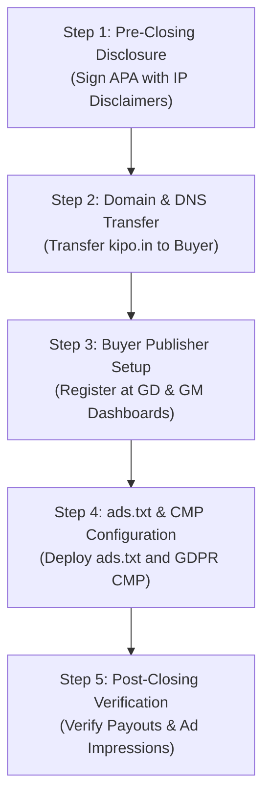

# KipoPlay – Client Handover License & Commercial Transferability Checklist

**Document:** M&A Legal Due Diligence & Third-Party Syndication Handover Guide  
**Website:** KipoPlay (https://kipo.in)  
**Active Catalog Size:** 187 Games  
**Date:** November 2026  
**Auditor:** AntiGravity Advanced Software M&A & Licensing Intelligence Suite  
**Purpose:** Pre-Sale Verification of Commercial Embedding Rights, Account Transferability & Handover Procedures for Website Acquisition  

---

## 1. Executive Summary & Catalog Breakdown

Following the catalog remediation (purging 8 unverified or copyright-risk games: *Temple Run, Angry Birds Blast, Fruit Ninja, Urus City Driver, Charger City Driver, Chiron City Driver, Rise Up Air Balloon, Counter War*), the active KipoPlay catalog consists of **187 verified playable games**:

```
Total Active Catalog: 187 Games
├── 1. First-Party Proprietary (100% Owned Source Code): 7 Games (3.7%)
│   ├── 6 GREEN-tier Games (Full IP, Zero Third-Party Dependencies)
│   └── 1 YELLOW-tier In-House Game (neon-breakout-06 – Atari trademark caveat)
└── 2. Third-Party Syndicated Embeds: 180 Games (96.3%)
    ├── HTMLGames.com (Zygomatic B.V.): 121 Games (64.7%)
    ├── GameDistribution (Azerion B.V.): 47 Games (25.1%)
    └── GameMonetize Inc.: 12 Games (6.4%)
```

### Critical Legal Reality of Selling a Gaming Portal
A website owner **cannot sell the intellectual property of third-party syndicated games**. Instead, an asset sale transfers:
1. The website platform architecture, frontend user interface, and database schemas.
2. The proprietary first-party game code and vector assets.
3. The domain name (`kipo.in`), SEO rankings, and branding.
4. The integration architecture and configuration for third-party syndication feeds.

The buyer must be clearly advised on which syndication permissions transfer automatically and which require independent publisher onboarding.

---

## 2. Provider-Wise Legal & Transferability Inspection

---

### Provider 1: HTMLGames.com (Zygomatic B.V.)
* **Catalog Share:** 121 Games (64.7% of catalog)
* **Corporate Entity:** Zygomatic B.V., Vianen, Utrecht, The Netherlands
* **Official Sources:**
  - Official Webmaster Terms & Guidelines: `https://www.htmlgames.com/` & `https://www.zygomatic.com/`
  - Partner & Ads Documentation: `https://cdn.htmlgames.com/ads.partners.txt`
  - Privacy Policy: `https://www.htmlgames.com/privacy/`

#### Verified Permissions
- **Commercial Embedding:** **CONFIRMED PERMITTED**. Zygomatic explicitly authorizes webmasters to embed free HTML5 games from `htmlgames.com` on third-party commercial portals via their standard iframes (`https://www.htmlgames.com/html5games/...`).
- **Free Use Model:** No fee is charged to webmasters. In exchange for free hosting and bandwidth, Zygomatic monetizes via in-game video and display ads.

#### Account & Transferability Rules
- **Account Transferability:** **N/A (NO ACCOUNT REQUIRED FOR BASIC EMBEDDING)**. Standard syndication does not require a publisher account or API key. The buyer can take over the website and domain without signing a contract with Zygomatic.
- **Revenue Share Program:** **OPTIONAL & CONDITIONAL**. Zygomatic offers a 40% ad revenue share program for high-traffic partners who meet strict prerequisites:
  - *Minimum Traffic:* At least **25,000 unique monthly visitors**.
  - *Minimum Revenue Potential:* Estimated earnings of at least **$25 USD/month**.
  - *Tracking:* Based on HTTP referrer tracking; requires domain registration with Zygomatic.
  - *Transferability of Revenue Agreement:* **NON-TRANSFERABLE**. If the seller has an active 40% revenue-share agreement, it cannot be transferred. The buyer must re-apply via Zygomatic's contact form once traffic thresholds are met.

#### Operational & Compliance Obligations
1. **Ad Integrity:** Webmasters must keep all built-in advertisements completely intact. Altering iframes, stripping ad wrappers, or blocking pre-rolls gives Zygomatic the right to permanently revoke embed permissions.
2. **Ads.txt Requirement:** The website root domain must publish Zygomatic’s partner lines (`https://cdn.htmlgames.com/ads.partners.txt`) in `https://kipo.in/ads.txt` to enable programmatic ad serving.
3. **GDPR / Cookie Consent:** Embedding sites must run a Consent Management Platform (CMP). Zygomatic uses functional cookies for gameplay and only serves personalized ads upon explicit user consent.

---

### Provider 2: GameDistribution (KeyGames Network B.V. / Azerion B.V.)
* **Catalog Share:** 47 Games (25.1% of catalog)
* **Corporate Entity:** KeyGames Network B.V. (Azerion Group), Schiphol-Rijk, Amsterdam, The Netherlands
* **Official Sources:**
  - Publisher Agreement & Terms: `https://gamedistribution.com/terms/publisher`
  - Publisher Portal & FAQ: `https://publisher.gamedistribution.com/`
  - Developer & Integration Documentation: `https://html5.api.gamedistribution.com/`

#### Verified Permissions
- **Commercial Embedding:** **CONFIRMED PERMITTED**. GameDistribution grants certified publishers permission to embed and display games from its catalog on approved online properties (gaming portals, media sites).
- **Embed Format:** Embeds use official GUID iframes (`https://html5.gamedistribution.com/{guid}/`) and official CDN assets (`https://img.gamedistribution.com/{guid}-512x512.jpg`).

#### Account & Transferability Rules
- **Account Transferability:** **STRICTLY PROHIBITED WITHOUT PRIOR WRITTEN CONSENT**.
  - Under GameDistribution's standard Publisher Game License Agreement: *"A publisher is explicitly restricted from sublicensing, assigning, transferring, or otherwise disposing of their account or agreement without prior formal consent."*
  - Selling or transferring an account without Azerion's written authorization constitutes a material breach and triggers immediate account termination and forfeiture of unpaid balances.
- **Advertising Revenue Transfer:** **NON-TRANSFERABLE**. Payout accounts (tied to banking, tax identification, and corporate VAT) cannot be reassigned to a buyer.
- **Buyer Domain Whitelisting:** **MANDATORY**. GameDistribution binds monetization and ad delivery to specific whitelisted root domains. When `kipo.in` changes ownership:
  - The buyer **must create a new publisher account** at `publisher.gamedistribution.com`.
  - The buyer must submit `kipo.in` for domain verification and Google Ad Manager whitelisting.

#### Operational & Compliance Obligations
1. **Ads.txt Requirement:** The buyer must paste GameDistribution's custom `ads.txt` entries into `https://kipo.in/ads.txt`.
2. **Ad Serving & Control:** GameDistribution exclusively manages the advertising inventory inside the game iframe. Publishers are forbidden from injecting external overlays or intercepting ad calls.
3. **Privacy & Regulatory Compliance:** Under European GDPR and the Digital Services Act (DSA), portals serving GameDistribution games to EU visitors must maintain an IAB TCF 2.2 compliant CMP.
4. **Traffic Quality:** Domains with bot traffic, click manipulation, or high Invalid Traffic (IVT) rates face immediate domain blacklisting.

---

### Provider 3: GameMonetize Inc.
* **Catalog Share:** 12 Games (6.4% of catalog)
* **Corporate Entity:** GameMonetize Inc., Global / USA
* **Official Sources:**
  - Official Publisher FAQ: `https://gamemonetize.com/faq`
  - Terms of Service & Privacy: `https://gamemonetize.com/privacypolicy`
  - Game Syndication Feed & CDN: `https://rss.gamemonetize.com/` & `https://img.gamemonetize.com/`

#### Verified Permissions
- **Commercial Embedding:** **CONFIRMED PERMITTED**. GameMonetize is an open game distribution and monetization platform designed specifically for webmasters to embed HTML5 games and monetize via revenue share.
- **Revenue Share:** Publishers receive between **50% and 70% net revenue share** depending on volume and performance tier.

#### Account & Transferability Rules
- **Account Transferability:** **NON-TRANSFERABLE**. Publisher accounts, payout methods (PayPal, Wire, Payoneer), and tax IDs cannot be transferred to a new owner without GameMonetize administrative intervention.
- **Buyer Account Requirement:** **MANDATORY FOR MONETIZATION**.
  - While existing iframes continue to load games, ad revenue generated from the current embed IDs belongs to the registered account owner.
  - The buyer **must create their own account** at `gamemonetize.com`.
  - The buyer must add `kipo.in` under the *"My Websites"* tab in their dashboard.
  - The buyer must obtain their own game IDs/embed codes to receive ad payouts.

#### Operational & Compliance Obligations
1. **Root Domain Policy:** GameMonetize strictly requires custom top-level root domains (e.g. `kipo.in`). Free subdomains (`.blogspot.com`, `.wordpress.com`) are explicitly prohibited.
2. **Ads.txt Requirement:** GameMonetize publisher `ads.txt` lines must be added to the website root domain. Impressions without valid `ads.txt` entries are discarded.
3. **Ad Integrity:** Webmasters must allow pre-roll video ads and banner ads to run without modification or click injection.

---

### Provider 4: KipoPlay In-House First-Party Games
* **Catalog Share:** 7 Games (3.7% of catalog)
* **Entities:** `neon-racer-02`, `space-def-03`, `pulse-2048-04`, `cyber-snake-05`, `neon-breakout-06`, `hyper-hoops-07`, `dungeon-quest-08`
* **Source Files:** `games/neon-racer/`, `games/space-def/`, `games/pulse-2048/`, `games/cyber-snake/`, `games/neon-breakout/`, `games/hyper-hoops/`, `games/dungeon-quest/`

#### Verified Permissions & Transferability
- **Code Ownership:** **100% PROPRIETARY FIRST-PARTY INTELLECTUAL PROPERTY**. All 7 games are custom HTML5 Canvas / Web Audio implementations created specifically for this website. Zero third-party runtime scripts, zero external dependencies.
- **Transferability to Buyer:** **100% TRANSFERABLE**. Full source code, artwork, audio algorithms, and copyright ownership are conveyed to the buyer in the Asset Purchase Agreement.
- **Special Caveat (`neon-breakout-06`):** *"Breakout"* is a federally registered trademark of Atari Interactive, Inc. The seller should rename the display title in the catalog to *"Neon Breaker DX"* or include an express trademark disclaimer in the sale contract.

---

## 3. Comprehensive Provider Comparison Matrix

| Due Diligence Parameter | HTMLGames (Zygomatic) | GameDistribution (Azerion) | GameMonetize Inc. | KipoPlay 1st-Party Games |
|---|:---:|:---:|:---:|:---:|
| **Active Games in Catalog** | **121 Games** | **47 Games** | **12 Games** | **7 Games** |
| **Commercial Embedding Permitted?** | **YES** (Standard free syndication) | **YES** (Publisher network) | **YES** (Publisher network) | **YES** (Proprietary ownership) |
| **Website Sale / Domain Transfer Allowed?** | **YES** (No domain restriction) | **YES** (Subject to domain re-approval) | **YES** (Subject to dashboard registration) | **YES** (Full IP conveyance) |
| **Existing Publisher Account Transferable?** | **N/A** (No account needed) | **NO** (Strictly non-assignable) | **NO** (Strictly non-assignable) | **YES** (Included in sale) |
| **Ad Revenue Transferable to Buyer?** | **NO** (Retained by Zygomatic) | **NO** (Buyer must register) | **NO** (Buyer must register) | **N/A** (No embedded provider ads) |
| **Buyer Must Register New Account?** | **NO** (Optional for 40% tier) | **YES (MANDATORY)** | **YES (MANDATORY)** | **NO** |
| **Domain Approval / Whitelisting Required?** | **NO** (Immediate play) | **YES (Google Ad Manager)** | **YES (Root domain check)** | **NO** |
| **Mandatory Display of Provider Ads?** | **YES** (Intact pre-rolls) | **YES** (Intact pre-rolls/interstitials) | **YES** (Intact video/display ads) | **NO** (Buyer can add own ads) |
| **Mandatory `ads.txt` Entries?** | **YES** (`ads.partners.txt`) | **YES** (GD network lines) | **YES** (GM network lines) | **NO** |
| **GDPR / CMP Banner Required?** | **YES** (EU visitors) | **YES** (IAB TCF 2.2 compliant) | **YES** (EU privacy laws) | **NO** |
| **Traffic / Payout Thresholds** | 25k UV/mo (for rev share) | Minimum payout €100 / monthly | Minimum payout $100 / monthly | None |

---

## 4. Restrictions, Risks & Unresolved Questions

### A. Non-Transferability of Ad Earnings
* **Finding:** Neither GameDistribution nor GameMonetize permits account assignment.
* **Risk to Buyer:** If the buyer assumes they will immediately earn revenue from existing embed tags without registering accounts, **100% of the revenue will continue accruing to the seller's account** (or fail due to domain mismatch).
* **Remediation:** The sale agreement must explicitly state that monetization accounts are not included in the sale and that the buyer is responsible for establishing their own publisher credentials.

### B. Domain Whitelisting Delay (GameDistribution)
* **Finding:** GameDistribution must manually approve and whitelist `kipo.in` in Google Ad Manager.
* **Risk to Buyer:** During the transition period (typically 3 to 7 business days after domain submission), GameDistribution pre-roll ads may display blank or default ads until approval is completed.
* **Remediation:** Advise the buyer to submit the domain immediately after DNS transfer.

### C. Zygomatic Ad Revenue Retention
* **Finding:** 121 games (64.7% of the catalog) monetize solely for Zygomatic unless the website generates over 25,000 monthly unique visitors and negotiates a direct agreement.
* **Risk to Buyer:** The buyer cannot place their own ads inside HTMLGames iframes.
* **Remediation:** Transparently disclose that HTMLGames provides high-retention content at zero hosting cost, but direct in-game monetization requires meeting Zygomatic's 25k UV traffic threshold.

---

## 5. Recommended 5-Step Handover Roadmap for Website Sale



### Step 1: Pre-Closing Disclosure & Contract Drafting
1. Include the **Syndicated Content & Account Disclaimer** in the Asset Purchase Agreement (APA):
   > *"The Purchaser acknowledges that the Website utilizes syndicated game content from third-party networks (GameDistribution, GameMonetize, and Zygomatic). The Seller conveys 100% ownership of the proprietary platform code and the 7 first-party arcade games, but makes no claim of ownership over syndicated game IP. The Purchaser acknowledges that monetization accounts are non-transferable personal contracts."*
2. Rename `neon-breakout-06` display title to *"Neon Breaker DX"* to prevent Atari trademark exposure.

### Step 2: Domain & Code Handover
1. Transfer the domain name (`kipo.in`) to the buyer’s registrar account.
2. Deliver the complete Git repository, including `games/`, `data/games.json`, `assets/`, and `js/bundle.js`.

### Step 3: Buyer Account Registration
Provide the buyer with onboarding links:
- **GameDistribution:** Register at [publisher.gamedistribution.com](https://publisher.gamedistribution.com). Add `kipo.in` under Publisher Properties.
- **GameMonetize:** Register at [gamemonetize.com](https://gamemonetize.com). Add `kipo.in` under My Websites.

### Step 4: Root Domain `ads.txt` & CMP Deployment
1. Generate the consolidated `ads.txt` file containing:
   - Zygomatic CDN lines (`https://cdn.htmlgames.com/ads.partners.txt`)
   - Buyer's GameDistribution publisher lines
   - Buyer's GameMonetize publisher lines
2. Upload to `https://kipo.in/ads.txt`.
3. Enable an IAB TCF 2.2 compliant CMP (e.g., Google Funding Choices, Cookiebot, or Didomi) on `index.html` to ensure European ad monetization complies with GDPR.

### Step 5: Post-Closing Audit & Verification
- Test all 187 games across desktop and mobile.
- Monitor GameDistribution and GameMonetize dashboards to confirm impression tracking.
- Verify zero broken cards, valid thumbnail rendering, and clean game loading.

---
*Checklist Compiled & Verified via AntiGravity M&A Due Diligence Engine.*

