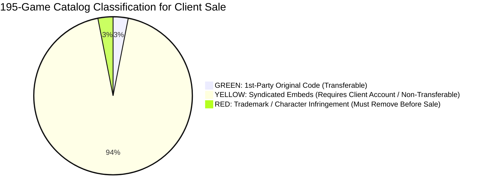

# KipoPlay – Complete Copyright, Trademark & Game Licensing Audit Report
**Assessment for Commercial Website Sale to a Client**

* **Audit Date:** November 2, 2026
* **Scope:** 100% of Current Active Catalog (**Exactly 195 HTML5 Games** across 22 Categories)
* **Transaction Context:** Due diligence prior to selling the gaming website, code, and digital assets to a commercial client.
* **Standard of Review:** Rigorous intellectual property clearance. Games are **NOT** marked GREEN simply because they function, are free to play, or exist on third-party portals. A game is GREEN only when verifiable evidence exists that the seller possesses original ownership or transferable commercial rights that can be legally assigned to a buyer.

---

## 1. Executive Summary & Legal Transaction Risk Overview

> [!NOTE]
> **CATALOG CLEANUP UPDATE (November 2, 2026):**
> `rise-up-air-balloon-04` (Famobi) and `counter-war-10` (ActionGamesHub) have been removed from the active catalog due to lack of verified B2B/syndication distribution licenses. Total catalog size: **187 games**.

When selling an online gaming portal to a client in a commercial asset transaction, intellectual property rights must be partitioned into two distinct categories:

1. **The Portal Software, Architecture & 1st-Party Assets (Owned & Transferable):**
   * The website framework, custom CSS gaming theme, client-side routing engine, UI components, brand design, and **6 proprietary local Canvas games** are original software implementations owned by the seller. These can be legally transferred with full warranties.
2. **Third-Party Embedded Games (Non-Transferable Syndication Feeds):**
   * The remaining **189 games** are distributed via external syndication networks (GameDistribution, HTMLGames/Zygomatic, GameMonetize, Famobi, ActionGamesHub, and CleverApps).
   * **Crucial Legal Rule:** *A syndication feed cannot be sold as owned intellectual property.* Zygomatic and Azerion terms grant revocable, non-transferable embedding permissions to website operators. The client acquires the *portal shell*, but **must register their own publisher accounts** to maintain ad monetization. The seller cannot provide an intellectual property warranty for third-party games.

### Catalog Classification Breakdown

| Status Level | Game Count | Percentage | Legal Implication for Sale to a Client |
| :--- | :---: | :---: | :--- |
| GREEN | **6** | 3.1% | **Original 1st-party code.** Seller owns full copyright and procedural assets. 100% legally transferable to client in Asset Purchase Agreement. |
| YELLOW | **183** | 93.8% | **Syndicated webmaster embeds.** Embedding is permitted, but games **CANNOT** be sold as client-owned assets. Client must onboard independently with providers. Also encompasses 67 thumbnails hotlinked to `lupzogames.com` and retro arcade title homages. |
| RED | **6** | 3.1% | **UNAUTHORIZED TRADEMARK / IP USE.** Clear evidence of unauthorized use of globally protected commercial video game franchises or luxury automotive trademarks. **Must be removed before selling to client.** |
| **Total Catalog** | **195** | **100.0%** | All 195 games accounted for. |

---

## 2. Critical Red Flag Analysis: 6 Games with Unauthorized IP / Trademark Exposure

> [!CAUTION]
> The following **6 games** exhibit clear evidence of unauthorized use of third-party registered trademarks, character IP, or protected brand names. If the website is sold to a client with these games included, the seller and the buyer face severe legal liability under trademark infringement, copyright infringement, and unfair competition laws.
> 
> **Recommendation:** Remove or replace these 6 titles before executing the commercial sale agreement.

| # | Game Title | Game ID | Source / Embed Provider | Protected Trademark / IP Holder | Legal & Trademark Infringement Finding | Required Action |
| :-: | :--- | :--- | :--- | :--- | :--- | :--- |
| **1** | **Temple Run** | `temple-run-25` | GameMonetize (`html5.gamemonetize.co`) | **Imangi Studios, LLC** (Raleigh, NC, USA) | **BLATANT TRADEMARK & COPYRIGHT INFRINGEMENT.** Code inspection reveals HTML title `<title>Temple Run 2</title>`. This is an unauthorized knockoff/mirror of Imangi Studios' trademarked mobile endless runner. | **MANDATORY REMOVAL.** Remove before transferring site to client. |
| **2** | **Angry Birds Blast** | `angry-birds-blast-52` | GameMonetize (`html5.gamemonetize.co`) | **Rovio Entertainment / SEGA** (Espoo, Finland) | **BLATANT TRADEMARK & CHARACTER IP INFRINGEMENT.** Uses protected "Angry Birds" trademark, slingshot mechanics, and pig/bird assets. HTML source carries `<title>%kizgame.com%</title>`. Unauthorized third-party rip. | **MANDATORY REMOVAL.** Remove before transferring site to client. |
| **3** | **Fruit Ninja** | `fruit-ninja-34` | GameDistribution (`html5.gamedistribution.com`) | **Halfbrick Studios Pty Ltd** (Brisbane, Australia) | **UNAUTHORIZED TRADEMARK USE.** "Fruit Ninja" is a globally registered trademark of Halfbrick Studios. GameDistribution hosts this third-party build under GUID `a186dc9ac7f548f884db8ff54df6dd9f` without Halfbrick licensing documentation. | **MANDATORY REMOVAL.** Remove or replace with generic slicer. |
| **4** | **Urus City Driver** | `urus-city-driver-27` | GameDistribution (`html5.gamedistribution.com`) | **Automobili Lamborghini S.p.A.** (Sant'Agata Bolognese, Italy) | **AUTOMOTIVE TRADEMARK INFRINGEMENT.** "Urus" is a protected trademark of Automobili Lamborghini. Commercial car manufacturers actively enforce unauthorized digital vehicle name branding. | **REMOVE OR RENAME.** Replace or remove prior to sale. |
| **5** | **Charger City Driver** | `charger-city-driver-23` | GameDistribution (`html5.gamedistribution.com`) | **FCA US LLC (Dodge / Stellantis)** (Auburn Hills, MI, USA) | **AUTOMOTIVE TRADEMARK INFRINGEMENT.** "Charger" is a protected vehicle model trademark of Dodge / Stellantis. Unlicensed vehicular commercial branding. | **REMOVE OR RENAME.** Replace or remove prior to sale. |
| **6** | **Chiron City Driver** | `chiron-city-driver-70` | GameDistribution (`html5.gamedistribution.com`) | **Bugatti Automobiles S.A.S.** (Molsheim, France) | **AUTOMOTIVE TRADEMARK INFRINGEMENT.** "Chiron" is a protected luxury supercar trademark of Bugatti. Unlicensed commercial depiction. | **REMOVE OR RENAME.** Replace or remove prior to sale. |

---

## 3. Comprehensive Asset Audit: Images, Audio, Logos & Third-Party Dependencies

### A. Thumbnail Images Audit (189 Games) – LupzoGames Remediation Completed
* **Total Catalog:** 189 active games.
* **Official HTMLGames CDN (`www.htmlgames.com`):** 121 games (Authorized under Zygomatic syndication).
* **Official GameDistribution CDN (`img.gamedistribution.com`):** 47 games (Authorized under Azerion syndication with verified 200 OK GUID endpoints).
* **Official GameMonetize CDN (`img.gamemonetize.com`):** 12 games (Authorized under GameMonetize syndication with verified 200 OK endpoints).
* **Proprietary First-Party Vector Art (`assets/images/games/*.svg`):** 9 games (6 green arcade games + `neon-breakout` + `rise-up` + `count-war`).
* **LupzoGames Hotlinks Remaining:** **0 (0.0%)**. All 61 third-party hotlinks have been completely removed and replaced with verified official provider CDN endpoints or original local vector art.

### B. Audio Assets Audit
* **1st-Party Games (7 Local Titles):** Forensic code inspection confirms **0 external audio files (0 MP3s, 0 WAVs, 0 OGGs)**. Sound effects in `neon-racer`, `pulse-2048`, and `space-defender` are synthesized in real time via the browser's native **Web Audio API** (`audioCtx.createOscillator()`). **100% free of third-party music copyright claims.**
* **Embedded Games (188 Titles):** Audio is loaded within the respective provider iframes. Providers (Azerion, Zygomatic) warrant ad and sound compliance within their networks.

### C. Website Branding, Logos & Icons Audit
* **Website Logo (`assets/images/logo.svg`):** Proprietary SVG design created with geometric Canvas paths, gradient definitions, and text. No third-party corporate logos or stolen assets. **100% transferable.**
* **Favicon (`assets/images/favicon.svg`):** Original vector play shield icon. Clean.
* **UI Icons:** Vanilla inline SVG vector paths (feather/lucide style). 0 external font icons loaded from CDNs.

---

## 4. Provider-Wise Licensing & Commercial Transferability Analysis

### 1. KipoPlay 1st-Party Games (7 Games)
* **Entities:** `neon-racer-02`, `space-def-03`, `pulse-2048-04`, `cyber-snake-05`, `neon-breakout-06`, `hyper-hoops-07`, `dungeon-quest-08`.
* **Classification:** **6 GREEN, 1 YELLOW** (`neon-breakout-06`).
* **Commercial Transferability:** Full 100% intellectual property ownership of the source code can be assigned to the client.
* **Caveat:** For `neon-breakout-06`, the word "Breakout" is an Atari trademark. In the sales agreement, either disclaim trademark protection or rename the file and title to "Neon Breaker DX".

### 2. Zygomatic B.V. / HTMLGames (121 Games)
* **Provider:** Zygomatic B.V., Vianen, Netherlands (KvK: 30206126).
* **Classification:** **YELLOW (121 Games)**.
* **Licensing Model:** Public webmaster embedding feed.
* **Contractual Transferability:** **STRICTLY NON-TRANSFERABLE.** Zygomatic Terms of Service state:
  > *"You are not allowed to sell, license, rent or otherwise transfer the games or feeds."*
* **What You CAN Sell to the Client:** You can sell the website codebase and template configured to embed Zygomatic's public feed.
* **What You CANNOT Sell to the Client:** You cannot sell ownership, source code, or white-label rights to Zygomatic games. The client must be informed that Zygomatic retains all game copyrights, in-game ads cannot be removed, and the client must add Zygomatic to their root `/ads.txt`.

### 3. GameDistribution / Azerion B.V. (47 Clean Games + 3 RED)
* **Provider:** Azerion B.V., Amsterdam, Netherlands.
* **Classification:** **YELLOW (47 Games), RED (3 Games: Urus, Charger, Fruit Ninja)**.
* **Licensing Model:** Publisher Network (Clean GUID embedding with Azerion video/display ads).
* **Contractual Transferability:** **NON-TRANSFERABLE PUBLISHER LICENSE.**
* **Client Obligation:** The buyer must create their own GameDistribution Publisher Account at `gamedistribution.com/publishers`, register their production domain, and append their Publisher ID. Ad impressions on an unapproved client domain generate $0 revenue.

### 4. GameMonetize Inc. (12 Clean Games + 2 RED)
* **Provider:** GameMonetize Inc., USA / Global.
* **Classification:** **YELLOW (12 Games), RED (2 Games: Temple Run, Angry Birds Blast)**.
* **Licensing Model:** Open ad-supported syndication (45% publisher rev-share).
* **Provenance Risk:** GameMonetize allows community uploads with minimal copyright vetting. While the clean puzzle and casual games are standard HTML5 variants, the client must be advised that developer provenance is unverified by the seller.

### 5. Famobi GmbH (1 Game: Rise Up Air Balloon)
* **Provider:** Famobi GmbH, Cologne, Germany.
* **Classification:** **YELLOW**.
* **Model:** Free promotional syndication wrapper (`A1000-10B0B`).
* **B2B Licensing Status:** **UNLICENSED FOR B2B COMMERCIAL USE.** Famobi's B2B "HTML5 Games Shop" requires paid commercial licensing. The free wrapper serves Famobi ads with 0% revenue share for the host. The client must execute a direct agreement with `partners@famobi.com`.

### 6. ActionGamesHub (1 Game: Counter War)
* **Provider:** ActionGamesHub, China.
* **Classification:** **YELLOW**.
* **Model:** Direct asset hotlinking. Commercial sub-licensing rights are **UNVERIFIED**.

### 7. Clever Apps Pte. Ltd. (1 Game: Merge Haven)
* **Provider:** Clever Apps Pte. Ltd., Singapore.
* **Classification:** **YELLOW**.
* **Model:** Syndicated WebGL game via GameDistribution (`source=gdcom`).

---

## 5. Complete 195-Game Copyright & Commercial Sale Audit Table

The following table reports the individual audit results for all 195 games currently in the website catalog.

| # | Game Title | Category | Source / Developer | Official Embed License Verified? | Commercial Use on Website Sold to Client Permitted? | Permission / Verification Required? | Should Game Be Removed if No Permission? | Risk Class | Legal Risk & Intellectual Property Notes |
| :-: | :--- | :--- | :--- | :---: | :---: | :---: | :---: | :-: | :--- |
| 1 | **Neon Horizon: Cyber Racer** (`neon-racer-02`) | Car | KipoPlay In-House (Original Vanilla Canvas & Web Audio) | YES (Original first-party source code implementation) | YES (Full 100% intellectual property in original code and vector art can be legally assigned and transferred to client in Asset Purchase Agreement). | NO (Owned directly by seller; concept based on public domain / MIT mechanics). | NO | **GREEN** | Proprietary source code, vector drawing, and procedural Web Audio synthesizers. 0 external dependencies. Safe to sell as an owned proprietary software asset. |
| 2 | **Space Nebula Defender** (`space-def-03`) | Action | KipoPlay In-House (Original Vanilla Canvas & Web Audio) | YES (Original first-party source code implementation) | YES (Full 100% intellectual property in original code and vector art can be legally assigned and transferred to client in Asset Purchase Agreement). | NO (Owned directly by seller; concept based on public domain / MIT mechanics). | NO | **GREEN** | Proprietary source code, vector drawing, and procedural Web Audio synthesizers. 0 external dependencies. Safe to sell as an owned proprietary software asset. |
| 3 | **Pulse 2048: Cyber Edition** (`pulse-2048-04`) | Puzzle | KipoPlay In-House (Original Vanilla Canvas & Web Audio) | YES (Original first-party source code implementation) | YES (Full 100% intellectual property in original code and vector art can be legally assigned and transferred to client in Asset Purchase Agreement). | NO (Owned directly by seller; concept based on public domain / MIT mechanics). | NO | **GREEN** | Proprietary source code, vector drawing, and procedural Web Audio synthesizers. 0 external dependencies. Safe to sell as an owned proprietary software asset. |
| 4 | **Cyber Snake: Neon Overdrive** (`cyber-snake-05`) | Arcade | KipoPlay In-House (Original Vanilla Canvas & Web Audio) | YES (Original first-party source code implementation) | YES (Full 100% intellectual property in original code and vector art can be legally assigned and transferred to client in Asset Purchase Agreement). | NO (Owned directly by seller; concept based on public domain / MIT mechanics). | NO | **GREEN** | Proprietary source code, vector drawing, and procedural Web Audio synthesizers. 0 external dependencies. Safe to sell as an owned proprietary software asset. |
| 5 | **Neon Breakout DX** (`neon-breakout-06`) | Arcade | KipoPlay In-House (Original Vanilla Canvas & Web Audio) | YES (Original first-party source code implementation) | CONDITIONAL (Code and visual assets are 100% transferable, but "Breakout" is a registered trademark of Atari Interactive, Inc. Recommend renaming to "Neon Breaker" in sale contract to prevent trademark warranty issues). | YES (Trademark verification on "Breakout" name before warranting clean IP to client) | NO | **YELLOW** | Proprietary Canvas code with procedural Web Audio API. 0 external images/audio. Minor trademark dilution risk on the title word "Breakout" (Atari). |
| 6 | **Hyper Hoops: Street Dunk** (`hyper-hoops-07`) | Sports | KipoPlay In-House (Original Vanilla Canvas & Web Audio) | YES (Original first-party source code implementation) | YES (Full 100% intellectual property in original code and vector art can be legally assigned and transferred to client in Asset Purchase Agreement). | NO (Owned directly by seller; concept based on public domain / MIT mechanics). | NO | **GREEN** | Proprietary source code, vector drawing, and procedural Web Audio synthesizers. 0 external dependencies. Safe to sell as an owned proprietary software asset. |
| 7 | **Chrono Dungeon: Crystal Quest** (`dungeon-quest-08`) | Adventure | KipoPlay In-House (Original Vanilla Canvas & Web Audio) | YES (Original first-party source code implementation) | YES (Full 100% intellectual property in original code and vector art can be legally assigned and transferred to client in Asset Purchase Agreement). | NO (Owned directly by seller; concept based on public domain / MIT mechanics). | NO | **GREEN** | Proprietary source code, vector drawing, and procedural Web Audio synthesizers. 0 external dependencies. Safe to sell as an owned proprietary software asset. |
| 8 | **Angry Heroes** (`angry-heroes-02`) | Adventure | GameDistribution (Azerion B.V., Netherlands) | YES (Official GUID embed authorized for web portals under GameDistribution Publisher Terms) | RESTRICTED TO EMBEDDING ONLY (Seller CANNOT sell game ownership or copyright to client. Client receives right to embed game via Azerion ad network. Client MUST register their own GameDistribution Publisher Account and submit their domain for ad attribution. Games cannot be represented as client-owned assets in the sale contract.) | YES (Client must onboard with GameDistribution; thumbnail asset hotlinks on lupzogames.com require licensing verification) | YES (If client requires 100% proprietary game ownership or refuses third-party advertising) | **YELLOW** | Ad-supported syndication feed. In-game video/banner ads served by Azerion. Thumbnail hosted on external domain (lupzogames.com), representing an unverified asset dependency. |
| 9 | **Rise Up Air Balloon** (`rise-up-air-balloon-04`) | Adventure | Famobi GmbH (Cologne, Germany) | PARTIALLY VERIFIED (Syndication wrapper with default affiliate tag A1000-10B0B; B2B HTML5 Games Shop commercial license is NOT held) | NO (Seller does not possess a B2B commercial license from Famobi HTML5 Games Shop. The client cannot claim commercial rights or revenue share without negotiating an independent publisher agreement with partners@famobi.com.) | YES (Client must execute direct publisher agreement with Famobi or acquire B2B license) | YES (If client requires commercial monetization rights) | **YELLOW** | Famobi operates a paid B2B licensing shop. Embed uses free promotional affiliate ID A1000-10B0B. Famobi retains 100% of ad revenue. |
| 10 | **Bubble Fall** (`bubble-fall-05`) | Puzzle | GameDistribution (Azerion B.V., Netherlands) | YES (Official GUID embed authorized for web portals under GameDistribution Publisher Terms) | RESTRICTED TO EMBEDDING ONLY (Seller CANNOT sell game ownership or copyright to client. Client receives right to embed game via Azerion ad network. Client MUST register their own GameDistribution Publisher Account and submit their domain for ad attribution. Games cannot be represented as client-owned assets in the sale contract.) | YES (Client must onboard with GameDistribution; thumbnail asset hotlinks on lupzogames.com require licensing verification) | YES (If client requires 100% proprietary game ownership or refuses third-party advertising) | **YELLOW** | Ad-supported syndication feed. In-game video/banner ads served by Azerion. Thumbnail hosted on external domain (lupzogames.com), representing an unverified asset dependency. |
| 11 | **Hand Fight** (`hand-feight-07`) | Casual | GameMonetize Inc. (Global / USA) | YES (Official GameMonetize publisher embed endpoint) | RESTRICTED TO EMBEDDING ONLY (Games cannot be sold as owned assets. Client must create a GameMonetize account to receive publisher ID for ad revenue attribution.) | YES (Client must register with GameMonetize; originating studio identities are largely unverified on open distribution network) | YES (If client demands proven developer chain-of-title or ad-free portal) | **YELLOW** | Open distribution network with community uploads. GameMonetize serves video/banner ads. Originating developer identity is UNVERIFIED. |
| 12 | **Home Island** (`home-island-08`) | Puzzle | GameDistribution (Azerion B.V., Netherlands) | YES (Official GUID embed authorized for web portals under GameDistribution Publisher Terms) | RESTRICTED TO EMBEDDING ONLY (Seller CANNOT sell game ownership or copyright to client. Client receives right to embed game via Azerion ad network. Client MUST register their own GameDistribution Publisher Account and submit their domain for ad attribution. Games cannot be represented as client-owned assets in the sale contract.) | YES (Client must onboard with GameDistribution; thumbnail asset hotlinks on lupzogames.com require licensing verification) | YES (If client requires 100% proprietary game ownership or refuses third-party advertising) | **YELLOW** | Ad-supported syndication feed. In-game video/banner ads served by Azerion. Thumbnail hosted on external domain (lupzogames.com), representing an unverified asset dependency. |
| 13 | **Dream Restaurant 3D** (`dream-restaurant-3d-09`) | Casual | GameMonetize Inc. (Global / USA) | YES (Official GameMonetize publisher embed endpoint) | RESTRICTED TO EMBEDDING ONLY (Games cannot be sold as owned assets. Client must create a GameMonetize account to receive publisher ID for ad revenue attribution.) | YES (Client must register with GameMonetize; originating studio identities are largely unverified on open distribution network) | YES (If client demands proven developer chain-of-title or ad-free portal) | **YELLOW** | Open distribution network with community uploads. GameMonetize serves video/banner ads. Originating developer identity is UNVERIFIED. |
| 14 | **Counter War** (`counter-war-10`) | Action | ActionGamesHub (Guangdong, China) | UNVERIFIED (Direct CDN asset link without formal publisher API key or sub-licensing agreement) | UNVERIFIED (No written commercial syndication contract exists between seller and ActionGamesHub) | YES (Written permission required from bd@actiongameshub.com) | YES (If client requires verified commercial warranties) | **YELLOW** | Direct asset hotlinking. Originating developer permission and commercial distribution rights are UNVERIFIED. |
| 15 | **Neon Breaks Breaker** (`neon-breacks-breaker-12`) | Casual | GameMonetize Inc. (Global / USA) | YES (Official GameMonetize publisher embed endpoint) | RESTRICTED TO EMBEDDING ONLY (Games cannot be sold as owned assets. Client must create a GameMonetize account to receive publisher ID for ad revenue attribution.) | YES (Client must register with GameMonetize; originating studio identities are largely unverified on open distribution network) | YES (If client demands proven developer chain-of-title or ad-free portal) | **YELLOW** | Open distribution network with community uploads. GameMonetize serves video/banner ads. Originating developer identity is UNVERIFIED. |
| 16 | **Helicopter Battle** (`helicopter-battle-13`) | Casual | GameMonetize Inc. (Global / USA) | YES (Official GameMonetize publisher embed endpoint) | RESTRICTED TO EMBEDDING ONLY (Games cannot be sold as owned assets. Client must create a GameMonetize account to receive publisher ID for ad revenue attribution.) | YES (Client must register with GameMonetize; originating studio identities are largely unverified on open distribution network) | YES (If client demands proven developer chain-of-title or ad-free portal) | **YELLOW** | Open distribution network with community uploads. GameMonetize serves video/banner ads. Originating developer identity is UNVERIFIED. |
| 17 | **Magic Block Puzzle** (`magic-block-puzzle-14`) | Puzzle | GameMonetize Inc. (Global / USA) | YES (Official GameMonetize publisher embed endpoint) | RESTRICTED TO EMBEDDING ONLY (Games cannot be sold as owned assets. Client must create a GameMonetize account to receive publisher ID for ad revenue attribution.) | YES (Client must register with GameMonetize; originating studio identities are largely unverified on open distribution network) | YES (If client demands proven developer chain-of-title or ad-free portal) | **YELLOW** | Open distribution network with community uploads. GameMonetize serves video/banner ads. Originating developer identity is UNVERIFIED. |
| 18 | **Ludo Kingdom** (`ludo-kingdom-16`) | Board | GameDistribution (Azerion B.V., Netherlands) | YES (Official GUID embed authorized for web portals under GameDistribution Publisher Terms) | RESTRICTED TO EMBEDDING ONLY (Seller CANNOT sell game ownership or copyright to client. Client receives right to embed game via Azerion ad network. Client MUST register their own GameDistribution Publisher Account and submit their domain for ad attribution. Games cannot be represented as client-owned assets in the sale contract.) | YES (Client must onboard with GameDistribution; thumbnail asset hotlinks on lupzogames.com require licensing verification) | YES (If client requires 100% proprietary game ownership or refuses third-party advertising) | **YELLOW** | Ad-supported syndication feed. In-game video/banner ads served by Azerion. Thumbnail hosted on external domain (lupzogames.com), representing an unverified asset dependency. |
| 19 | **Word Connect** (`word-connect-17`) | Puzzle | GameMonetize Inc. (Global / USA) | YES (Official GameMonetize publisher embed endpoint) | RESTRICTED TO EMBEDDING ONLY (Games cannot be sold as owned assets. Client must create a GameMonetize account to receive publisher ID for ad revenue attribution.) | YES (Client must register with GameMonetize; originating studio identities are largely unverified on open distribution network) | YES (If client demands proven developer chain-of-title or ad-free portal) | **YELLOW** | Open distribution network with community uploads. GameMonetize serves video/banner ads. Originating developer identity is UNVERIFIED. |
| 20 | **Daily Sudoku** (`daily-sudoku-18`) | Puzzle | GameDistribution (Azerion B.V., Netherlands) | YES (Official GUID embed authorized for web portals under GameDistribution Publisher Terms) | RESTRICTED TO EMBEDDING ONLY (Seller CANNOT sell game ownership or copyright to client. Client receives right to embed game via Azerion ad network. Client MUST register their own GameDistribution Publisher Account and submit their domain for ad attribution. Games cannot be represented as client-owned assets in the sale contract.) | YES (Client must onboard with GameDistribution; thumbnail asset hotlinks on lupzogames.com require licensing verification) | YES (If client requires 100% proprietary game ownership or refuses third-party advertising) | **YELLOW** | Ad-supported syndication feed. In-game video/banner ads served by Azerion. Thumbnail hosted on external domain (lupzogames.com), representing an unverified asset dependency. |
| 21 | **Tic Tac Toe Immanitas** (`tic-tac-toe-immanitas-19`) | Board | GameMonetize Inc. (Global / USA) | YES (Official GameMonetize publisher embed endpoint) | RESTRICTED TO EMBEDDING ONLY (Games cannot be sold as owned assets. Client must create a GameMonetize account to receive publisher ID for ad revenue attribution.) | YES (Client must register with GameMonetize; originating studio identities are largely unverified on open distribution network) | YES (If client demands proven developer chain-of-title or ad-free portal) | **YELLOW** | Open distribution network with community uploads. GameMonetize serves video/banner ads. Originating developer identity is UNVERIFIED. |
| 22 | **Wood & Screw Puzzle** (`wood-screw-puzzle-20`) | Puzzle | GameDistribution (Azerion B.V., Netherlands) | YES (Official GUID embed authorized for web portals under GameDistribution Publisher Terms) | RESTRICTED TO EMBEDDING ONLY (Seller CANNOT sell game ownership or copyright to client. Client receives right to embed game via Azerion ad network. Client MUST register their own GameDistribution Publisher Account and submit their domain for ad attribution. Games cannot be represented as client-owned assets in the sale contract.) | YES (Client must onboard with GameDistribution; thumbnail asset hotlinks on lupzogames.com require licensing verification) | YES (If client requires 100% proprietary game ownership or refuses third-party advertising) | **YELLOW** | Ad-supported syndication feed. In-game video/banner ads served by Azerion. Thumbnail hosted on external domain (lupzogames.com), representing an unverified asset dependency. |
| 23 | **3D Fashion Princess - Dress Up** (`3d-fashion-princess-dress-up-21`) | Casual | GameDistribution (Azerion B.V., Netherlands) | YES (Official GUID embed authorized for web portals under GameDistribution Publisher Terms) | RESTRICTED TO EMBEDDING ONLY (Seller CANNOT sell game ownership or copyright to client. Client receives right to embed game via Azerion ad network. Client MUST register their own GameDistribution Publisher Account and submit their domain for ad attribution. Games cannot be represented as client-owned assets in the sale contract.) | YES (Client must onboard with GameDistribution; thumbnail asset hotlinks on lupzogames.com require licensing verification) | YES (If client requires 100% proprietary game ownership or refuses third-party advertising) | **YELLOW** | Ad-supported syndication feed. In-game video/banner ads served by Azerion. Thumbnail hosted on external domain (lupzogames.com), representing an unverified asset dependency. |
| 24 | **Bomber Plane** (`bomber-plane-22`) | Adventure | GameDistribution (Azerion B.V., Netherlands) | YES (Official GUID embed authorized for web portals under GameDistribution Publisher Terms) | RESTRICTED TO EMBEDDING ONLY (Seller CANNOT sell game ownership or copyright to client. Client receives right to embed game via Azerion ad network. Client MUST register their own GameDistribution Publisher Account and submit their domain for ad attribution. Games cannot be represented as client-owned assets in the sale contract.) | YES (Client must onboard with GameDistribution; thumbnail asset hotlinks on lupzogames.com require licensing verification) | YES (If client requires 100% proprietary game ownership or refuses third-party advertising) | **YELLOW** | Ad-supported syndication feed. In-game video/banner ads served by Azerion. Thumbnail hosted on external domain (lupzogames.com), representing an unverified asset dependency. |
| 25 | **Charger City Driver** (`charger-city-driver-23`) | Action | GameDistribution (Azerion B.V.) | NO (Unauthorized clone / unlicensed trademark) | PROHIBITED (Clear evidence of unauthorized third-party trademark/IP use) | YES (Formal trademark license from IP holder required) | YES (Must be removed immediately prior to client sale) | **RED** | AUTOMOTIVE TRADEMARK INFRINGEMENT: "Charger" is a registered automotive trademark of FCA US LLC (Dodge / Stellantis). Using automobile model branding without a brand license poses trademark dilution risk when transferring the site to a client. |
| 26 | **Crazy Traffic Racer** (`crazy-traffic-racer-24`) | Adventure | GameDistribution (Azerion B.V., Netherlands) | YES (Official GUID embed authorized for web portals under GameDistribution Publisher Terms) | RESTRICTED TO EMBEDDING ONLY (Seller CANNOT sell game ownership or copyright to client. Client receives right to embed game via Azerion ad network. Client MUST register their own GameDistribution Publisher Account and submit their domain for ad attribution. Games cannot be represented as client-owned assets in the sale contract.) | YES (Client must onboard with GameDistribution; thumbnail asset hotlinks on lupzogames.com require licensing verification) | YES (If client requires 100% proprietary game ownership or refuses third-party advertising) | **YELLOW** | Ad-supported syndication feed. In-game video/banner ads served by Azerion. Thumbnail hosted on external domain (lupzogames.com), representing an unverified asset dependency. |
| 27 | **Temple Run** (`temple-run-25`) | Adventure | GameMonetize Inc. (Third-Party Upload) | NO (Unauthorized clone / unlicensed trademark) | PROHIBITED (Clear evidence of unauthorized third-party trademark/IP use) | YES (Formal trademark license from IP holder required) | YES (Must be removed immediately prior to client sale) | **RED** | CRITICAL TRADEMARK INFRINGEMENT: "Temple Run" / "Temple Run 2" is a globally registered trademark and proprietary IP owned by Imangi Studios, LLC. This GameMonetize embed is an unauthorized port/clone. Selling a website that includes this title creates direct trademark and copyright liability under Lanham Act / EU trademark law. |
| 28 | **Tank Wars 2** (`tank-wars-2-26`) | Adventure | GameDistribution (Azerion B.V., Netherlands) | YES (Official GUID embed authorized for web portals under GameDistribution Publisher Terms) | RESTRICTED TO EMBEDDING ONLY (Seller CANNOT sell game ownership or copyright to client. Client receives right to embed game via Azerion ad network. Client MUST register their own GameDistribution Publisher Account and submit their domain for ad attribution. Games cannot be represented as client-owned assets in the sale contract.) | YES (Client must onboard with GameDistribution; thumbnail asset hotlinks on lupzogames.com require licensing verification) | YES (If client requires 100% proprietary game ownership or refuses third-party advertising) | **YELLOW** | Ad-supported syndication feed. In-game video/banner ads served by Azerion. Thumbnail hosted on external domain (lupzogames.com), representing an unverified asset dependency. |
| 29 | **Urus City Driver** (`urus-city-driver-27`) | Adventure | GameDistribution (Azerion B.V.) | NO (Unauthorized clone / unlicensed trademark) | PROHIBITED (Clear evidence of unauthorized third-party trademark/IP use) | YES (Formal trademark license from IP holder required) | YES (Must be removed immediately prior to client sale) | **RED** | AUTOMOTIVE TRADEMARK INFRINGEMENT: "Urus" is a registered automotive trademark of Automobili Lamborghini S.p.A. Unlicensed use of luxury vehicle model names in commercial web games creates trademark infringement exposure in a commercial website transaction. |
| 30 | **Mahjong Garden** (`mahjong-garden-28`) | Board | GameDistribution (Azerion B.V., Netherlands) | YES (Official GUID embed authorized for web portals under GameDistribution Publisher Terms) | RESTRICTED TO EMBEDDING ONLY (Seller CANNOT sell game ownership or copyright to client. Client receives right to embed game via Azerion ad network. Client MUST register their own GameDistribution Publisher Account and submit their domain for ad attribution. Games cannot be represented as client-owned assets in the sale contract.) | YES (Client must onboard with GameDistribution; thumbnail asset hotlinks on lupzogames.com require licensing verification) | YES (If client requires 100% proprietary game ownership or refuses third-party advertising) | **YELLOW** | Ad-supported syndication feed. In-game video/banner ads served by Azerion. Thumbnail hosted on external domain (lupzogames.com), representing an unverified asset dependency. |
| 31 | **Snake Master** (`snake-master-29`) | Casual | GameDistribution (Azerion B.V., Netherlands) | YES (Official GUID embed authorized for web portals under GameDistribution Publisher Terms) | RESTRICTED TO EMBEDDING ONLY (Seller CANNOT sell game ownership or copyright to client. Client receives right to embed game via Azerion ad network. Client MUST register their own GameDistribution Publisher Account and submit their domain for ad attribution. Games cannot be represented as client-owned assets in the sale contract.) | YES (Client must onboard with GameDistribution; thumbnail asset hotlinks on lupzogames.com require licensing verification) | YES (If client requires 100% proprietary game ownership or refuses third-party advertising) | **YELLOW** | Ad-supported syndication feed. In-game video/banner ads served by Azerion. Thumbnail hosted on external domain (lupzogames.com), representing an unverified asset dependency. |
| 32 | **Ludo World** (`ludo-world-30`) | Action | GameDistribution (Azerion B.V., Netherlands) | YES (Official GUID embed authorized for web portals under GameDistribution Publisher Terms) | RESTRICTED TO EMBEDDING ONLY (Seller CANNOT sell game ownership or copyright to client. Client receives right to embed game via Azerion ad network. Client MUST register their own GameDistribution Publisher Account and submit their domain for ad attribution. Games cannot be represented as client-owned assets in the sale contract.) | YES (Client must onboard with GameDistribution; thumbnail asset hotlinks on lupzogames.com require licensing verification) | YES (If client requires 100% proprietary game ownership or refuses third-party advertising) | **YELLOW** | Ad-supported syndication feed. In-game video/banner ads served by Azerion. Thumbnail hosted on external domain (lupzogames.com), representing an unverified asset dependency. |
| 33 | **Farm: Merge Harvest** (`farm-merge-harvest-31`) | Adventure | GameDistribution (Azerion B.V., Netherlands) | YES (Official GUID embed authorized for web portals under GameDistribution Publisher Terms) | RESTRICTED TO EMBEDDING ONLY (Seller CANNOT sell game ownership or copyright to client. Client receives right to embed game via Azerion ad network. Client MUST register their own GameDistribution Publisher Account and submit their domain for ad attribution. Games cannot be represented as client-owned assets in the sale contract.) | YES (Client must onboard with GameDistribution; thumbnail asset hotlinks on lupzogames.com require licensing verification) | YES (If client requires 100% proprietary game ownership or refuses third-party advertising) | **YELLOW** | Ad-supported syndication feed. In-game video/banner ads served by Azerion. Thumbnail hosted on external domain (lupzogames.com), representing an unverified asset dependency. |
| 34 | **Fruit Jam** (`fruit-jam-32`) | Board | GameMonetize Inc. (Global / USA) | YES (Official GameMonetize publisher embed endpoint) | RESTRICTED TO EMBEDDING ONLY (Games cannot be sold as owned assets. Client must create a GameMonetize account to receive publisher ID for ad revenue attribution.) | YES (Client must register with GameMonetize; originating studio identities are largely unverified on open distribution network) | YES (If client demands proven developer chain-of-title or ad-free portal) | **YELLOW** | Open distribution network with community uploads. GameMonetize serves video/banner ads. Originating developer identity is UNVERIFIED. |
| 35 | **Mega Shark** (`mega-shark-33`) | Action | GameDistribution (Azerion B.V., Netherlands) | YES (Official GUID embed authorized for web portals under GameDistribution Publisher Terms) | RESTRICTED TO EMBEDDING ONLY (Seller CANNOT sell game ownership or copyright to client. Client receives right to embed game via Azerion ad network. Client MUST register their own GameDistribution Publisher Account and submit their domain for ad attribution. Games cannot be represented as client-owned assets in the sale contract.) | YES (Client must onboard with GameDistribution; thumbnail asset hotlinks on lupzogames.com require licensing verification) | YES (If client requires 100% proprietary game ownership or refuses third-party advertising) | **YELLOW** | Ad-supported syndication feed. In-game video/banner ads served by Azerion. Thumbnail hosted on external domain (lupzogames.com), representing an unverified asset dependency. |
| 36 | **Fruit Ninja** (`fruit-ninja-34`) | Action | GameDistribution (Azerion B.V.) | NO (Unauthorized clone / unlicensed trademark) | PROHIBITED (Clear evidence of unauthorized third-party trademark/IP use) | YES (Formal trademark license from IP holder required) | YES (Must be removed immediately prior to client sale) | **RED** | CRITICAL TRADEMARK INFRINGEMENT: "Fruit Ninja" is a registered trademark of Halfbrick Studios Pty Ltd. This GameDistribution build uses the exact protected title and slicing mechanics without verifiable sub-licensing clearance from Halfbrick Studios. |
| 37 | **The Zombie House** (`the-zombie-house-35`) | Adventure | GameDistribution (Azerion B.V., Netherlands) | YES (Official GUID embed authorized for web portals under GameDistribution Publisher Terms) | RESTRICTED TO EMBEDDING ONLY (Seller CANNOT sell game ownership or copyright to client. Client receives right to embed game via Azerion ad network. Client MUST register their own GameDistribution Publisher Account and submit their domain for ad attribution. Games cannot be represented as client-owned assets in the sale contract.) | YES (Client must onboard with GameDistribution; thumbnail asset hotlinks on lupzogames.com require licensing verification) | YES (If client requires 100% proprietary game ownership or refuses third-party advertising) | **YELLOW** | Ad-supported syndication feed. In-game video/banner ads served by Azerion. Thumbnail hosted on external domain (lupzogames.com), representing an unverified asset dependency. |
| 38 | **Dino Idle Park** (`dino-idle-park-36`) | Casual | GameDistribution (Azerion B.V., Netherlands) | YES (Official GUID embed authorized for web portals under GameDistribution Publisher Terms) | RESTRICTED TO EMBEDDING ONLY (Seller CANNOT sell game ownership or copyright to client. Client receives right to embed game via Azerion ad network. Client MUST register their own GameDistribution Publisher Account and submit their domain for ad attribution. Games cannot be represented as client-owned assets in the sale contract.) | YES (Client must onboard with GameDistribution; thumbnail asset hotlinks on lupzogames.com require licensing verification) | YES (If client requires 100% proprietary game ownership or refuses third-party advertising) | **YELLOW** | Ad-supported syndication feed. In-game video/banner ads served by Azerion. Thumbnail hosted on external domain (lupzogames.com), representing an unverified asset dependency. |
| 39 | **Marble Blast** (`marble-blast-37`) | Puzzle | GameDistribution (Azerion B.V., Netherlands) | YES (Official GUID embed authorized for web portals under GameDistribution Publisher Terms) | RESTRICTED TO EMBEDDING ONLY (Seller CANNOT sell game ownership or copyright to client. Client receives right to embed game via Azerion ad network. Client MUST register their own GameDistribution Publisher Account and submit their domain for ad attribution. Games cannot be represented as client-owned assets in the sale contract.) | YES (Client must onboard with GameDistribution; thumbnail asset hotlinks on lupzogames.com require licensing verification) | YES (If client requires 100% proprietary game ownership or refuses third-party advertising) | **YELLOW** | Ad-supported syndication feed. In-game video/banner ads served by Azerion. Thumbnail hosted on external domain (lupzogames.com), representing an unverified asset dependency. |
| 40 | **Pool Diamond Challenge** (`pool-diamond-challenge-38`) | Board | GameDistribution (Azerion B.V., Netherlands) | YES (Official GUID embed authorized for web portals under GameDistribution Publisher Terms) | RESTRICTED TO EMBEDDING ONLY (Seller CANNOT sell game ownership or copyright to client. Client receives right to embed game via Azerion ad network. Client MUST register their own GameDistribution Publisher Account and submit their domain for ad attribution. Games cannot be represented as client-owned assets in the sale contract.) | YES (Client must onboard with GameDistribution; thumbnail asset hotlinks on lupzogames.com require licensing verification) | YES (If client requires 100% proprietary game ownership or refuses third-party advertising) | **YELLOW** | Ad-supported syndication feed. In-game video/banner ads served by Azerion. Thumbnail hosted on external domain (lupzogames.com), representing an unverified asset dependency. |
| 41 | **Fast Rescue - Save Human** (`fast-rescue-save-human-39`) | Action | GameMonetize Inc. (Global / USA) | YES (Official GameMonetize publisher embed endpoint) | RESTRICTED TO EMBEDDING ONLY (Games cannot be sold as owned assets. Client must create a GameMonetize account to receive publisher ID for ad revenue attribution.) | YES (Client must register with GameMonetize; originating studio identities are largely unverified on open distribution network) | YES (If client demands proven developer chain-of-title or ad-free portal) | **YELLOW** | Open distribution network with community uploads. GameMonetize serves video/banner ads. Originating developer identity is UNVERIFIED. |
| 42 | **Dart Jam 2** (`dart-jam-2-40`) | Puzzle | GameDistribution (Azerion B.V., Netherlands) | YES (Official GUID embed authorized for web portals under GameDistribution Publisher Terms) | RESTRICTED TO EMBEDDING ONLY (Seller CANNOT sell game ownership or copyright to client. Client receives right to embed game via Azerion ad network. Client MUST register their own GameDistribution Publisher Account and submit their domain for ad attribution. Games cannot be represented as client-owned assets in the sale contract.) | YES (Client must onboard with GameDistribution; thumbnail asset hotlinks on lupzogames.com require licensing verification) | YES (If client requires 100% proprietary game ownership or refuses third-party advertising) | **YELLOW** | Ad-supported syndication feed. In-game video/banner ads served by Azerion. Thumbnail hosted on external domain (lupzogames.com), representing an unverified asset dependency. |
| 43 | **Coffee Cup - Fill Blocks** (`coffee-cup-fill-blocks-41`) | Puzzle | GameDistribution (Azerion B.V., Netherlands) | YES (Official GUID embed authorized for web portals under GameDistribution Publisher Terms) | RESTRICTED TO EMBEDDING ONLY (Seller CANNOT sell game ownership or copyright to client. Client receives right to embed game via Azerion ad network. Client MUST register their own GameDistribution Publisher Account and submit their domain for ad attribution. Games cannot be represented as client-owned assets in the sale contract.) | YES (Client must onboard with GameDistribution; thumbnail asset hotlinks on lupzogames.com require licensing verification) | YES (If client requires 100% proprietary game ownership or refuses third-party advertising) | **YELLOW** | Ad-supported syndication feed. In-game video/banner ads served by Azerion. Thumbnail hosted on external domain (lupzogames.com), representing an unverified asset dependency. |
| 44 | **Ellie and Ben Christmas Eve** (`ellie-and-ben-christmas-eve-42`) | Beauty | GameDistribution (Azerion B.V., Netherlands) | YES (Official GUID embed authorized for web portals under GameDistribution Publisher Terms) | RESTRICTED TO EMBEDDING ONLY (Seller CANNOT sell game ownership or copyright to client. Client receives right to embed game via Azerion ad network. Client MUST register their own GameDistribution Publisher Account and submit their domain for ad attribution. Games cannot be represented as client-owned assets in the sale contract.) | YES (Client must onboard with GameDistribution; thumbnail asset hotlinks on lupzogames.com require licensing verification) | YES (If client requires 100% proprietary game ownership or refuses third-party advertising) | **YELLOW** | Ad-supported syndication feed. In-game video/banner ads served by Azerion. Thumbnail hosted on external domain (lupzogames.com), representing an unverified asset dependency. |
| 45 | **Halloween Fruit Slice** (`halloween-fruit-slice-43`) | Action | GameDistribution (Azerion B.V., Netherlands) | YES (Official GUID embed authorized for web portals under GameDistribution Publisher Terms) | RESTRICTED TO EMBEDDING ONLY (Seller CANNOT sell game ownership or copyright to client. Client receives right to embed game via Azerion ad network. Client MUST register their own GameDistribution Publisher Account and submit their domain for ad attribution. Games cannot be represented as client-owned assets in the sale contract.) | YES (Client must onboard with GameDistribution; thumbnail asset hotlinks on lupzogames.com require licensing verification) | YES (If client requires 100% proprietary game ownership or refuses third-party advertising) | **YELLOW** | Ad-supported syndication feed. In-game video/banner ads served by Azerion. Thumbnail hosted on external domain (lupzogames.com), representing an unverified asset dependency. |
| 46 | **Epic Racing - Descent on Cars** (`epic-racing-descent-on-cars-44`) | Action | GameDistribution (Azerion B.V., Netherlands) | YES (Official GUID embed authorized for web portals under GameDistribution Publisher Terms) | RESTRICTED TO EMBEDDING ONLY (Seller CANNOT sell game ownership or copyright to client. Client receives right to embed game via Azerion ad network. Client MUST register their own GameDistribution Publisher Account and submit their domain for ad attribution. Games cannot be represented as client-owned assets in the sale contract.) | YES (Client must onboard with GameDistribution; thumbnail asset hotlinks on lupzogames.com require licensing verification) | YES (If client requires 100% proprietary game ownership or refuses third-party advertising) | **YELLOW** | Ad-supported syndication feed. In-game video/banner ads served by Azerion. Thumbnail hosted on external domain (lupzogames.com), representing an unverified asset dependency. |
| 47 | **Bubble Shooter Wild West** (`bubble-shooter-wild-west-45`) | Puzzle | GameDistribution (Azerion B.V., Netherlands) | YES (Official GUID embed authorized for web portals under GameDistribution Publisher Terms) | RESTRICTED TO EMBEDDING ONLY (Seller CANNOT sell game ownership or copyright to client. Client receives right to embed game via Azerion ad network. Client MUST register their own GameDistribution Publisher Account and submit their domain for ad attribution. Games cannot be represented as client-owned assets in the sale contract.) | YES (Client must onboard with GameDistribution; thumbnail asset hotlinks on lupzogames.com require licensing verification) | YES (If client requires 100% proprietary game ownership or refuses third-party advertising) | **YELLOW** | Ad-supported syndication feed. In-game video/banner ads served by Azerion. Thumbnail hosted on external domain (lupzogames.com), representing an unverified asset dependency. |
| 48 | **Ludo Classic** (`ludo-classic-46`) | Adventure | GameDistribution (Azerion B.V., Netherlands) | YES (Official GUID embed authorized for web portals under GameDistribution Publisher Terms) | RESTRICTED TO EMBEDDING ONLY (Seller CANNOT sell game ownership or copyright to client. Client receives right to embed game via Azerion ad network. Client MUST register their own GameDistribution Publisher Account and submit their domain for ad attribution. Games cannot be represented as client-owned assets in the sale contract.) | YES (Client must onboard with GameDistribution; thumbnail asset hotlinks on lupzogames.com require licensing verification) | YES (If client requires 100% proprietary game ownership or refuses third-party advertising) | **YELLOW** | Ad-supported syndication feed. In-game video/banner ads served by Azerion. Thumbnail hosted on external domain (lupzogames.com), representing an unverified asset dependency. |
| 49 | **Merge Haven** (`merge-haven-47`) | Adventure | Clever Apps Pte. Ltd. (Singapore) / GameDistribution | YES (WebGL build with source=gdcom syndicated via GameDistribution) | RESTRICTED (Operates under GameDistribution publisher terms; cannot be sold as owned game asset) | YES (Client must maintain active GameDistribution publisher account) | NO (Permitted as GameDistribution embed) | **YELLOW** | Syndicated partner WebGL game. Monetized via in-game purchases and video ads. |
| 50 | **Chain Puzzle** (`chain-puzzle-48`) | Puzzle | GameDistribution (Azerion B.V., Netherlands) | YES (Official GUID embed authorized for web portals under GameDistribution Publisher Terms) | RESTRICTED TO EMBEDDING ONLY (Seller CANNOT sell game ownership or copyright to client. Client receives right to embed game via Azerion ad network. Client MUST register their own GameDistribution Publisher Account and submit their domain for ad attribution. Games cannot be represented as client-owned assets in the sale contract.) | YES (Client must onboard with GameDistribution; thumbnail asset hotlinks on lupzogames.com require licensing verification) | YES (If client requires 100% proprietary game ownership or refuses third-party advertising) | **YELLOW** | Ad-supported syndication feed. In-game video/banner ads served by Azerion. Thumbnail hosted on external domain (lupzogames.com), representing an unverified asset dependency. |
| 51 | **Two Stunt Racers** (`two-stunt-racers-49`) | Action | GameDistribution (Azerion B.V., Netherlands) | YES (Official GUID embed authorized for web portals under GameDistribution Publisher Terms) | RESTRICTED TO EMBEDDING ONLY (Seller CANNOT sell game ownership or copyright to client. Client receives right to embed game via Azerion ad network. Client MUST register their own GameDistribution Publisher Account and submit their domain for ad attribution. Games cannot be represented as client-owned assets in the sale contract.) | YES (Client must onboard with GameDistribution; thumbnail asset hotlinks on lupzogames.com require licensing verification) | YES (If client requires 100% proprietary game ownership or refuses third-party advertising) | **YELLOW** | Ad-supported syndication feed. In-game video/banner ads served by Azerion. Thumbnail hosted on external domain (lupzogames.com), representing an unverified asset dependency. |
| 52 | **Blast Cube** (`blast-cube-50`) | Adventure | GameDistribution (Azerion B.V., Netherlands) | YES (Official GUID embed authorized for web portals under GameDistribution Publisher Terms) | RESTRICTED TO EMBEDDING ONLY (Seller CANNOT sell game ownership or copyright to client. Client receives right to embed game via Azerion ad network. Client MUST register their own GameDistribution Publisher Account and submit their domain for ad attribution. Games cannot be represented as client-owned assets in the sale contract.) | YES (Client must onboard with GameDistribution; thumbnail asset hotlinks on lupzogames.com require licensing verification) | YES (If client requires 100% proprietary game ownership or refuses third-party advertising) | **YELLOW** | Ad-supported syndication feed. In-game video/banner ads served by Azerion. Thumbnail hosted on external domain (lupzogames.com), representing an unverified asset dependency. |
| 53 | **Marble Run - Ultimate Race!** (`marble-run-ultimate-race-51`) | Adventure | GameDistribution (Azerion B.V., Netherlands) | YES (Official GUID embed authorized for web portals under GameDistribution Publisher Terms) | RESTRICTED TO EMBEDDING ONLY (Seller CANNOT sell game ownership or copyright to client. Client receives right to embed game via Azerion ad network. Client MUST register their own GameDistribution Publisher Account and submit their domain for ad attribution. Games cannot be represented as client-owned assets in the sale contract.) | YES (Client must onboard with GameDistribution; thumbnail asset hotlinks on lupzogames.com require licensing verification) | YES (If client requires 100% proprietary game ownership or refuses third-party advertising) | **YELLOW** | Ad-supported syndication feed. In-game video/banner ads served by Azerion. Thumbnail hosted on external domain (lupzogames.com), representing an unverified asset dependency. |
| 54 | **Angry Birds Blast** (`angry-birds-blast-52`) | Adventure | GameMonetize Inc. (Third-Party Upload) | NO (Unauthorized clone / unlicensed trademark) | PROHIBITED (Clear evidence of unauthorized third-party trademark/IP use) | YES (Formal trademark license from IP holder required) | YES (Must be removed immediately prior to client sale) | **RED** | CRITICAL TRADEMARK INFRINGEMENT: "Angry Birds" and associated pig/bird characters are registered trademarks and copyrighted IP owned by Rovio Entertainment (SEGA). The GameMonetize source code reveals HTML title "%kizgame.com%" and unauthorized bird/pig assets. Selling a website with this game creates severe statutory copyright infringement risk. |
| 55 | **3D Super Rolling Ball Race** (`3d-super-rolling-ball-race-53`) | Casual | GameDistribution (Azerion B.V., Netherlands) | YES (Official GUID embed authorized for web portals under GameDistribution Publisher Terms) | RESTRICTED TO EMBEDDING ONLY (Seller CANNOT sell game ownership or copyright to client. Client receives right to embed game via Azerion ad network. Client MUST register their own GameDistribution Publisher Account and submit their domain for ad attribution. Games cannot be represented as client-owned assets in the sale contract.) | YES (Client must onboard with GameDistribution; thumbnail asset hotlinks on lupzogames.com require licensing verification) | YES (If client requires 100% proprietary game ownership or refuses third-party advertising) | **YELLOW** | Ad-supported syndication feed. In-game video/banner ads served by Azerion. Thumbnail hosted on external domain (lupzogames.com), representing an unverified asset dependency. |
| 56 | **Association - Connect Word** (`association-connect-word-54`) | Puzzle | GameDistribution (Azerion B.V., Netherlands) | YES (Official GUID embed authorized for web portals under GameDistribution Publisher Terms) | RESTRICTED TO EMBEDDING ONLY (Seller CANNOT sell game ownership or copyright to client. Client receives right to embed game via Azerion ad network. Client MUST register their own GameDistribution Publisher Account and submit their domain for ad attribution. Games cannot be represented as client-owned assets in the sale contract.) | YES (Client must onboard with GameDistribution; thumbnail asset hotlinks on lupzogames.com require licensing verification) | YES (If client requires 100% proprietary game ownership or refuses third-party advertising) | **YELLOW** | Ad-supported syndication feed. In-game video/banner ads served by Azerion. Thumbnail hosted on external domain (lupzogames.com), representing an unverified asset dependency. |
| 57 | **Bubble Pop Fairyland** (`bubble-pop-fairyland-55`) | Adventure | GameDistribution (Azerion B.V., Netherlands) | YES (Official GUID embed authorized for web portals under GameDistribution Publisher Terms) | RESTRICTED TO EMBEDDING ONLY (Seller CANNOT sell game ownership or copyright to client. Client receives right to embed game via Azerion ad network. Client MUST register their own GameDistribution Publisher Account and submit their domain for ad attribution. Games cannot be represented as client-owned assets in the sale contract.) | YES (Client must onboard with GameDistribution; thumbnail asset hotlinks on lupzogames.com require licensing verification) | YES (If client requires 100% proprietary game ownership or refuses third-party advertising) | **YELLOW** | Ad-supported syndication feed. In-game video/banner ads served by Azerion. Thumbnail hosted on external domain (lupzogames.com), representing an unverified asset dependency. |
| 58 | **Nut Color Sort Puzzle** (`nut-color-sort-puzzle-56`) | Puzzle | GameMonetize Inc. (Global / USA) | YES (Official GameMonetize publisher embed endpoint) | RESTRICTED TO EMBEDDING ONLY (Games cannot be sold as owned assets. Client must create a GameMonetize account to receive publisher ID for ad revenue attribution.) | YES (Client must register with GameMonetize; originating studio identities are largely unverified on open distribution network) | YES (If client demands proven developer chain-of-title or ad-free portal) | **YELLOW** | Open distribution network with community uploads. GameMonetize serves video/banner ads. Originating developer identity is UNVERIFIED. |
| 59 | **Search the Word** (`search-the-word-57`) | Board | GameDistribution (Azerion B.V., Netherlands) | YES (Official GUID embed authorized for web portals under GameDistribution Publisher Terms) | RESTRICTED TO EMBEDDING ONLY (Seller CANNOT sell game ownership or copyright to client. Client receives right to embed game via Azerion ad network. Client MUST register their own GameDistribution Publisher Account and submit their domain for ad attribution. Games cannot be represented as client-owned assets in the sale contract.) | YES (Client must onboard with GameDistribution; thumbnail asset hotlinks on lupzogames.com require licensing verification) | YES (If client requires 100% proprietary game ownership or refuses third-party advertising) | **YELLOW** | Ad-supported syndication feed. In-game video/banner ads served by Azerion. Thumbnail hosted on external domain (lupzogames.com), representing an unverified asset dependency. |
| 60 | **Fighter Jet Airplane Rush** (`fighter-jet-airplane-rush-58`) | Action | GameDistribution (Azerion B.V., Netherlands) | YES (Official GUID embed authorized for web portals under GameDistribution Publisher Terms) | RESTRICTED TO EMBEDDING ONLY (Seller CANNOT sell game ownership or copyright to client. Client receives right to embed game via Azerion ad network. Client MUST register their own GameDistribution Publisher Account and submit their domain for ad attribution. Games cannot be represented as client-owned assets in the sale contract.) | YES (Client must onboard with GameDistribution; thumbnail asset hotlinks on lupzogames.com require licensing verification) | YES (If client requires 100% proprietary game ownership or refuses third-party advertising) | **YELLOW** | Ad-supported syndication feed. In-game video/banner ads served by Azerion. Thumbnail hosted on external domain (lupzogames.com), representing an unverified asset dependency. |
| 61 | **Pool Master** (`pool-master-59`) | Pool | GameDistribution (Azerion B.V., Netherlands) | YES (Official GUID embed authorized for web portals under GameDistribution Publisher Terms) | RESTRICTED TO EMBEDDING ONLY (Seller CANNOT sell game ownership or copyright to client. Client receives right to embed game via Azerion ad network. Client MUST register their own GameDistribution Publisher Account and submit their domain for ad attribution. Games cannot be represented as client-owned assets in the sale contract.) | YES (Client must onboard with GameDistribution; thumbnail asset hotlinks on lupzogames.com require licensing verification) | YES (If client requires 100% proprietary game ownership or refuses third-party advertising) | **YELLOW** | Ad-supported syndication feed. In-game video/banner ads served by Azerion. Thumbnail hosted on external domain (lupzogames.com), representing an unverified asset dependency. |
| 62 | **Celebrity E-Girl Vibes** (`celebrity-e-girl-vibes-60`) | Beauty | GameDistribution (Azerion B.V., Netherlands) | YES (Official GUID embed authorized for web portals under GameDistribution Publisher Terms) | RESTRICTED TO EMBEDDING ONLY (Seller CANNOT sell game ownership or copyright to client. Client receives right to embed game via Azerion ad network. Client MUST register their own GameDistribution Publisher Account and submit their domain for ad attribution. Games cannot be represented as client-owned assets in the sale contract.) | YES (Client must onboard with GameDistribution; thumbnail asset hotlinks on lupzogames.com require licensing verification) | YES (If client requires 100% proprietary game ownership or refuses third-party advertising) | **YELLOW** | Ad-supported syndication feed. In-game video/banner ads served by Azerion. Thumbnail hosted on external domain (lupzogames.com), representing an unverified asset dependency. |
| 63 | **Celebrity Thanksgiving Prep** (`celebrity-thanksgiving-prep-61`) | Beauty | GameDistribution (Azerion B.V., Netherlands) | YES (Official GUID embed authorized for web portals under GameDistribution Publisher Terms) | RESTRICTED TO EMBEDDING ONLY (Seller CANNOT sell game ownership or copyright to client. Client receives right to embed game via Azerion ad network. Client MUST register their own GameDistribution Publisher Account and submit their domain for ad attribution. Games cannot be represented as client-owned assets in the sale contract.) | YES (Client must onboard with GameDistribution; thumbnail asset hotlinks on lupzogames.com require licensing verification) | YES (If client requires 100% proprietary game ownership or refuses third-party advertising) | **YELLOW** | Ad-supported syndication feed. In-game video/banner ads served by Azerion. Thumbnail hosted on external domain (lupzogames.com), representing an unverified asset dependency. |
| 64 | **Crazy Stunts 3D** (`crazy-stunts-3d-62`) | Car | GameDistribution (Azerion B.V., Netherlands) | YES (Official GUID embed authorized for web portals under GameDistribution Publisher Terms) | RESTRICTED TO EMBEDDING ONLY (Seller CANNOT sell game ownership or copyright to client. Client receives right to embed game via Azerion ad network. Client MUST register their own GameDistribution Publisher Account and submit their domain for ad attribution. Games cannot be represented as client-owned assets in the sale contract.) | YES (Client must onboard with GameDistribution; thumbnail asset hotlinks on lupzogames.com require licensing verification) | YES (If client requires 100% proprietary game ownership or refuses third-party advertising) | **YELLOW** | Ad-supported syndication feed. In-game video/banner ads served by Azerion. Thumbnail hosted on external domain (lupzogames.com), representing an unverified asset dependency. |
| 65 | **Screw Puzzle** (`screw-puzzle-63`) | Puzzle | GameDistribution (Azerion B.V., Netherlands) | YES (Official GUID embed authorized for web portals under GameDistribution Publisher Terms) | RESTRICTED TO EMBEDDING ONLY (Seller CANNOT sell game ownership or copyright to client. Client receives right to embed game via Azerion ad network. Client MUST register their own GameDistribution Publisher Account and submit their domain for ad attribution. Games cannot be represented as client-owned assets in the sale contract.) | YES (Client must onboard with GameDistribution; thumbnail asset hotlinks on lupzogames.com require licensing verification) | YES (If client requires 100% proprietary game ownership or refuses third-party advertising) | **YELLOW** | Ad-supported syndication feed. In-game video/banner ads served by Azerion. Thumbnail hosted on external domain (lupzogames.com), representing an unverified asset dependency. |
| 66 | **Word Search Universe** (`word-search-universe-64`) | Puzzle | GameDistribution (Azerion B.V., Netherlands) | YES (Official GUID embed authorized for web portals under GameDistribution Publisher Terms) | RESTRICTED TO EMBEDDING ONLY (Seller CANNOT sell game ownership or copyright to client. Client receives right to embed game via Azerion ad network. Client MUST register their own GameDistribution Publisher Account and submit their domain for ad attribution. Games cannot be represented as client-owned assets in the sale contract.) | YES (Client must onboard with GameDistribution; thumbnail asset hotlinks on lupzogames.com require licensing verification) | YES (If client requires 100% proprietary game ownership or refuses third-party advertising) | **YELLOW** | Ad-supported syndication feed. In-game video/banner ads served by Azerion. Thumbnail hosted on external domain (lupzogames.com), representing an unverified asset dependency. |
| 67 | **Celebrities Get Ready For Christmas** (`celebrities-get-ready-for-christmas-65`) | Beauty | GameDistribution (Azerion B.V., Netherlands) | YES (Official GUID embed authorized for web portals under GameDistribution Publisher Terms) | RESTRICTED TO EMBEDDING ONLY (Seller CANNOT sell game ownership or copyright to client. Client receives right to embed game via Azerion ad network. Client MUST register their own GameDistribution Publisher Account and submit their domain for ad attribution. Games cannot be represented as client-owned assets in the sale contract.) | YES (Client must onboard with GameDistribution; thumbnail asset hotlinks on lupzogames.com require licensing verification) | YES (If client requires 100% proprietary game ownership or refuses third-party advertising) | **YELLOW** | Ad-supported syndication feed. In-game video/banner ads served by Azerion. Thumbnail hosted on external domain (lupzogames.com), representing an unverified asset dependency. |
| 68 | **Hill Racing - Egg drop!** (`hill-racing-egg-drop-66`) | Car | GameDistribution (Azerion B.V., Netherlands) | YES (Official GUID embed authorized for web portals under GameDistribution Publisher Terms) | RESTRICTED TO EMBEDDING ONLY (Seller CANNOT sell game ownership or copyright to client. Client receives right to embed game via Azerion ad network. Client MUST register their own GameDistribution Publisher Account and submit their domain for ad attribution. Games cannot be represented as client-owned assets in the sale contract.) | YES (Client must onboard with GameDistribution; thumbnail asset hotlinks on lupzogames.com require licensing verification) | YES (If client requires 100% proprietary game ownership or refuses third-party advertising) | **YELLOW** | Ad-supported syndication feed. In-game video/banner ads served by Azerion. Thumbnail hosted on external domain (lupzogames.com), representing an unverified asset dependency. |
| 69 | **Air Force Space Shooter** (`air-force-space-shooter-67`) | Action | GameDistribution (Azerion B.V., Netherlands) | YES (Official GUID embed authorized for web portals under GameDistribution Publisher Terms) | RESTRICTED TO EMBEDDING ONLY (Seller CANNOT sell game ownership or copyright to client. Client receives right to embed game via Azerion ad network. Client MUST register their own GameDistribution Publisher Account and submit their domain for ad attribution. Games cannot be represented as client-owned assets in the sale contract.) | YES (Client must onboard with GameDistribution; thumbnail asset hotlinks on lupzogames.com require licensing verification) | YES (If client requires 100% proprietary game ownership or refuses third-party advertising) | **YELLOW** | Ad-supported syndication feed. In-game video/banner ads served by Azerion. Thumbnail hosted on external domain (lupzogames.com), representing an unverified asset dependency. |
| 70 | **Pool Maniya** (`pool-maniya-68`) | Board | GameMonetize Inc. (Global / USA) | YES (Official GameMonetize publisher embed endpoint) | RESTRICTED TO EMBEDDING ONLY (Games cannot be sold as owned assets. Client must create a GameMonetize account to receive publisher ID for ad revenue attribution.) | YES (Client must register with GameMonetize; originating studio identities are largely unverified on open distribution network) | YES (If client demands proven developer chain-of-title or ad-free portal) | **YELLOW** | Open distribution network with community uploads. GameMonetize serves video/banner ads. Originating developer identity is UNVERIFIED. |
| 71 | **Sort Puzzle - Nuts and Bolts** (`sort-puzzle-nuts-and-bolts-69`) | Puzzle | GameDistribution (Azerion B.V., Netherlands) | YES (Official GUID embed authorized for web portals under GameDistribution Publisher Terms) | RESTRICTED TO EMBEDDING ONLY (Seller CANNOT sell game ownership or copyright to client. Client receives right to embed game via Azerion ad network. Client MUST register their own GameDistribution Publisher Account and submit their domain for ad attribution. Games cannot be represented as client-owned assets in the sale contract.) | YES (Client must onboard with GameDistribution; thumbnail asset hotlinks on lupzogames.com require licensing verification) | YES (If client requires 100% proprietary game ownership or refuses third-party advertising) | **YELLOW** | Ad-supported syndication feed. In-game video/banner ads served by Azerion. Thumbnail hosted on external domain (lupzogames.com), representing an unverified asset dependency. |
| 72 | **Chiron City Driver** (`chiron-city-driver-70`) | Car | GameDistribution (Azerion B.V.) | NO (Unauthorized clone / unlicensed trademark) | PROHIBITED (Clear evidence of unauthorized third-party trademark/IP use) | YES (Formal trademark license from IP holder required) | YES (Must be removed immediately prior to client sale) | **RED** | AUTOMOTIVE TRADEMARK INFRINGEMENT: "Chiron" is a registered automotive trademark of Bugatti Automobiles S.A.S. Commercial representation of luxury supercar trademarks without authorization violates trademark protections. |
| 73 | **Cross Word Puzzle** (`cross-word-puzzle-71`) | Puzzle | GameMonetize Inc. (Global / USA) | YES (Official GameMonetize publisher embed endpoint) | RESTRICTED TO EMBEDDING ONLY (Games cannot be sold as owned assets. Client must create a GameMonetize account to receive publisher ID for ad revenue attribution.) | YES (Client must register with GameMonetize; originating studio identities are largely unverified on open distribution network) | YES (If client demands proven developer chain-of-title or ad-free portal) | **YELLOW** | Open distribution network with community uploads. GameMonetize serves video/banner ads. Originating developer identity is UNVERIFIED. |
| 74 | **Royal Garden Match 2** (`royal-garden-match-2-72`) | Board | GameDistribution (Azerion B.V., Netherlands) | YES (Official GUID embed authorized for web portals under GameDistribution Publisher Terms) | RESTRICTED TO EMBEDDING ONLY (Seller CANNOT sell game ownership or copyright to client. Client receives right to embed game via Azerion ad network. Client MUST register their own GameDistribution Publisher Account and submit their domain for ad attribution. Games cannot be represented as client-owned assets in the sale contract.) | YES (Client must onboard with GameDistribution; thumbnail asset hotlinks on lupzogames.com require licensing verification) | YES (If client requires 100% proprietary game ownership or refuses third-party advertising) | **YELLOW** | Ad-supported syndication feed. In-game video/banner ads served by Azerion. Thumbnail hosted on external domain (lupzogames.com), representing an unverified asset dependency. |
| 75 | **Tower Defend** (`hg-tower-defend`) | Action | Zygomatic B.V. (HTMLGames.com, Vianen, Netherlands) | YES (Official public webmaster feed at htmlgames.com/html5-games-for-your-site/) | RESTRICTED TO EMBEDDING ONLY (Zygomatic terms explicitly state: "You are not allowed to sell, license, rent or otherwise transfer the games or feeds." The website portal code can be sold, but the buyer MUST be informed that games are non-transferable embedded feeds. In-game ads and Zygomatic branding must remain unaltered.) | YES (Client must be formally notified that games are third-party embeds; client must maintain GDPR CMP consent banner and Zygomatic root ads.txt) | NO (Permitted to remain as embedded feeds under webmaster terms, but must be excluded from proprietary IP warranties) | **YELLOW** | Free webmaster syndication feed. In-game pre-roll ads served by Zygomatic. Thumbnails hotlinked from www.htmlgames.com CDN. |
| 76 | **Gold Mine** (`hg-gold-mine`) | Action | Zygomatic B.V. (HTMLGames.com, Vianen, Netherlands) | YES (Official public webmaster feed at htmlgames.com/html5-games-for-your-site/) | RESTRICTED TO EMBEDDING ONLY (Zygomatic terms explicitly state: "You are not allowed to sell, license, rent or otherwise transfer the games or feeds." The website portal code can be sold, but the buyer MUST be informed that games are non-transferable embedded feeds. In-game ads and Zygomatic branding must remain unaltered.) | YES (Client must be formally notified that games are third-party embeds; client must maintain GDPR CMP consent banner and Zygomatic root ads.txt) | NO (Permitted to remain as embedded feeds under webmaster terms, but must be excluded from proprietary IP warranties) | **YELLOW** | Free webmaster syndication feed. In-game pre-roll ads served by Zygomatic. Thumbnails hotlinked from www.htmlgames.com CDN. |
| 77 | **City Sniper** (`hg-city-sniper`) | Action | Zygomatic B.V. (HTMLGames.com, Vianen, Netherlands) | YES (Official public webmaster feed at htmlgames.com/html5-games-for-your-site/) | RESTRICTED TO EMBEDDING ONLY (Zygomatic terms explicitly state: "You are not allowed to sell, license, rent or otherwise transfer the games or feeds." The website portal code can be sold, but the buyer MUST be informed that games are non-transferable embedded feeds. In-game ads and Zygomatic branding must remain unaltered.) | YES (Client must be formally notified that games are third-party embeds; client must maintain GDPR CMP consent banner and Zygomatic root ads.txt) | NO (Permitted to remain as embedded feeds under webmaster terms, but must be excluded from proprietary IP warranties) | **YELLOW** | Free webmaster syndication feed. In-game pre-roll ads served by Zygomatic. Thumbnails hotlinked from www.htmlgames.com CDN. |
| 78 | **Medieval Castle Defense** (`hg-medieval-castle-defense`) | Action | Zygomatic B.V. (HTMLGames.com, Vianen, Netherlands) | YES (Official public webmaster feed at htmlgames.com/html5-games-for-your-site/) | RESTRICTED TO EMBEDDING ONLY (Zygomatic terms explicitly state: "You are not allowed to sell, license, rent or otherwise transfer the games or feeds." The website portal code can be sold, but the buyer MUST be informed that games are non-transferable embedded feeds. In-game ads and Zygomatic branding must remain unaltered.) | YES (Client must be formally notified that games are third-party embeds; client must maintain GDPR CMP consent banner and Zygomatic root ads.txt) | NO (Permitted to remain as embedded feeds under webmaster terms, but must be excluded from proprietary IP warranties) | **YELLOW** | Free webmaster syndication feed. In-game pre-roll ads served by Zygomatic. Thumbnails hotlinked from www.htmlgames.com CDN. |
| 79 | **Medieval Defense** (`hg-medieval-defense`) | Action | Zygomatic B.V. (HTMLGames.com, Vianen, Netherlands) | YES (Official public webmaster feed at htmlgames.com/html5-games-for-your-site/) | RESTRICTED TO EMBEDDING ONLY (Zygomatic terms explicitly state: "You are not allowed to sell, license, rent or otherwise transfer the games or feeds." The website portal code can be sold, but the buyer MUST be informed that games are non-transferable embedded feeds. In-game ads and Zygomatic branding must remain unaltered.) | YES (Client must be formally notified that games are third-party embeds; client must maintain GDPR CMP consent banner and Zygomatic root ads.txt) | NO (Permitted to remain as embedded feeds under webmaster terms, but must be excluded from proprietary IP warranties) | **YELLOW** | Free webmaster syndication feed. In-game pre-roll ads served by Zygomatic. Thumbnails hotlinked from www.htmlgames.com CDN. |
| 80 | **Bottle Shooter** (`hg-bottle-shooter`) | Action | Zygomatic B.V. (HTMLGames.com, Vianen, Netherlands) | YES (Official public webmaster feed at htmlgames.com/html5-games-for-your-site/) | RESTRICTED TO EMBEDDING ONLY (Zygomatic terms explicitly state: "You are not allowed to sell, license, rent or otherwise transfer the games or feeds." The website portal code can be sold, but the buyer MUST be informed that games are non-transferable embedded feeds. In-game ads and Zygomatic branding must remain unaltered.) | YES (Client must be formally notified that games are third-party embeds; client must maintain GDPR CMP consent banner and Zygomatic root ads.txt) | NO (Permitted to remain as embedded feeds under webmaster terms, but must be excluded from proprietary IP warranties) | **YELLOW** | Free webmaster syndication feed. In-game pre-roll ads served by Zygomatic. Thumbnails hotlinked from www.htmlgames.com CDN. |
| 81 | **Goblin Run** (`hg-goblin-run`) | Action | Zygomatic B.V. (HTMLGames.com, Vianen, Netherlands) | YES (Official public webmaster feed at htmlgames.com/html5-games-for-your-site/) | RESTRICTED TO EMBEDDING ONLY (Zygomatic terms explicitly state: "You are not allowed to sell, license, rent or otherwise transfer the games or feeds." The website portal code can be sold, but the buyer MUST be informed that games are non-transferable embedded feeds. In-game ads and Zygomatic branding must remain unaltered.) | YES (Client must be formally notified that games are third-party embeds; client must maintain GDPR CMP consent banner and Zygomatic root ads.txt) | NO (Permitted to remain as embedded feeds under webmaster terms, but must be excluded from proprietary IP warranties) | **YELLOW** | Free webmaster syndication feed. In-game pre-roll ads served by Zygomatic. Thumbnails hotlinked from www.htmlgames.com CDN. |
| 82 | **Jungle Sniper** (`hg-jungle-sniper`) | Action | Zygomatic B.V. (HTMLGames.com, Vianen, Netherlands) | YES (Official public webmaster feed at htmlgames.com/html5-games-for-your-site/) | RESTRICTED TO EMBEDDING ONLY (Zygomatic terms explicitly state: "You are not allowed to sell, license, rent or otherwise transfer the games or feeds." The website portal code can be sold, but the buyer MUST be informed that games are non-transferable embedded feeds. In-game ads and Zygomatic branding must remain unaltered.) | YES (Client must be formally notified that games are third-party embeds; client must maintain GDPR CMP consent banner and Zygomatic root ads.txt) | NO (Permitted to remain as embedded feeds under webmaster terms, but must be excluded from proprietary IP warranties) | **YELLOW** | Free webmaster syndication feed. In-game pre-roll ads served by Zygomatic. Thumbnails hotlinked from www.htmlgames.com CDN. |
| 83 | **Archery Training** (`hg-archery-training`) | Action | Zygomatic B.V. (HTMLGames.com, Vianen, Netherlands) | YES (Official public webmaster feed at htmlgames.com/html5-games-for-your-site/) | RESTRICTED TO EMBEDDING ONLY (Zygomatic terms explicitly state: "You are not allowed to sell, license, rent or otherwise transfer the games or feeds." The website portal code can be sold, but the buyer MUST be informed that games are non-transferable embedded feeds. In-game ads and Zygomatic branding must remain unaltered.) | YES (Client must be formally notified that games are third-party embeds; client must maintain GDPR CMP consent banner and Zygomatic root ads.txt) | NO (Permitted to remain as embedded feeds under webmaster terms, but must be excluded from proprietary IP warranties) | **YELLOW** | Free webmaster syndication feed. In-game pre-roll ads served by Zygomatic. Thumbnails hotlinked from www.htmlgames.com CDN. |
| 84 | **Airport Sniper** (`hg-airport-sniper`) | Action | Zygomatic B.V. (HTMLGames.com, Vianen, Netherlands) | YES (Official public webmaster feed at htmlgames.com/html5-games-for-your-site/) | RESTRICTED TO EMBEDDING ONLY (Zygomatic terms explicitly state: "You are not allowed to sell, license, rent or otherwise transfer the games or feeds." The website portal code can be sold, but the buyer MUST be informed that games are non-transferable embedded feeds. In-game ads and Zygomatic branding must remain unaltered.) | YES (Client must be formally notified that games are third-party embeds; client must maintain GDPR CMP consent banner and Zygomatic root ads.txt) | NO (Permitted to remain as embedded feeds under webmaster terms, but must be excluded from proprietary IP warranties) | **YELLOW** | Free webmaster syndication feed. In-game pre-roll ads served by Zygomatic. Thumbnails hotlinked from www.htmlgames.com CDN. |
| 85 | **Tesla Defense** (`hg-tesla-defense`) | Action | Zygomatic B.V. (HTMLGames.com, Vianen, Netherlands) | YES (Official public webmaster feed at htmlgames.com/html5-games-for-your-site/) | RESTRICTED TO EMBEDDING ONLY (Zygomatic terms explicitly state: "You are not allowed to sell, license, rent or otherwise transfer the games or feeds." The website portal code can be sold, but the buyer MUST be informed that games are non-transferable embedded feeds. In-game ads and Zygomatic branding must remain unaltered.) | YES (Client must be formally notified that games are third-party embeds; client must maintain GDPR CMP consent banner and Zygomatic root ads.txt) | NO (Permitted to remain as embedded feeds under webmaster terms, but must be excluded from proprietary IP warranties) | **YELLOW** | Free webmaster syndication feed. In-game pre-roll ads served by Zygomatic. Thumbnails hotlinked from www.htmlgames.com CDN. |
| 86 | **Galaxy Shooter** (`hg-galaxy-shooter`) | Action | Zygomatic B.V. (HTMLGames.com, Vianen, Netherlands) | YES (Official public webmaster feed at htmlgames.com/html5-games-for-your-site/) | RESTRICTED TO EMBEDDING ONLY (Zygomatic terms explicitly state: "You are not allowed to sell, license, rent or otherwise transfer the games or feeds." The website portal code can be sold, but the buyer MUST be informed that games are non-transferable embedded feeds. In-game ads and Zygomatic branding must remain unaltered.) | YES (Client must be formally notified that games are third-party embeds; client must maintain GDPR CMP consent banner and Zygomatic root ads.txt) | NO (Permitted to remain as embedded feeds under webmaster terms, but must be excluded from proprietary IP warranties) | **YELLOW** | Free webmaster syndication feed. In-game pre-roll ads served by Zygomatic. Thumbnails hotlinked from www.htmlgames.com CDN. |
| 87 | **Archer** (`hg-archer`) | Action | Zygomatic B.V. (HTMLGames.com, Vianen, Netherlands) | YES (Official public webmaster feed at htmlgames.com/html5-games-for-your-site/) | RESTRICTED TO EMBEDDING ONLY (Zygomatic terms explicitly state: "You are not allowed to sell, license, rent or otherwise transfer the games or feeds." The website portal code can be sold, but the buyer MUST be informed that games are non-transferable embedded feeds. In-game ads and Zygomatic branding must remain unaltered.) | YES (Client must be formally notified that games are third-party embeds; client must maintain GDPR CMP consent banner and Zygomatic root ads.txt) | NO (Permitted to remain as embedded feeds under webmaster terms, but must be excluded from proprietary IP warranties) | **YELLOW** | Free webmaster syndication feed. In-game pre-roll ads served by Zygomatic. Thumbnails hotlinked from www.htmlgames.com CDN. |
| 88 | **Soldier Attack 3** (`hg-soldier-attack-3`) | Action | Zygomatic B.V. (HTMLGames.com, Vianen, Netherlands) | YES (Official public webmaster feed at htmlgames.com/html5-games-for-your-site/) | RESTRICTED TO EMBEDDING ONLY (Zygomatic terms explicitly state: "You are not allowed to sell, license, rent or otherwise transfer the games or feeds." The website portal code can be sold, but the buyer MUST be informed that games are non-transferable embedded feeds. In-game ads and Zygomatic branding must remain unaltered.) | YES (Client must be formally notified that games are third-party embeds; client must maintain GDPR CMP consent banner and Zygomatic root ads.txt) | NO (Permitted to remain as embedded feeds under webmaster terms, but must be excluded from proprietary IP warranties) | **YELLOW** | Free webmaster syndication feed. In-game pre-roll ads served by Zygomatic. Thumbnails hotlinked from www.htmlgames.com CDN. |
| 89 | **Avoider** (`hg-avoider`) | Action | Zygomatic B.V. (HTMLGames.com, Vianen, Netherlands) | YES (Official public webmaster feed at htmlgames.com/html5-games-for-your-site/) | RESTRICTED TO EMBEDDING ONLY (Zygomatic terms explicitly state: "You are not allowed to sell, license, rent or otherwise transfer the games or feeds." The website portal code can be sold, but the buyer MUST be informed that games are non-transferable embedded feeds. In-game ads and Zygomatic branding must remain unaltered.) | YES (Client must be formally notified that games are third-party embeds; client must maintain GDPR CMP consent banner and Zygomatic root ads.txt) | NO (Permitted to remain as embedded feeds under webmaster terms, but must be excluded from proprietary IP warranties) | **YELLOW** | Free webmaster syndication feed. In-game pre-roll ads served by Zygomatic. Thumbnails hotlinked from www.htmlgames.com CDN. |
| 90 | **Saloon Shootout** (`hg-saloon-shootout`) | Action | Zygomatic B.V. (HTMLGames.com, Vianen, Netherlands) | YES (Official public webmaster feed at htmlgames.com/html5-games-for-your-site/) | RESTRICTED TO EMBEDDING ONLY (Zygomatic terms explicitly state: "You are not allowed to sell, license, rent or otherwise transfer the games or feeds." The website portal code can be sold, but the buyer MUST be informed that games are non-transferable embedded feeds. In-game ads and Zygomatic branding must remain unaltered.) | YES (Client must be formally notified that games are third-party embeds; client must maintain GDPR CMP consent banner and Zygomatic root ads.txt) | NO (Permitted to remain as embedded feeds under webmaster terms, but must be excluded from proprietary IP warranties) | **YELLOW** | Free webmaster syndication feed. In-game pre-roll ads served by Zygomatic. Thumbnails hotlinked from www.htmlgames.com CDN. |
| 91 | **Rocket Tap** (`hg-rocket-tap`) | Action | Zygomatic B.V. (HTMLGames.com, Vianen, Netherlands) | YES (Official public webmaster feed at htmlgames.com/html5-games-for-your-site/) | RESTRICTED TO EMBEDDING ONLY (Zygomatic terms explicitly state: "You are not allowed to sell, license, rent or otherwise transfer the games or feeds." The website portal code can be sold, but the buyer MUST be informed that games are non-transferable embedded feeds. In-game ads and Zygomatic branding must remain unaltered.) | YES (Client must be formally notified that games are third-party embeds; client must maintain GDPR CMP consent banner and Zygomatic root ads.txt) | NO (Permitted to remain as embedded feeds under webmaster terms, but must be excluded from proprietary IP warranties) | **YELLOW** | Free webmaster syndication feed. In-game pre-roll ads served by Zygomatic. Thumbnails hotlinked from www.htmlgames.com CDN. |
| 92 | **Stay in the Dark** (`hg-stay-in-the-dark`) | Action | Zygomatic B.V. (HTMLGames.com, Vianen, Netherlands) | YES (Official public webmaster feed at htmlgames.com/html5-games-for-your-site/) | RESTRICTED TO EMBEDDING ONLY (Zygomatic terms explicitly state: "You are not allowed to sell, license, rent or otherwise transfer the games or feeds." The website portal code can be sold, but the buyer MUST be informed that games are non-transferable embedded feeds. In-game ads and Zygomatic branding must remain unaltered.) | YES (Client must be formally notified that games are third-party embeds; client must maintain GDPR CMP consent banner and Zygomatic root ads.txt) | NO (Permitted to remain as embedded feeds under webmaster terms, but must be excluded from proprietary IP warranties) | **YELLOW** | Free webmaster syndication feed. In-game pre-roll ads served by Zygomatic. Thumbnails hotlinked from www.htmlgames.com CDN. |
| 93 | **Traffic Racer 2** (`hg-traffic-racer-2`) | Car | Zygomatic B.V. (HTMLGames.com, Vianen, Netherlands) | YES (Official public webmaster feed at htmlgames.com/html5-games-for-your-site/) | RESTRICTED TO EMBEDDING ONLY (Zygomatic terms explicitly state: "You are not allowed to sell, license, rent or otherwise transfer the games or feeds." The website portal code can be sold, but the buyer MUST be informed that games are non-transferable embedded feeds. In-game ads and Zygomatic branding must remain unaltered.) | YES (Client must be formally notified that games are third-party embeds; client must maintain GDPR CMP consent banner and Zygomatic root ads.txt) | NO (Permitted to remain as embedded feeds under webmaster terms, but must be excluded from proprietary IP warranties) | **YELLOW** | Free webmaster syndication feed. In-game pre-roll ads served by Zygomatic. Thumbnails hotlinked from www.htmlgames.com CDN. |
| 94 | **Traffic Racer** (`hg-traffic-racer`) | Car | Zygomatic B.V. (HTMLGames.com, Vianen, Netherlands) | YES (Official public webmaster feed at htmlgames.com/html5-games-for-your-site/) | RESTRICTED TO EMBEDDING ONLY (Zygomatic terms explicitly state: "You are not allowed to sell, license, rent or otherwise transfer the games or feeds." The website portal code can be sold, but the buyer MUST be informed that games are non-transferable embedded feeds. In-game ads and Zygomatic branding must remain unaltered.) | YES (Client must be formally notified that games are third-party embeds; client must maintain GDPR CMP consent banner and Zygomatic root ads.txt) | NO (Permitted to remain as embedded feeds under webmaster terms, but must be excluded from proprietary IP warranties) | **YELLOW** | Free webmaster syndication feed. In-game pre-roll ads served by Zygomatic. Thumbnails hotlinked from www.htmlgames.com CDN. |
| 95 | **Big Parking** (`hg-big-parking`) | Car | Zygomatic B.V. (HTMLGames.com, Vianen, Netherlands) | YES (Official public webmaster feed at htmlgames.com/html5-games-for-your-site/) | RESTRICTED TO EMBEDDING ONLY (Zygomatic terms explicitly state: "You are not allowed to sell, license, rent or otherwise transfer the games or feeds." The website portal code can be sold, but the buyer MUST be informed that games are non-transferable embedded feeds. In-game ads and Zygomatic branding must remain unaltered.) | YES (Client must be formally notified that games are third-party embeds; client must maintain GDPR CMP consent banner and Zygomatic root ads.txt) | NO (Permitted to remain as embedded feeds under webmaster terms, but must be excluded from proprietary IP warranties) | **YELLOW** | Free webmaster syndication feed. In-game pre-roll ads served by Zygomatic. Thumbnails hotlinked from www.htmlgames.com CDN. |
| 96 | **Soccer Pinball** (`hg-soccer-pinball`) | Sports | Zygomatic B.V. (HTMLGames.com, Vianen, Netherlands) | YES (Official public webmaster feed at htmlgames.com/html5-games-for-your-site/) | RESTRICTED TO EMBEDDING ONLY (Zygomatic terms explicitly state: "You are not allowed to sell, license, rent or otherwise transfer the games or feeds." The website portal code can be sold, but the buyer MUST be informed that games are non-transferable embedded feeds. In-game ads and Zygomatic branding must remain unaltered.) | YES (Client must be formally notified that games are third-party embeds; client must maintain GDPR CMP consent banner and Zygomatic root ads.txt) | NO (Permitted to remain as embedded feeds under webmaster terms, but must be excluded from proprietary IP warranties) | **YELLOW** | Free webmaster syndication feed. In-game pre-roll ads served by Zygomatic. Thumbnails hotlinked from www.htmlgames.com CDN. |
| 97 | **Downhill** (`hg-downhill`) | Sports | Zygomatic B.V. (HTMLGames.com, Vianen, Netherlands) | YES (Official public webmaster feed at htmlgames.com/html5-games-for-your-site/) | RESTRICTED TO EMBEDDING ONLY (Zygomatic terms explicitly state: "You are not allowed to sell, license, rent or otherwise transfer the games or feeds." The website portal code can be sold, but the buyer MUST be informed that games are non-transferable embedded feeds. In-game ads and Zygomatic branding must remain unaltered.) | YES (Client must be formally notified that games are third-party embeds; client must maintain GDPR CMP consent banner and Zygomatic root ads.txt) | NO (Permitted to remain as embedded feeds under webmaster terms, but must be excluded from proprietary IP warranties) | **YELLOW** | Free webmaster syndication feed. In-game pre-roll ads served by Zygomatic. Thumbnails hotlinked from www.htmlgames.com CDN. |
| 98 | **Dunk Balls** (`hg-dunk-balls`) | Sports | Zygomatic B.V. (HTMLGames.com, Vianen, Netherlands) | YES (Official public webmaster feed at htmlgames.com/html5-games-for-your-site/) | RESTRICTED TO EMBEDDING ONLY (Zygomatic terms explicitly state: "You are not allowed to sell, license, rent or otherwise transfer the games or feeds." The website portal code can be sold, but the buyer MUST be informed that games are non-transferable embedded feeds. In-game ads and Zygomatic branding must remain unaltered.) | YES (Client must be formally notified that games are third-party embeds; client must maintain GDPR CMP consent banner and Zygomatic root ads.txt) | NO (Permitted to remain as embedded feeds under webmaster terms, but must be excluded from proprietary IP warranties) | **YELLOW** | Free webmaster syndication feed. In-game pre-roll ads served by Zygomatic. Thumbnails hotlinked from www.htmlgames.com CDN. |
| 99 | **Maya Golf 2** (`hg-maya-golf-2`) | Sports | Zygomatic B.V. (HTMLGames.com, Vianen, Netherlands) | YES (Official public webmaster feed at htmlgames.com/html5-games-for-your-site/) | RESTRICTED TO EMBEDDING ONLY (Zygomatic terms explicitly state: "You are not allowed to sell, license, rent or otherwise transfer the games or feeds." The website portal code can be sold, but the buyer MUST be informed that games are non-transferable embedded feeds. In-game ads and Zygomatic branding must remain unaltered.) | YES (Client must be formally notified that games are third-party embeds; client must maintain GDPR CMP consent banner and Zygomatic root ads.txt) | NO (Permitted to remain as embedded feeds under webmaster terms, but must be excluded from proprietary IP warranties) | **YELLOW** | Free webmaster syndication feed. In-game pre-roll ads served by Zygomatic. Thumbnails hotlinked from www.htmlgames.com CDN. |
| 100 | **Ski Slalom** (`hg-ski-slalom`) | Sports | Zygomatic B.V. (HTMLGames.com, Vianen, Netherlands) | YES (Official public webmaster feed at htmlgames.com/html5-games-for-your-site/) | RESTRICTED TO EMBEDDING ONLY (Zygomatic terms explicitly state: "You are not allowed to sell, license, rent or otherwise transfer the games or feeds." The website portal code can be sold, but the buyer MUST be informed that games are non-transferable embedded feeds. In-game ads and Zygomatic branding must remain unaltered.) | YES (Client must be formally notified that games are third-party embeds; client must maintain GDPR CMP consent banner and Zygomatic root ads.txt) | NO (Permitted to remain as embedded feeds under webmaster terms, but must be excluded from proprietary IP warranties) | **YELLOW** | Free webmaster syndication feed. In-game pre-roll ads served by Zygomatic. Thumbnails hotlinked from www.htmlgames.com CDN. |
| 101 | **Basketball Legend** (`hg-basketball-legend`) | Sports | Zygomatic B.V. (HTMLGames.com, Vianen, Netherlands) | YES (Official public webmaster feed at htmlgames.com/html5-games-for-your-site/) | RESTRICTED TO EMBEDDING ONLY (Zygomatic terms explicitly state: "You are not allowed to sell, license, rent or otherwise transfer the games or feeds." The website portal code can be sold, but the buyer MUST be informed that games are non-transferable embedded feeds. In-game ads and Zygomatic branding must remain unaltered.) | YES (Client must be formally notified that games are third-party embeds; client must maintain GDPR CMP consent banner and Zygomatic root ads.txt) | NO (Permitted to remain as embedded feeds under webmaster terms, but must be excluded from proprietary IP warranties) | **YELLOW** | Free webmaster syndication feed. In-game pre-roll ads served by Zygomatic. Thumbnails hotlinked from www.htmlgames.com CDN. |
| 102 | **Giant Slalom** (`hg-giant-slalom`) | Sports | Zygomatic B.V. (HTMLGames.com, Vianen, Netherlands) | YES (Official public webmaster feed at htmlgames.com/html5-games-for-your-site/) | RESTRICTED TO EMBEDDING ONLY (Zygomatic terms explicitly state: "You are not allowed to sell, license, rent or otherwise transfer the games or feeds." The website portal code can be sold, but the buyer MUST be informed that games are non-transferable embedded feeds. In-game ads and Zygomatic branding must remain unaltered.) | YES (Client must be formally notified that games are third-party embeds; client must maintain GDPR CMP consent banner and Zygomatic root ads.txt) | NO (Permitted to remain as embedded feeds under webmaster terms, but must be excluded from proprietary IP warranties) | **YELLOW** | Free webmaster syndication feed. In-game pre-roll ads served by Zygomatic. Thumbnails hotlinked from www.htmlgames.com CDN. |
| 103 | **Downhill Ski** (`hg-downhill-ski`) | Sports | Zygomatic B.V. (HTMLGames.com, Vianen, Netherlands) | YES (Official public webmaster feed at htmlgames.com/html5-games-for-your-site/) | RESTRICTED TO EMBEDDING ONLY (Zygomatic terms explicitly state: "You are not allowed to sell, license, rent or otherwise transfer the games or feeds." The website portal code can be sold, but the buyer MUST be informed that games are non-transferable embedded feeds. In-game ads and Zygomatic branding must remain unaltered.) | YES (Client must be formally notified that games are third-party embeds; client must maintain GDPR CMP consent banner and Zygomatic root ads.txt) | NO (Permitted to remain as embedded feeds under webmaster terms, but must be excluded from proprietary IP warranties) | **YELLOW** | Free webmaster syndication feed. In-game pre-roll ads served by Zygomatic. Thumbnails hotlinked from www.htmlgames.com CDN. |
| 104 | **Table Shuffleboard** (`hg-table-shuffleboard`) | Sports | Zygomatic B.V. (HTMLGames.com, Vianen, Netherlands) | YES (Official public webmaster feed at htmlgames.com/html5-games-for-your-site/) | RESTRICTED TO EMBEDDING ONLY (Zygomatic terms explicitly state: "You are not allowed to sell, license, rent or otherwise transfer the games or feeds." The website portal code can be sold, but the buyer MUST be informed that games are non-transferable embedded feeds. In-game ads and Zygomatic branding must remain unaltered.) | YES (Client must be formally notified that games are third-party embeds; client must maintain GDPR CMP consent banner and Zygomatic root ads.txt) | NO (Permitted to remain as embedded feeds under webmaster terms, but must be excluded from proprietary IP warranties) | **YELLOW** | Free webmaster syndication feed. In-game pre-roll ads served by Zygomatic. Thumbnails hotlinked from www.htmlgames.com CDN. |
| 105 | **Bowling** (`hg-bowling`) | Sports | Zygomatic B.V. (HTMLGames.com, Vianen, Netherlands) | YES (Official public webmaster feed at htmlgames.com/html5-games-for-your-site/) | RESTRICTED TO EMBEDDING ONLY (Zygomatic terms explicitly state: "You are not allowed to sell, license, rent or otherwise transfer the games or feeds." The website portal code can be sold, but the buyer MUST be informed that games are non-transferable embedded feeds. In-game ads and Zygomatic branding must remain unaltered.) | YES (Client must be formally notified that games are third-party embeds; client must maintain GDPR CMP consent banner and Zygomatic root ads.txt) | NO (Permitted to remain as embedded feeds under webmaster terms, but must be excluded from proprietary IP warranties) | **YELLOW** | Free webmaster syndication feed. In-game pre-roll ads served by Zygomatic. Thumbnails hotlinked from www.htmlgames.com CDN. |
| 106 | **Dutch Shuffleboard** (`hg-dutch-shuffleboard`) | Sports | Zygomatic B.V. (HTMLGames.com, Vianen, Netherlands) | YES (Official public webmaster feed at htmlgames.com/html5-games-for-your-site/) | RESTRICTED TO EMBEDDING ONLY (Zygomatic terms explicitly state: "You are not allowed to sell, license, rent or otherwise transfer the games or feeds." The website portal code can be sold, but the buyer MUST be informed that games are non-transferable embedded feeds. In-game ads and Zygomatic branding must remain unaltered.) | YES (Client must be formally notified that games are third-party embeds; client must maintain GDPR CMP consent banner and Zygomatic root ads.txt) | NO (Permitted to remain as embedded feeds under webmaster terms, but must be excluded from proprietary IP warranties) | **YELLOW** | Free webmaster syndication feed. In-game pre-roll ads served by Zygomatic. Thumbnails hotlinked from www.htmlgames.com CDN. |
| 107 | **Summer Beach** (`hg-summer-beach`) | Sports | Zygomatic B.V. (HTMLGames.com, Vianen, Netherlands) | YES (Official public webmaster feed at htmlgames.com/html5-games-for-your-site/) | RESTRICTED TO EMBEDDING ONLY (Zygomatic terms explicitly state: "You are not allowed to sell, license, rent or otherwise transfer the games or feeds." The website portal code can be sold, but the buyer MUST be informed that games are non-transferable embedded feeds. In-game ads and Zygomatic branding must remain unaltered.) | YES (Client must be formally notified that games are third-party embeds; client must maintain GDPR CMP consent banner and Zygomatic root ads.txt) | NO (Permitted to remain as embedded feeds under webmaster terms, but must be excluded from proprietary IP warranties) | **YELLOW** | Free webmaster syndication feed. In-game pre-roll ads served by Zygomatic. Thumbnails hotlinked from www.htmlgames.com CDN. |
| 108 | **Carrom Pool** (`hg-carrom-pool`) | Pool | Zygomatic B.V. (HTMLGames.com, Vianen, Netherlands) | YES (Official public webmaster feed at htmlgames.com/html5-games-for-your-site/) | RESTRICTED TO EMBEDDING ONLY (Zygomatic terms explicitly state: "You are not allowed to sell, license, rent or otherwise transfer the games or feeds." The website portal code can be sold, but the buyer MUST be informed that games are non-transferable embedded feeds. In-game ads and Zygomatic branding must remain unaltered.) | YES (Client must be formally notified that games are third-party embeds; client must maintain GDPR CMP consent banner and Zygomatic root ads.txt) | NO (Permitted to remain as embedded feeds under webmaster terms, but must be excluded from proprietary IP warranties) | **YELLOW** | Free webmaster syndication feed. In-game pre-roll ads served by Zygomatic. Thumbnails hotlinked from www.htmlgames.com CDN. |
| 109 | **Bubble Ball** (`hg-bubble-ball`) | Pool | Zygomatic B.V. (HTMLGames.com, Vianen, Netherlands) | YES (Official public webmaster feed at htmlgames.com/html5-games-for-your-site/) | RESTRICTED TO EMBEDDING ONLY (Zygomatic terms explicitly state: "You are not allowed to sell, license, rent or otherwise transfer the games or feeds." The website portal code can be sold, but the buyer MUST be informed that games are non-transferable embedded feeds. In-game ads and Zygomatic branding must remain unaltered.) | YES (Client must be formally notified that games are third-party embeds; client must maintain GDPR CMP consent banner and Zygomatic root ads.txt) | NO (Permitted to remain as embedded feeds under webmaster terms, but must be excluded from proprietary IP warranties) | **YELLOW** | Free webmaster syndication feed. In-game pre-roll ads served by Zygomatic. Thumbnails hotlinked from www.htmlgames.com CDN. |
| 110 | **Neon Billiards** (`hg-neon-billiards`) | Pool | Zygomatic B.V. (HTMLGames.com, Vianen, Netherlands) | YES (Official public webmaster feed at htmlgames.com/html5-games-for-your-site/) | RESTRICTED TO EMBEDDING ONLY (Zygomatic terms explicitly state: "You are not allowed to sell, license, rent or otherwise transfer the games or feeds." The website portal code can be sold, but the buyer MUST be informed that games are non-transferable embedded feeds. In-game ads and Zygomatic branding must remain unaltered.) | YES (Client must be formally notified that games are third-party embeds; client must maintain GDPR CMP consent banner and Zygomatic root ads.txt) | NO (Permitted to remain as embedded feeds under webmaster terms, but must be excluded from proprietary IP warranties) | **YELLOW** | Free webmaster syndication feed. In-game pre-roll ads served by Zygomatic. Thumbnails hotlinked from www.htmlgames.com CDN. |
| 111 | **Neon Ball** (`hg-neon-ball`) | Pool | Zygomatic B.V. (HTMLGames.com, Vianen, Netherlands) | YES (Official public webmaster feed at htmlgames.com/html5-games-for-your-site/) | RESTRICTED TO EMBEDDING ONLY (Zygomatic terms explicitly state: "You are not allowed to sell, license, rent or otherwise transfer the games or feeds." The website portal code can be sold, but the buyer MUST be informed that games are non-transferable embedded feeds. In-game ads and Zygomatic branding must remain unaltered.) | YES (Client must be formally notified that games are third-party embeds; client must maintain GDPR CMP consent banner and Zygomatic root ads.txt) | NO (Permitted to remain as embedded feeds under webmaster terms, but must be excluded from proprietary IP warranties) | **YELLOW** | Free webmaster syndication feed. In-game pre-roll ads served by Zygomatic. Thumbnails hotlinked from www.htmlgames.com CDN. |
| 112 | **Trick Ball** (`hg-trick-ball`) | Pool | Zygomatic B.V. (HTMLGames.com, Vianen, Netherlands) | YES (Official public webmaster feed at htmlgames.com/html5-games-for-your-site/) | RESTRICTED TO EMBEDDING ONLY (Zygomatic terms explicitly state: "You are not allowed to sell, license, rent or otherwise transfer the games or feeds." The website portal code can be sold, but the buyer MUST be informed that games are non-transferable embedded feeds. In-game ads and Zygomatic branding must remain unaltered.) | YES (Client must be formally notified that games are third-party embeds; client must maintain GDPR CMP consent banner and Zygomatic root ads.txt) | NO (Permitted to remain as embedded feeds under webmaster terms, but must be excluded from proprietary IP warranties) | **YELLOW** | Free webmaster syndication feed. In-game pre-roll ads served by Zygomatic. Thumbnails hotlinked from www.htmlgames.com CDN. |
| 113 | **Disc Pool 2 Player** (`hg-disc-pool-2-player`) | Pool | Zygomatic B.V. (HTMLGames.com, Vianen, Netherlands) | YES (Official public webmaster feed at htmlgames.com/html5-games-for-your-site/) | RESTRICTED TO EMBEDDING ONLY (Zygomatic terms explicitly state: "You are not allowed to sell, license, rent or otherwise transfer the games or feeds." The website portal code can be sold, but the buyer MUST be informed that games are non-transferable embedded feeds. In-game ads and Zygomatic branding must remain unaltered.) | YES (Client must be formally notified that games are third-party embeds; client must maintain GDPR CMP consent banner and Zygomatic root ads.txt) | NO (Permitted to remain as embedded feeds under webmaster terms, but must be excluded from proprietary IP warranties) | **YELLOW** | Free webmaster syndication feed. In-game pre-roll ads served by Zygomatic. Thumbnails hotlinked from www.htmlgames.com CDN. |
| 114 | **Lunar Lander** (`hg-lunar-lander`) | Arcade | Zygomatic B.V. (HTMLGames.com, Vianen, Netherlands) | YES (Official public webmaster feed at htmlgames.com/html5-games-for-your-site/) | RESTRICTED TO EMBEDDING ONLY (Zygomatic terms explicitly state: "You are not allowed to sell, license, rent or otherwise transfer the games or feeds." The website portal code can be sold, but the buyer MUST be informed that games are non-transferable embedded feeds. In-game ads and Zygomatic branding must remain unaltered.) | YES (Client must be formally notified that games are third-party embeds; client must maintain GDPR CMP consent banner and Zygomatic root ads.txt) | NO (Permitted to remain as embedded feeds under webmaster terms, but must be excluded from proprietary IP warranties) | **YELLOW** | Free webmaster syndication feed. In-game pre-roll ads served by Zygomatic. Thumbnails hotlinked from www.htmlgames.com CDN. |
| 115 | **Minesweeper** (`hg-minesweeper`) | Arcade | Zygomatic B.V. (HTMLGames.com, Vianen, Netherlands) | YES (Official public webmaster feed at htmlgames.com/html5-games-for-your-site/) | RESTRICTED TO EMBEDDING ONLY (Zygomatic terms explicitly state: "You are not allowed to sell, license, rent or otherwise transfer the games or feeds." The website portal code can be sold, but the buyer MUST be informed that games are non-transferable embedded feeds. In-game ads and Zygomatic branding must remain unaltered.) | YES (Client must be formally notified that games are third-party embeds; client must maintain GDPR CMP consent banner and Zygomatic root ads.txt) | NO (Permitted to remain as embedded feeds under webmaster terms, but must be excluded from proprietary IP warranties) | **YELLOW** | Free webmaster syndication feed. In-game pre-roll ads served by Zygomatic. Thumbnails hotlinked from www.htmlgames.com CDN. |
| 116 | **Space Pinball** (`hg-space-pinball`) | Arcade | Zygomatic B.V. (HTMLGames.com, Vianen, Netherlands) | YES (Official public webmaster feed at htmlgames.com/html5-games-for-your-site/) | RESTRICTED TO EMBEDDING ONLY (Zygomatic terms explicitly state: "You are not allowed to sell, license, rent or otherwise transfer the games or feeds." The website portal code can be sold, but the buyer MUST be informed that games are non-transferable embedded feeds. In-game ads and Zygomatic branding must remain unaltered.) | YES (Client must be formally notified that games are third-party embeds; client must maintain GDPR CMP consent banner and Zygomatic root ads.txt) | NO (Permitted to remain as embedded feeds under webmaster terms, but must be excluded from proprietary IP warranties) | **YELLOW** | Free webmaster syndication feed. In-game pre-roll ads served by Zygomatic. Thumbnails hotlinked from www.htmlgames.com CDN. |
| 117 | **Pac Maze** (`hg-pac-maze`) | Arcade | Zygomatic B.V. (HTMLGames.com, Vianen, Netherlands) | YES (Official public webmaster feed at htmlgames.com/html5-games-for-your-site/) | RESTRICTED TO EMBEDDING ONLY (Zygomatic terms explicitly state: "You are not allowed to sell, license, rent or otherwise transfer the games or feeds." The website portal code can be sold, but the buyer MUST be informed that games are non-transferable embedded feeds. In-game ads and Zygomatic branding must remain unaltered.) | YES (Client must be formally notified that games are third-party embeds; client must maintain GDPR CMP consent banner and Zygomatic root ads.txt) | NO (Permitted to remain as embedded feeds under webmaster terms, but must be excluded from proprietary IP warranties) | **YELLOW** | POTENTIAL TRADEMARK RISK: Uses "Pac" prefix echoing Bandai Namco's Pac-Man trademark. Gameplay is star-collection maze puzzle. |
| 118 | **Ninja Breakout** (`hg-ninja-breakout`) | Arcade | Zygomatic B.V. (HTMLGames.com, Vianen, Netherlands) | YES (Official public webmaster feed at htmlgames.com/html5-games-for-your-site/) | RESTRICTED TO EMBEDDING ONLY (Zygomatic terms explicitly state: "You are not allowed to sell, license, rent or otherwise transfer the games or feeds." The website portal code can be sold, but the buyer MUST be informed that games are non-transferable embedded feeds. In-game ads and Zygomatic branding must remain unaltered.) | YES (Client must be formally notified that games are third-party embeds; client must maintain GDPR CMP consent banner and Zygomatic root ads.txt) | NO (Permitted to remain as embedded feeds under webmaster terms, but must be excluded from proprietary IP warranties) | **YELLOW** | Free webmaster syndication feed. In-game pre-roll ads served by Zygomatic. Thumbnails hotlinked from www.htmlgames.com CDN. |
| 119 | **Pinball Breakout** (`hg-pinball-breakout`) | Arcade | Zygomatic B.V. (HTMLGames.com, Vianen, Netherlands) | YES (Official public webmaster feed at htmlgames.com/html5-games-for-your-site/) | RESTRICTED TO EMBEDDING ONLY (Zygomatic terms explicitly state: "You are not allowed to sell, license, rent or otherwise transfer the games or feeds." The website portal code can be sold, but the buyer MUST be informed that games are non-transferable embedded feeds. In-game ads and Zygomatic branding must remain unaltered.) | YES (Client must be formally notified that games are third-party embeds; client must maintain GDPR CMP consent banner and Zygomatic root ads.txt) | NO (Permitted to remain as embedded feeds under webmaster terms, but must be excluded from proprietary IP warranties) | **YELLOW** | Free webmaster syndication feed. In-game pre-roll ads served by Zygomatic. Thumbnails hotlinked from www.htmlgames.com CDN. |
| 120 | **Neon Breaker** (`hg-neon-breaker`) | Arcade | Zygomatic B.V. (HTMLGames.com, Vianen, Netherlands) | YES (Official public webmaster feed at htmlgames.com/html5-games-for-your-site/) | RESTRICTED TO EMBEDDING ONLY (Zygomatic terms explicitly state: "You are not allowed to sell, license, rent or otherwise transfer the games or feeds." The website portal code can be sold, but the buyer MUST be informed that games are non-transferable embedded feeds. In-game ads and Zygomatic branding must remain unaltered.) | YES (Client must be formally notified that games are third-party embeds; client must maintain GDPR CMP consent banner and Zygomatic root ads.txt) | NO (Permitted to remain as embedded feeds under webmaster terms, but must be excluded from proprietary IP warranties) | **YELLOW** | Free webmaster syndication feed. In-game pre-roll ads served by Zygomatic. Thumbnails hotlinked from www.htmlgames.com CDN. |
| 121 | **Coloring Mandalas** (`hg-coloring-mandalas`) | Arcade | Zygomatic B.V. (HTMLGames.com, Vianen, Netherlands) | YES (Official public webmaster feed at htmlgames.com/html5-games-for-your-site/) | RESTRICTED TO EMBEDDING ONLY (Zygomatic terms explicitly state: "You are not allowed to sell, license, rent or otherwise transfer the games or feeds." The website portal code can be sold, but the buyer MUST be informed that games are non-transferable embedded feeds. In-game ads and Zygomatic branding must remain unaltered.) | YES (Client must be formally notified that games are third-party embeds; client must maintain GDPR CMP consent banner and Zygomatic root ads.txt) | NO (Permitted to remain as embedded feeds under webmaster terms, but must be excluded from proprietary IP warranties) | **YELLOW** | Free webmaster syndication feed. In-game pre-roll ads served by Zygomatic. Thumbnails hotlinked from www.htmlgames.com CDN. |
| 122 | **Neon Arkanoid** (`hg-neon-arkanoid`) | Arcade | Zygomatic B.V. (HTMLGames.com, Vianen, Netherlands) | YES (Official public webmaster feed at htmlgames.com/html5-games-for-your-site/) | RESTRICTED TO EMBEDDING ONLY (Zygomatic terms explicitly state: "You are not allowed to sell, license, rent or otherwise transfer the games or feeds." The website portal code can be sold, but the buyer MUST be informed that games are non-transferable embedded feeds. In-game ads and Zygomatic branding must remain unaltered.) | YES (Client must be formally notified that games are third-party embeds; client must maintain GDPR CMP consent banner and Zygomatic root ads.txt) | NO (Permitted to remain as embedded feeds under webmaster terms, but must be excluded from proprietary IP warranties) | **YELLOW** | POTENTIAL TRADEMARK RISK: "Arkanoid" is a registered trademark of Taito Corporation. Game is a neon brick-breaker variant distributed by Zygomatic. |
| 123 | **Snow Balls** (`hg-snow-balls`) | Arcade | Zygomatic B.V. (HTMLGames.com, Vianen, Netherlands) | YES (Official public webmaster feed at htmlgames.com/html5-games-for-your-site/) | RESTRICTED TO EMBEDDING ONLY (Zygomatic terms explicitly state: "You are not allowed to sell, license, rent or otherwise transfer the games or feeds." The website portal code can be sold, but the buyer MUST be informed that games are non-transferable embedded feeds. In-game ads and Zygomatic branding must remain unaltered.) | YES (Client must be formally notified that games are third-party embeds; client must maintain GDPR CMP consent banner and Zygomatic root ads.txt) | NO (Permitted to remain as embedded feeds under webmaster terms, but must be excluded from proprietary IP warranties) | **YELLOW** | Free webmaster syndication feed. In-game pre-roll ads served by Zygomatic. Thumbnails hotlinked from www.htmlgames.com CDN. |
| 124 | **Endless Break Out** (`hg-endless-break-out`) | Arcade | Zygomatic B.V. (HTMLGames.com, Vianen, Netherlands) | YES (Official public webmaster feed at htmlgames.com/html5-games-for-your-site/) | RESTRICTED TO EMBEDDING ONLY (Zygomatic terms explicitly state: "You are not allowed to sell, license, rent or otherwise transfer the games or feeds." The website portal code can be sold, but the buyer MUST be informed that games are non-transferable embedded feeds. In-game ads and Zygomatic branding must remain unaltered.) | YES (Client must be formally notified that games are third-party embeds; client must maintain GDPR CMP consent banner and Zygomatic root ads.txt) | NO (Permitted to remain as embedded feeds under webmaster terms, but must be excluded from proprietary IP warranties) | **YELLOW** | Free webmaster syndication feed. In-game pre-roll ads served by Zygomatic. Thumbnails hotlinked from www.htmlgames.com CDN. |
| 125 | **Coloring for Kids** (`hg-coloring-for-kids`) | Arcade | Zygomatic B.V. (HTMLGames.com, Vianen, Netherlands) | YES (Official public webmaster feed at htmlgames.com/html5-games-for-your-site/) | RESTRICTED TO EMBEDDING ONLY (Zygomatic terms explicitly state: "You are not allowed to sell, license, rent or otherwise transfer the games or feeds." The website portal code can be sold, but the buyer MUST be informed that games are non-transferable embedded feeds. In-game ads and Zygomatic branding must remain unaltered.) | YES (Client must be formally notified that games are third-party embeds; client must maintain GDPR CMP consent banner and Zygomatic root ads.txt) | NO (Permitted to remain as embedded feeds under webmaster terms, but must be excluded from proprietary IP warranties) | **YELLOW** | Free webmaster syndication feed. In-game pre-roll ads served by Zygomatic. Thumbnails hotlinked from www.htmlgames.com CDN. |
| 126 | **Alien Invaders 2** (`hg-alien-invaders-2`) | Arcade | Zygomatic B.V. (HTMLGames.com, Vianen, Netherlands) | YES (Official public webmaster feed at htmlgames.com/html5-games-for-your-site/) | RESTRICTED TO EMBEDDING ONLY (Zygomatic terms explicitly state: "You are not allowed to sell, license, rent or otherwise transfer the games or feeds." The website portal code can be sold, but the buyer MUST be informed that games are non-transferable embedded feeds. In-game ads and Zygomatic branding must remain unaltered.) | YES (Client must be formally notified that games are third-party embeds; client must maintain GDPR CMP consent banner and Zygomatic root ads.txt) | NO (Permitted to remain as embedded feeds under webmaster terms, but must be excluded from proprietary IP warranties) | **YELLOW** | Free webmaster syndication feed. In-game pre-roll ads served by Zygomatic. Thumbnails hotlinked from www.htmlgames.com CDN. |
| 127 | **Neon Nibblet** (`hg-neon-nibblet`) | Arcade | Zygomatic B.V. (HTMLGames.com, Vianen, Netherlands) | YES (Official public webmaster feed at htmlgames.com/html5-games-for-your-site/) | RESTRICTED TO EMBEDDING ONLY (Zygomatic terms explicitly state: "You are not allowed to sell, license, rent or otherwise transfer the games or feeds." The website portal code can be sold, but the buyer MUST be informed that games are non-transferable embedded feeds. In-game ads and Zygomatic branding must remain unaltered.) | YES (Client must be formally notified that games are third-party embeds; client must maintain GDPR CMP consent banner and Zygomatic root ads.txt) | NO (Permitted to remain as embedded feeds under webmaster terms, but must be excluded from proprietary IP warranties) | **YELLOW** | Free webmaster syndication feed. In-game pre-roll ads served by Zygomatic. Thumbnails hotlinked from www.htmlgames.com CDN. |
| 128 | **Bubble Trouble** (`hg-bubble-trouble`) | Arcade | Zygomatic B.V. (HTMLGames.com, Vianen, Netherlands) | YES (Official public webmaster feed at htmlgames.com/html5-games-for-your-site/) | RESTRICTED TO EMBEDDING ONLY (Zygomatic terms explicitly state: "You are not allowed to sell, license, rent or otherwise transfer the games or feeds." The website portal code can be sold, but the buyer MUST be informed that games are non-transferable embedded feeds. In-game ads and Zygomatic branding must remain unaltered.) | YES (Client must be formally notified that games are third-party embeds; client must maintain GDPR CMP consent banner and Zygomatic root ads.txt) | NO (Permitted to remain as embedded feeds under webmaster terms, but must be excluded from proprietary IP warranties) | **YELLOW** | Free webmaster syndication feed. In-game pre-roll ads served by Zygomatic. Thumbnails hotlinked from www.htmlgames.com CDN. |
| 129 | **Greedy Worm** (`hg-greedy-worm`) | Arcade | Zygomatic B.V. (HTMLGames.com, Vianen, Netherlands) | YES (Official public webmaster feed at htmlgames.com/html5-games-for-your-site/) | RESTRICTED TO EMBEDDING ONLY (Zygomatic terms explicitly state: "You are not allowed to sell, license, rent or otherwise transfer the games or feeds." The website portal code can be sold, but the buyer MUST be informed that games are non-transferable embedded feeds. In-game ads and Zygomatic branding must remain unaltered.) | YES (Client must be formally notified that games are third-party embeds; client must maintain GDPR CMP consent banner and Zygomatic root ads.txt) | NO (Permitted to remain as embedded feeds under webmaster terms, but must be excluded from proprietary IP warranties) | **YELLOW** | Free webmaster syndication feed. In-game pre-roll ads served by Zygomatic. Thumbnails hotlinked from www.htmlgames.com CDN. |
| 130 | **Mahjong Line Connect** (`hg-mahjong-line-connect`) | Board | Zygomatic B.V. (HTMLGames.com, Vianen, Netherlands) | YES (Official public webmaster feed at htmlgames.com/html5-games-for-your-site/) | RESTRICTED TO EMBEDDING ONLY (Zygomatic terms explicitly state: "You are not allowed to sell, license, rent or otherwise transfer the games or feeds." The website portal code can be sold, but the buyer MUST be informed that games are non-transferable embedded feeds. In-game ads and Zygomatic branding must remain unaltered.) | YES (Client must be formally notified that games are third-party embeds; client must maintain GDPR CMP consent banner and Zygomatic root ads.txt) | NO (Permitted to remain as embedded feeds under webmaster terms, but must be excluded from proprietary IP warranties) | **YELLOW** | Free webmaster syndication feed. In-game pre-roll ads served by Zygomatic. Thumbnails hotlinked from www.htmlgames.com CDN. |
| 131 | **Klondike** (`hg-klondike`) | Board | Zygomatic B.V. (HTMLGames.com, Vianen, Netherlands) | YES (Official public webmaster feed at htmlgames.com/html5-games-for-your-site/) | RESTRICTED TO EMBEDDING ONLY (Zygomatic terms explicitly state: "You are not allowed to sell, license, rent or otherwise transfer the games or feeds." The website portal code can be sold, but the buyer MUST be informed that games are non-transferable embedded feeds. In-game ads and Zygomatic branding must remain unaltered.) | YES (Client must be formally notified that games are third-party embeds; client must maintain GDPR CMP consent banner and Zygomatic root ads.txt) | NO (Permitted to remain as embedded feeds under webmaster terms, but must be excluded from proprietary IP warranties) | **YELLOW** | Free webmaster syndication feed. In-game pre-roll ads served by Zygomatic. Thumbnails hotlinked from www.htmlgames.com CDN. |
| 132 | **Creepy Spider** (`hg-creepy-spider`) | Board | Zygomatic B.V. (HTMLGames.com, Vianen, Netherlands) | YES (Official public webmaster feed at htmlgames.com/html5-games-for-your-site/) | RESTRICTED TO EMBEDDING ONLY (Zygomatic terms explicitly state: "You are not allowed to sell, license, rent or otherwise transfer the games or feeds." The website portal code can be sold, but the buyer MUST be informed that games are non-transferable embedded feeds. In-game ads and Zygomatic branding must remain unaltered.) | YES (Client must be formally notified that games are third-party embeds; client must maintain GDPR CMP consent banner and Zygomatic root ads.txt) | NO (Permitted to remain as embedded feeds under webmaster terms, but must be excluded from proprietary IP warranties) | **YELLOW** | Free webmaster syndication feed. In-game pre-roll ads served by Zygomatic. Thumbnails hotlinked from www.htmlgames.com CDN. |
| 133 | **Pyramid Solitaire - Sphinx of Giza** (`hg-pyramid-solitaire-sphinx-of-giza`) | Board | Zygomatic B.V. (HTMLGames.com, Vianen, Netherlands) | YES (Official public webmaster feed at htmlgames.com/html5-games-for-your-site/) | RESTRICTED TO EMBEDDING ONLY (Zygomatic terms explicitly state: "You are not allowed to sell, license, rent or otherwise transfer the games or feeds." The website portal code can be sold, but the buyer MUST be informed that games are non-transferable embedded feeds. In-game ads and Zygomatic branding must remain unaltered.) | YES (Client must be formally notified that games are third-party embeds; client must maintain GDPR CMP consent banner and Zygomatic root ads.txt) | NO (Permitted to remain as embedded feeds under webmaster terms, but must be excluded from proprietary IP warranties) | **YELLOW** | Free webmaster syndication feed. In-game pre-roll ads served by Zygomatic. Thumbnails hotlinked from www.htmlgames.com CDN. |
| 134 | **Double Tripeaks** (`hg-double-tripeaks`) | Board | Zygomatic B.V. (HTMLGames.com, Vianen, Netherlands) | YES (Official public webmaster feed at htmlgames.com/html5-games-for-your-site/) | RESTRICTED TO EMBEDDING ONLY (Zygomatic terms explicitly state: "You are not allowed to sell, license, rent or otherwise transfer the games or feeds." The website portal code can be sold, but the buyer MUST be informed that games are non-transferable embedded feeds. In-game ads and Zygomatic branding must remain unaltered.) | YES (Client must be formally notified that games are third-party embeds; client must maintain GDPR CMP consent banner and Zygomatic root ads.txt) | NO (Permitted to remain as embedded feeds under webmaster terms, but must be excluded from proprietary IP warranties) | **YELLOW** | Free webmaster syndication feed. In-game pre-roll ads served by Zygomatic. Thumbnails hotlinked from www.htmlgames.com CDN. |
| 135 | **Shimai** (`hg-shimai`) | Board | Zygomatic B.V. (HTMLGames.com, Vianen, Netherlands) | YES (Official public webmaster feed at htmlgames.com/html5-games-for-your-site/) | RESTRICTED TO EMBEDDING ONLY (Zygomatic terms explicitly state: "You are not allowed to sell, license, rent or otherwise transfer the games or feeds." The website portal code can be sold, but the buyer MUST be informed that games are non-transferable embedded feeds. In-game ads and Zygomatic branding must remain unaltered.) | YES (Client must be formally notified that games are third-party embeds; client must maintain GDPR CMP consent banner and Zygomatic root ads.txt) | NO (Permitted to remain as embedded feeds under webmaster terms, but must be excluded from proprietary IP warranties) | **YELLOW** | Free webmaster syndication feed. In-game pre-roll ads served by Zygomatic. Thumbnails hotlinked from www.htmlgames.com CDN. |
| 136 | **Castles in Spain** (`hg-castles-in-spain`) | Board | Zygomatic B.V. (HTMLGames.com, Vianen, Netherlands) | YES (Official public webmaster feed at htmlgames.com/html5-games-for-your-site/) | RESTRICTED TO EMBEDDING ONLY (Zygomatic terms explicitly state: "You are not allowed to sell, license, rent or otherwise transfer the games or feeds." The website portal code can be sold, but the buyer MUST be informed that games are non-transferable embedded feeds. In-game ads and Zygomatic branding must remain unaltered.) | YES (Client must be formally notified that games are third-party embeds; client must maintain GDPR CMP consent banner and Zygomatic root ads.txt) | NO (Permitted to remain as embedded feeds under webmaster terms, but must be excluded from proprietary IP warranties) | **YELLOW** | Free webmaster syndication feed. In-game pre-roll ads served by Zygomatic. Thumbnails hotlinked from www.htmlgames.com CDN. |
| 137 | **Five Up Domino** (`hg-five-up-domino`) | Board | Zygomatic B.V. (HTMLGames.com, Vianen, Netherlands) | YES (Official public webmaster feed at htmlgames.com/html5-games-for-your-site/) | RESTRICTED TO EMBEDDING ONLY (Zygomatic terms explicitly state: "You are not allowed to sell, license, rent or otherwise transfer the games or feeds." The website portal code can be sold, but the buyer MUST be informed that games are non-transferable embedded feeds. In-game ads and Zygomatic branding must remain unaltered.) | YES (Client must be formally notified that games are third-party embeds; client must maintain GDPR CMP consent banner and Zygomatic root ads.txt) | NO (Permitted to remain as embedded feeds under webmaster terms, but must be excluded from proprietary IP warranties) | **YELLOW** | Free webmaster syndication feed. In-game pre-roll ads served by Zygomatic. Thumbnails hotlinked from www.htmlgames.com CDN. |
| 138 | **Black and White Mahjong Connect** (`hg-black-and-white-mahjong-connect`) | Board | Zygomatic B.V. (HTMLGames.com, Vianen, Netherlands) | YES (Official public webmaster feed at htmlgames.com/html5-games-for-your-site/) | RESTRICTED TO EMBEDDING ONLY (Zygomatic terms explicitly state: "You are not allowed to sell, license, rent or otherwise transfer the games or feeds." The website portal code can be sold, but the buyer MUST be informed that games are non-transferable embedded feeds. In-game ads and Zygomatic branding must remain unaltered.) | YES (Client must be formally notified that games are third-party embeds; client must maintain GDPR CMP consent banner and Zygomatic root ads.txt) | NO (Permitted to remain as embedded feeds under webmaster terms, but must be excluded from proprietary IP warranties) | **YELLOW** | Free webmaster syndication feed. In-game pre-roll ads served by Zygomatic. Thumbnails hotlinked from www.htmlgames.com CDN. |
| 139 | **Tokyo Mahjong** (`hg-tokyo-mahjong`) | Board | Zygomatic B.V. (HTMLGames.com, Vianen, Netherlands) | YES (Official public webmaster feed at htmlgames.com/html5-games-for-your-site/) | RESTRICTED TO EMBEDDING ONLY (Zygomatic terms explicitly state: "You are not allowed to sell, license, rent or otherwise transfer the games or feeds." The website portal code can be sold, but the buyer MUST be informed that games are non-transferable embedded feeds. In-game ads and Zygomatic branding must remain unaltered.) | YES (Client must be formally notified that games are third-party embeds; client must maintain GDPR CMP consent banner and Zygomatic root ads.txt) | NO (Permitted to remain as embedded feeds under webmaster terms, but must be excluded from proprietary IP warranties) | **YELLOW** | Free webmaster syndication feed. In-game pre-roll ads served by Zygomatic. Thumbnails hotlinked from www.htmlgames.com CDN. |
| 140 | **Trio Mahjong** (`hg-trio-mahjong`) | Board | Zygomatic B.V. (HTMLGames.com, Vianen, Netherlands) | YES (Official public webmaster feed at htmlgames.com/html5-games-for-your-site/) | RESTRICTED TO EMBEDDING ONLY (Zygomatic terms explicitly state: "You are not allowed to sell, license, rent or otherwise transfer the games or feeds." The website portal code can be sold, but the buyer MUST be informed that games are non-transferable embedded feeds. In-game ads and Zygomatic branding must remain unaltered.) | YES (Client must be formally notified that games are third-party embeds; client must maintain GDPR CMP consent banner and Zygomatic root ads.txt) | NO (Permitted to remain as embedded feeds under webmaster terms, but must be excluded from proprietary IP warranties) | **YELLOW** | Free webmaster syndication feed. In-game pre-roll ads served by Zygomatic. Thumbnails hotlinked from www.htmlgames.com CDN. |
| 141 | **Park and Ride Solitaire** (`hg-park-and-ride-solitaire`) | Board | Zygomatic B.V. (HTMLGames.com, Vianen, Netherlands) | YES (Official public webmaster feed at htmlgames.com/html5-games-for-your-site/) | RESTRICTED TO EMBEDDING ONLY (Zygomatic terms explicitly state: "You are not allowed to sell, license, rent or otherwise transfer the games or feeds." The website portal code can be sold, but the buyer MUST be informed that games are non-transferable embedded feeds. In-game ads and Zygomatic branding must remain unaltered.) | YES (Client must be formally notified that games are third-party embeds; client must maintain GDPR CMP consent banner and Zygomatic root ads.txt) | NO (Permitted to remain as embedded feeds under webmaster terms, but must be excluded from proprietary IP warranties) | **YELLOW** | Free webmaster syndication feed. In-game pre-roll ads served by Zygomatic. Thumbnails hotlinked from www.htmlgames.com CDN. |
| 142 | **Four Rivers Mahjong** (`hg-four-rivers-mahjong`) | Board | Zygomatic B.V. (HTMLGames.com, Vianen, Netherlands) | YES (Official public webmaster feed at htmlgames.com/html5-games-for-your-site/) | RESTRICTED TO EMBEDDING ONLY (Zygomatic terms explicitly state: "You are not allowed to sell, license, rent or otherwise transfer the games or feeds." The website portal code can be sold, but the buyer MUST be informed that games are non-transferable embedded feeds. In-game ads and Zygomatic branding must remain unaltered.) | YES (Client must be formally notified that games are third-party embeds; client must maintain GDPR CMP consent banner and Zygomatic root ads.txt) | NO (Permitted to remain as embedded feeds under webmaster terms, but must be excluded from proprietary IP warranties) | **YELLOW** | Free webmaster syndication feed. In-game pre-roll ads served by Zygomatic. Thumbnails hotlinked from www.htmlgames.com CDN. |
| 143 | **Zweeds Pesten (Dutch Shithead)** (`hg-zweeds-pesten-dutch-shithead`) | Board | Zygomatic B.V. (HTMLGames.com, Vianen, Netherlands) | YES (Official public webmaster feed at htmlgames.com/html5-games-for-your-site/) | RESTRICTED TO EMBEDDING ONLY (Zygomatic terms explicitly state: "You are not allowed to sell, license, rent or otherwise transfer the games or feeds." The website portal code can be sold, but the buyer MUST be informed that games are non-transferable embedded feeds. In-game ads and Zygomatic branding must remain unaltered.) | YES (Client must be formally notified that games are third-party embeds; client must maintain GDPR CMP consent banner and Zygomatic root ads.txt) | NO (Permitted to remain as embedded feeds under webmaster terms, but must be excluded from proprietary IP warranties) | **YELLOW** | Free webmaster syndication feed. In-game pre-roll ads served by Zygomatic. Thumbnails hotlinked from www.htmlgames.com CDN. |
| 144 | **Shithead** (`hg-shithead`) | Board | Zygomatic B.V. (HTMLGames.com, Vianen, Netherlands) | YES (Official public webmaster feed at htmlgames.com/html5-games-for-your-site/) | RESTRICTED TO EMBEDDING ONLY (Zygomatic terms explicitly state: "You are not allowed to sell, license, rent or otherwise transfer the games or feeds." The website portal code can be sold, but the buyer MUST be informed that games are non-transferable embedded feeds. In-game ads and Zygomatic branding must remain unaltered.) | YES (Client must be formally notified that games are third-party embeds; client must maintain GDPR CMP consent banner and Zygomatic root ads.txt) | NO (Permitted to remain as embedded feeds under webmaster terms, but must be excluded from proprietary IP warranties) | **YELLOW** | Free webmaster syndication feed. In-game pre-roll ads served by Zygomatic. Thumbnails hotlinked from www.htmlgames.com CDN. |
| 145 | **ChouChou Kyodai** (`hg-chouchou-kyodai`) | Board | Zygomatic B.V. (HTMLGames.com, Vianen, Netherlands) | YES (Official public webmaster feed at htmlgames.com/html5-games-for-your-site/) | RESTRICTED TO EMBEDDING ONLY (Zygomatic terms explicitly state: "You are not allowed to sell, license, rent or otherwise transfer the games or feeds." The website portal code can be sold, but the buyer MUST be informed that games are non-transferable embedded feeds. In-game ads and Zygomatic branding must remain unaltered.) | YES (Client must be formally notified that games are third-party embeds; client must maintain GDPR CMP consent banner and Zygomatic root ads.txt) | NO (Permitted to remain as embedded feeds under webmaster terms, but must be excluded from proprietary IP warranties) | **YELLOW** | Free webmaster syndication feed. In-game pre-roll ads served by Zygomatic. Thumbnails hotlinked from www.htmlgames.com CDN. |
| 146 | **Snake Escape** (`hg-snake-escape`) | Adventure | Zygomatic B.V. (HTMLGames.com, Vianen, Netherlands) | YES (Official public webmaster feed at htmlgames.com/html5-games-for-your-site/) | RESTRICTED TO EMBEDDING ONLY (Zygomatic terms explicitly state: "You are not allowed to sell, license, rent or otherwise transfer the games or feeds." The website portal code can be sold, but the buyer MUST be informed that games are non-transferable embedded feeds. In-game ads and Zygomatic branding must remain unaltered.) | YES (Client must be formally notified that games are third-party embeds; client must maintain GDPR CMP consent banner and Zygomatic root ads.txt) | NO (Permitted to remain as embedded feeds under webmaster terms, but must be excluded from proprietary IP warranties) | **YELLOW** | Free webmaster syndication feed. In-game pre-roll ads served by Zygomatic. Thumbnails hotlinked from www.htmlgames.com CDN. |
| 147 | **Maze Puzzle** (`hg-maze-puzzle`) | Adventure | Zygomatic B.V. (HTMLGames.com, Vianen, Netherlands) | YES (Official public webmaster feed at htmlgames.com/html5-games-for-your-site/) | RESTRICTED TO EMBEDDING ONLY (Zygomatic terms explicitly state: "You are not allowed to sell, license, rent or otherwise transfer the games or feeds." The website portal code can be sold, but the buyer MUST be informed that games are non-transferable embedded feeds. In-game ads and Zygomatic branding must remain unaltered.) | YES (Client must be formally notified that games are third-party embeds; client must maintain GDPR CMP consent banner and Zygomatic root ads.txt) | NO (Permitted to remain as embedded feeds under webmaster terms, but must be excluded from proprietary IP warranties) | **YELLOW** | Free webmaster syndication feed. In-game pre-roll ads served by Zygomatic. Thumbnails hotlinked from www.htmlgames.com CDN. |
| 148 | **Escape Room - Hotel Escape** (`hg-escape-room-hotel-escape`) | Adventure | Zygomatic B.V. (HTMLGames.com, Vianen, Netherlands) | YES (Official public webmaster feed at htmlgames.com/html5-games-for-your-site/) | RESTRICTED TO EMBEDDING ONLY (Zygomatic terms explicitly state: "You are not allowed to sell, license, rent or otherwise transfer the games or feeds." The website portal code can be sold, but the buyer MUST be informed that games are non-transferable embedded feeds. In-game ads and Zygomatic branding must remain unaltered.) | YES (Client must be formally notified that games are third-party embeds; client must maintain GDPR CMP consent banner and Zygomatic root ads.txt) | NO (Permitted to remain as embedded feeds under webmaster terms, but must be excluded from proprietary IP warranties) | **YELLOW** | Free webmaster syndication feed. In-game pre-roll ads served by Zygomatic. Thumbnails hotlinked from www.htmlgames.com CDN. |
| 149 | **Country Labyrinth 4** (`hg-country-labyrinth-4`) | Adventure | Zygomatic B.V. (HTMLGames.com, Vianen, Netherlands) | YES (Official public webmaster feed at htmlgames.com/html5-games-for-your-site/) | RESTRICTED TO EMBEDDING ONLY (Zygomatic terms explicitly state: "You are not allowed to sell, license, rent or otherwise transfer the games or feeds." The website portal code can be sold, but the buyer MUST be informed that games are non-transferable embedded feeds. In-game ads and Zygomatic branding must remain unaltered.) | YES (Client must be formally notified that games are third-party embeds; client must maintain GDPR CMP consent banner and Zygomatic root ads.txt) | NO (Permitted to remain as embedded feeds under webmaster terms, but must be excluded from proprietary IP warranties) | **YELLOW** | Free webmaster syndication feed. In-game pre-roll ads served by Zygomatic. Thumbnails hotlinked from www.htmlgames.com CDN. |
| 150 | **Treasure Maze** (`hg-treasure-maze`) | Adventure | Zygomatic B.V. (HTMLGames.com, Vianen, Netherlands) | YES (Official public webmaster feed at htmlgames.com/html5-games-for-your-site/) | RESTRICTED TO EMBEDDING ONLY (Zygomatic terms explicitly state: "You are not allowed to sell, license, rent or otherwise transfer the games or feeds." The website portal code can be sold, but the buyer MUST be informed that games are non-transferable embedded feeds. In-game ads and Zygomatic branding must remain unaltered.) | YES (Client must be formally notified that games are third-party embeds; client must maintain GDPR CMP consent banner and Zygomatic root ads.txt) | NO (Permitted to remain as embedded feeds under webmaster terms, but must be excluded from proprietary IP warranties) | **YELLOW** | Free webmaster syndication feed. In-game pre-roll ads served by Zygomatic. Thumbnails hotlinked from www.htmlgames.com CDN. |
| 151 | **Escape Room - Home Escape** (`hg-escape-room-home-escape`) | Adventure | Zygomatic B.V. (HTMLGames.com, Vianen, Netherlands) | YES (Official public webmaster feed at htmlgames.com/html5-games-for-your-site/) | RESTRICTED TO EMBEDDING ONLY (Zygomatic terms explicitly state: "You are not allowed to sell, license, rent or otherwise transfer the games or feeds." The website portal code can be sold, but the buyer MUST be informed that games are non-transferable embedded feeds. In-game ads and Zygomatic branding must remain unaltered.) | YES (Client must be formally notified that games are third-party embeds; client must maintain GDPR CMP consent banner and Zygomatic root ads.txt) | NO (Permitted to remain as embedded feeds under webmaster terms, but must be excluded from proprietary IP warranties) | **YELLOW** | Free webmaster syndication feed. In-game pre-roll ads served by Zygomatic. Thumbnails hotlinked from www.htmlgames.com CDN. |
| 152 | **Balloon Maze** (`hg-balloon-maze`) | Adventure | Zygomatic B.V. (HTMLGames.com, Vianen, Netherlands) | YES (Official public webmaster feed at htmlgames.com/html5-games-for-your-site/) | RESTRICTED TO EMBEDDING ONLY (Zygomatic terms explicitly state: "You are not allowed to sell, license, rent or otherwise transfer the games or feeds." The website portal code can be sold, but the buyer MUST be informed that games are non-transferable embedded feeds. In-game ads and Zygomatic branding must remain unaltered.) | YES (Client must be formally notified that games are third-party embeds; client must maintain GDPR CMP consent banner and Zygomatic root ads.txt) | NO (Permitted to remain as embedded feeds under webmaster terms, but must be excluded from proprietary IP warranties) | **YELLOW** | Free webmaster syndication feed. In-game pre-roll ads served by Zygomatic. Thumbnails hotlinked from www.htmlgames.com CDN. |
| 153 | **Fill the Maze** (`hg-fill-the-maze`) | Adventure | Zygomatic B.V. (HTMLGames.com, Vianen, Netherlands) | YES (Official public webmaster feed at htmlgames.com/html5-games-for-your-site/) | RESTRICTED TO EMBEDDING ONLY (Zygomatic terms explicitly state: "You are not allowed to sell, license, rent or otherwise transfer the games or feeds." The website portal code can be sold, but the buyer MUST be informed that games are non-transferable embedded feeds. In-game ads and Zygomatic branding must remain unaltered.) | YES (Client must be formally notified that games are third-party embeds; client must maintain GDPR CMP consent banner and Zygomatic root ads.txt) | NO (Permitted to remain as embedded feeds under webmaster terms, but must be excluded from proprietary IP warranties) | **YELLOW** | Free webmaster syndication feed. In-game pre-roll ads served by Zygomatic. Thumbnails hotlinked from www.htmlgames.com CDN. |
| 154 | **Discover the Dog** (`hg-discover-the-dog`) | Casual | Zygomatic B.V. (HTMLGames.com, Vianen, Netherlands) | YES (Official public webmaster feed at htmlgames.com/html5-games-for-your-site/) | RESTRICTED TO EMBEDDING ONLY (Zygomatic terms explicitly state: "You are not allowed to sell, license, rent or otherwise transfer the games or feeds." The website portal code can be sold, but the buyer MUST be informed that games are non-transferable embedded feeds. In-game ads and Zygomatic branding must remain unaltered.) | YES (Client must be formally notified that games are third-party embeds; client must maintain GDPR CMP consent banner and Zygomatic root ads.txt) | NO (Permitted to remain as embedded feeds under webmaster terms, but must be excluded from proprietary IP warranties) | **YELLOW** | Free webmaster syndication feed. In-game pre-roll ads served by Zygomatic. Thumbnails hotlinked from www.htmlgames.com CDN. |
| 155 | **Ancient Library - Hidden Secrets** (`hg-ancient-library-hidden-secrets`) | Casual | Zygomatic B.V. (HTMLGames.com, Vianen, Netherlands) | YES (Official public webmaster feed at htmlgames.com/html5-games-for-your-site/) | RESTRICTED TO EMBEDDING ONLY (Zygomatic terms explicitly state: "You are not allowed to sell, license, rent or otherwise transfer the games or feeds." The website portal code can be sold, but the buyer MUST be informed that games are non-transferable embedded feeds. In-game ads and Zygomatic branding must remain unaltered.) | YES (Client must be formally notified that games are third-party embeds; client must maintain GDPR CMP consent banner and Zygomatic root ads.txt) | NO (Permitted to remain as embedded feeds under webmaster terms, but must be excluded from proprietary IP warranties) | **YELLOW** | Free webmaster syndication feed. In-game pre-roll ads served by Zygomatic. Thumbnails hotlinked from www.htmlgames.com CDN. |
| 156 | **Magic Memory** (`hg-magic-memory`) | Casual | Zygomatic B.V. (HTMLGames.com, Vianen, Netherlands) | YES (Official public webmaster feed at htmlgames.com/html5-games-for-your-site/) | RESTRICTED TO EMBEDDING ONLY (Zygomatic terms explicitly state: "You are not allowed to sell, license, rent or otherwise transfer the games or feeds." The website portal code can be sold, but the buyer MUST be informed that games are non-transferable embedded feeds. In-game ads and Zygomatic branding must remain unaltered.) | YES (Client must be formally notified that games are third-party embeds; client must maintain GDPR CMP consent banner and Zygomatic root ads.txt) | NO (Permitted to remain as embedded feeds under webmaster terms, but must be excluded from proprietary IP warranties) | **YELLOW** | Free webmaster syndication feed. In-game pre-roll ads served by Zygomatic. Thumbnails hotlinked from www.htmlgames.com CDN. |
| 157 | **Delhi Hidden Objects** (`hg-delhi-hidden-objects`) | Casual | Zygomatic B.V. (HTMLGames.com, Vianen, Netherlands) | YES (Official public webmaster feed at htmlgames.com/html5-games-for-your-site/) | RESTRICTED TO EMBEDDING ONLY (Zygomatic terms explicitly state: "You are not allowed to sell, license, rent or otherwise transfer the games or feeds." The website portal code can be sold, but the buyer MUST be informed that games are non-transferable embedded feeds. In-game ads and Zygomatic branding must remain unaltered.) | YES (Client must be formally notified that games are third-party embeds; client must maintain GDPR CMP consent banner and Zygomatic root ads.txt) | NO (Permitted to remain as embedded feeds under webmaster terms, but must be excluded from proprietary IP warranties) | **YELLOW** | Free webmaster syndication feed. In-game pre-roll ads served by Zygomatic. Thumbnails hotlinked from www.htmlgames.com CDN. |
| 158 | **Supermarket Stack** (`hg-supermarket-stack`) | Casual | Zygomatic B.V. (HTMLGames.com, Vianen, Netherlands) | YES (Official public webmaster feed at htmlgames.com/html5-games-for-your-site/) | RESTRICTED TO EMBEDDING ONLY (Zygomatic terms explicitly state: "You are not allowed to sell, license, rent or otherwise transfer the games or feeds." The website portal code can be sold, but the buyer MUST be informed that games are non-transferable embedded feeds. In-game ads and Zygomatic branding must remain unaltered.) | YES (Client must be formally notified that games are third-party embeds; client must maintain GDPR CMP consent banner and Zygomatic root ads.txt) | NO (Permitted to remain as embedded feeds under webmaster terms, but must be excluded from proprietary IP warranties) | **YELLOW** | Free webmaster syndication feed. In-game pre-roll ads served by Zygomatic. Thumbnails hotlinked from www.htmlgames.com CDN. |
| 159 | **Istanbul Hidden Objects** (`hg-istanbul-hidden-objects`) | Casual | Zygomatic B.V. (HTMLGames.com, Vianen, Netherlands) | YES (Official public webmaster feed at htmlgames.com/html5-games-for-your-site/) | RESTRICTED TO EMBEDDING ONLY (Zygomatic terms explicitly state: "You are not allowed to sell, license, rent or otherwise transfer the games or feeds." The website portal code can be sold, but the buyer MUST be informed that games are non-transferable embedded feeds. In-game ads and Zygomatic branding must remain unaltered.) | YES (Client must be formally notified that games are third-party embeds; client must maintain GDPR CMP consent banner and Zygomatic root ads.txt) | NO (Permitted to remain as embedded feeds under webmaster terms, but must be excluded from proprietary IP warranties) | **YELLOW** | Free webmaster syndication feed. In-game pre-roll ads served by Zygomatic. Thumbnails hotlinked from www.htmlgames.com CDN. |
| 160 | **Love Hidden Hearts** (`hg-love-hidden-hearts`) | Casual | Zygomatic B.V. (HTMLGames.com, Vianen, Netherlands) | YES (Official public webmaster feed at htmlgames.com/html5-games-for-your-site/) | RESTRICTED TO EMBEDDING ONLY (Zygomatic terms explicitly state: "You are not allowed to sell, license, rent or otherwise transfer the games or feeds." The website portal code can be sold, but the buyer MUST be informed that games are non-transferable embedded feeds. In-game ads and Zygomatic branding must remain unaltered.) | YES (Client must be formally notified that games are third-party embeds; client must maintain GDPR CMP consent banner and Zygomatic root ads.txt) | NO (Permitted to remain as embedded feeds under webmaster terms, but must be excluded from proprietary IP warranties) | **YELLOW** | Free webmaster syndication feed. In-game pre-roll ads served by Zygomatic. Thumbnails hotlinked from www.htmlgames.com CDN. |
| 161 | **Hunting Jack - At the Train Station** (`hg-hunting-jack-at-the-train-station`) | Casual | Zygomatic B.V. (HTMLGames.com, Vianen, Netherlands) | YES (Official public webmaster feed at htmlgames.com/html5-games-for-your-site/) | RESTRICTED TO EMBEDDING ONLY (Zygomatic terms explicitly state: "You are not allowed to sell, license, rent or otherwise transfer the games or feeds." The website portal code can be sold, but the buyer MUST be informed that games are non-transferable embedded feeds. In-game ads and Zygomatic branding must remain unaltered.) | YES (Client must be formally notified that games are third-party embeds; client must maintain GDPR CMP consent banner and Zygomatic root ads.txt) | NO (Permitted to remain as embedded feeds under webmaster terms, but must be excluded from proprietary IP warranties) | **YELLOW** | Free webmaster syndication feed. In-game pre-roll ads served by Zygomatic. Thumbnails hotlinked from www.htmlgames.com CDN. |
| 162 | **Dubai Hidden Objects** (`hg-dubai-hidden-objects`) | Casual | Zygomatic B.V. (HTMLGames.com, Vianen, Netherlands) | YES (Official public webmaster feed at htmlgames.com/html5-games-for-your-site/) | RESTRICTED TO EMBEDDING ONLY (Zygomatic terms explicitly state: "You are not allowed to sell, license, rent or otherwise transfer the games or feeds." The website portal code can be sold, but the buyer MUST be informed that games are non-transferable embedded feeds. In-game ads and Zygomatic branding must remain unaltered.) | YES (Client must be formally notified that games are third-party embeds; client must maintain GDPR CMP consent banner and Zygomatic root ads.txt) | NO (Permitted to remain as embedded feeds under webmaster terms, but must be excluded from proprietary IP warranties) | **YELLOW** | Free webmaster syndication feed. In-game pre-roll ads served by Zygomatic. Thumbnails hotlinked from www.htmlgames.com CDN. |
| 163 | **Memory Puzzle** (`hg-memory-puzzle`) | Casual | Zygomatic B.V. (HTMLGames.com, Vianen, Netherlands) | YES (Official public webmaster feed at htmlgames.com/html5-games-for-your-site/) | RESTRICTED TO EMBEDDING ONLY (Zygomatic terms explicitly state: "You are not allowed to sell, license, rent or otherwise transfer the games or feeds." The website portal code can be sold, but the buyer MUST be informed that games are non-transferable embedded feeds. In-game ads and Zygomatic branding must remain unaltered.) | YES (Client must be formally notified that games are third-party embeds; client must maintain GDPR CMP consent banner and Zygomatic root ads.txt) | NO (Permitted to remain as embedded feeds under webmaster terms, but must be excluded from proprietary IP warranties) | **YELLOW** | Free webmaster syndication feed. In-game pre-roll ads served by Zygomatic. Thumbnails hotlinked from www.htmlgames.com CDN. |
| 164 | **Tower of Hanoi Sort** (`hg-tower-of-hanoi-sort`) | Casual | Zygomatic B.V. (HTMLGames.com, Vianen, Netherlands) | YES (Official public webmaster feed at htmlgames.com/html5-games-for-your-site/) | RESTRICTED TO EMBEDDING ONLY (Zygomatic terms explicitly state: "You are not allowed to sell, license, rent or otherwise transfer the games or feeds." The website portal code can be sold, but the buyer MUST be informed that games are non-transferable embedded feeds. In-game ads and Zygomatic branding must remain unaltered.) | YES (Client must be formally notified that games are third-party embeds; client must maintain GDPR CMP consent banner and Zygomatic root ads.txt) | NO (Permitted to remain as embedded feeds under webmaster terms, but must be excluded from proprietary IP warranties) | **YELLOW** | Free webmaster syndication feed. In-game pre-roll ads served by Zygomatic. Thumbnails hotlinked from www.htmlgames.com CDN. |
| 165 | **Guardian Lighthouse - Hidden Secrets** (`hg-guardian-lighthouse-hidden-secrets`) | Casual | Zygomatic B.V. (HTMLGames.com, Vianen, Netherlands) | YES (Official public webmaster feed at htmlgames.com/html5-games-for-your-site/) | RESTRICTED TO EMBEDDING ONLY (Zygomatic terms explicitly state: "You are not allowed to sell, license, rent or otherwise transfer the games or feeds." The website portal code can be sold, but the buyer MUST be informed that games are non-transferable embedded feeds. In-game ads and Zygomatic branding must remain unaltered.) | YES (Client must be formally notified that games are third-party embeds; client must maintain GDPR CMP consent banner and Zygomatic root ads.txt) | NO (Permitted to remain as embedded feeds under webmaster terms, but must be excluded from proprietary IP warranties) | **YELLOW** | Free webmaster syndication feed. In-game pre-roll ads served by Zygomatic. Thumbnails hotlinked from www.htmlgames.com CDN. |
| 166 | **Halloween Pairs** (`hg-halloween-pairs`) | Casual | Zygomatic B.V. (HTMLGames.com, Vianen, Netherlands) | YES (Official public webmaster feed at htmlgames.com/html5-games-for-your-site/) | RESTRICTED TO EMBEDDING ONLY (Zygomatic terms explicitly state: "You are not allowed to sell, license, rent or otherwise transfer the games or feeds." The website portal code can be sold, but the buyer MUST be informed that games are non-transferable embedded feeds. In-game ads and Zygomatic branding must remain unaltered.) | YES (Client must be formally notified that games are third-party embeds; client must maintain GDPR CMP consent banner and Zygomatic root ads.txt) | NO (Permitted to remain as embedded feeds under webmaster terms, but must be excluded from proprietary IP warranties) | **YELLOW** | Free webmaster syndication feed. In-game pre-roll ads served by Zygomatic. Thumbnails hotlinked from www.htmlgames.com CDN. |
| 167 | **Wild West Mysteries** (`hg-wild-west-mysteries`) | Casual | Zygomatic B.V. (HTMLGames.com, Vianen, Netherlands) | YES (Official public webmaster feed at htmlgames.com/html5-games-for-your-site/) | RESTRICTED TO EMBEDDING ONLY (Zygomatic terms explicitly state: "You are not allowed to sell, license, rent or otherwise transfer the games or feeds." The website portal code can be sold, but the buyer MUST be informed that games are non-transferable embedded feeds. In-game ads and Zygomatic branding must remain unaltered.) | YES (Client must be formally notified that games are third-party embeds; client must maintain GDPR CMP consent banner and Zygomatic root ads.txt) | NO (Permitted to remain as embedded feeds under webmaster terms, but must be excluded from proprietary IP warranties) | **YELLOW** | Free webmaster syndication feed. In-game pre-roll ads served by Zygomatic. Thumbnails hotlinked from www.htmlgames.com CDN. |
| 168 | **Drop** (`hg-drop`) | Casual | Zygomatic B.V. (HTMLGames.com, Vianen, Netherlands) | YES (Official public webmaster feed at htmlgames.com/html5-games-for-your-site/) | RESTRICTED TO EMBEDDING ONLY (Zygomatic terms explicitly state: "You are not allowed to sell, license, rent or otherwise transfer the games or feeds." The website portal code can be sold, but the buyer MUST be informed that games are non-transferable embedded feeds. In-game ads and Zygomatic branding must remain unaltered.) | YES (Client must be formally notified that games are third-party embeds; client must maintain GDPR CMP consent banner and Zygomatic root ads.txt) | NO (Permitted to remain as embedded feeds under webmaster terms, but must be excluded from proprietary IP warranties) | **YELLOW** | Free webmaster syndication feed. In-game pre-roll ads served by Zygomatic. Thumbnails hotlinked from www.htmlgames.com CDN. |
| 169 | **Medieval Castle Hidden Differences** (`hg-medieval-castle-hidden-differences`) | Casual | Zygomatic B.V. (HTMLGames.com, Vianen, Netherlands) | YES (Official public webmaster feed at htmlgames.com/html5-games-for-your-site/) | RESTRICTED TO EMBEDDING ONLY (Zygomatic terms explicitly state: "You are not allowed to sell, license, rent or otherwise transfer the games or feeds." The website portal code can be sold, but the buyer MUST be informed that games are non-transferable embedded feeds. In-game ads and Zygomatic branding must remain unaltered.) | YES (Client must be formally notified that games are third-party embeds; client must maintain GDPR CMP consent banner and Zygomatic root ads.txt) | NO (Permitted to remain as embedded feeds under webmaster terms, but must be excluded from proprietary IP warranties) | **YELLOW** | Free webmaster syndication feed. In-game pre-roll ads served by Zygomatic. Thumbnails hotlinked from www.htmlgames.com CDN. |
| 170 | **Street Hidden Objects** (`hg-street-hidden-objects`) | Casual | Zygomatic B.V. (HTMLGames.com, Vianen, Netherlands) | YES (Official public webmaster feed at htmlgames.com/html5-games-for-your-site/) | RESTRICTED TO EMBEDDING ONLY (Zygomatic terms explicitly state: "You are not allowed to sell, license, rent or otherwise transfer the games or feeds." The website portal code can be sold, but the buyer MUST be informed that games are non-transferable embedded feeds. In-game ads and Zygomatic branding must remain unaltered.) | YES (Client must be formally notified that games are third-party embeds; client must maintain GDPR CMP consent banner and Zygomatic root ads.txt) | NO (Permitted to remain as embedded feeds under webmaster terms, but must be excluded from proprietary IP warranties) | **YELLOW** | Free webmaster syndication feed. In-game pre-roll ads served by Zygomatic. Thumbnails hotlinked from www.htmlgames.com CDN. |
| 171 | **Bounce Ball 2** (`hg-bounce-ball-2`) | Casual | Zygomatic B.V. (HTMLGames.com, Vianen, Netherlands) | YES (Official public webmaster feed at htmlgames.com/html5-games-for-your-site/) | RESTRICTED TO EMBEDDING ONLY (Zygomatic terms explicitly state: "You are not allowed to sell, license, rent or otherwise transfer the games or feeds." The website portal code can be sold, but the buyer MUST be informed that games are non-transferable embedded feeds. In-game ads and Zygomatic branding must remain unaltered.) | YES (Client must be formally notified that games are third-party embeds; client must maintain GDPR CMP consent banner and Zygomatic root ads.txt) | NO (Permitted to remain as embedded feeds under webmaster terms, but must be excluded from proprietary IP warranties) | **YELLOW** | Free webmaster syndication feed. In-game pre-roll ads served by Zygomatic. Thumbnails hotlinked from www.htmlgames.com CDN. |
| 172 | **Four Winds** (`hg-four-winds`) | Puzzle | Zygomatic B.V. (HTMLGames.com, Vianen, Netherlands) | YES (Official public webmaster feed at htmlgames.com/html5-games-for-your-site/) | RESTRICTED TO EMBEDDING ONLY (Zygomatic terms explicitly state: "You are not allowed to sell, license, rent or otherwise transfer the games or feeds." The website portal code can be sold, but the buyer MUST be informed that games are non-transferable embedded feeds. In-game ads and Zygomatic branding must remain unaltered.) | YES (Client must be formally notified that games are third-party embeds; client must maintain GDPR CMP consent banner and Zygomatic root ads.txt) | NO (Permitted to remain as embedded feeds under webmaster terms, but must be excluded from proprietary IP warranties) | **YELLOW** | Free webmaster syndication feed. In-game pre-roll ads served by Zygomatic. Thumbnails hotlinked from www.htmlgames.com CDN. |
| 173 | **Bubble Merge** (`hg-bubble-merge`) | Puzzle | Zygomatic B.V. (HTMLGames.com, Vianen, Netherlands) | YES (Official public webmaster feed at htmlgames.com/html5-games-for-your-site/) | RESTRICTED TO EMBEDDING ONLY (Zygomatic terms explicitly state: "You are not allowed to sell, license, rent or otherwise transfer the games or feeds." The website portal code can be sold, but the buyer MUST be informed that games are non-transferable embedded feeds. In-game ads and Zygomatic branding must remain unaltered.) | YES (Client must be formally notified that games are third-party embeds; client must maintain GDPR CMP consent banner and Zygomatic root ads.txt) | NO (Permitted to remain as embedded feeds under webmaster terms, but must be excluded from proprietary IP warranties) | **YELLOW** | Free webmaster syndication feed. In-game pre-roll ads served by Zygomatic. Thumbnails hotlinked from www.htmlgames.com CDN. |
| 174 | **Bubble Shooter XL** (`hg-bubble-shooter-xl`) | Puzzle | Zygomatic B.V. (HTMLGames.com, Vianen, Netherlands) | YES (Official public webmaster feed at htmlgames.com/html5-games-for-your-site/) | RESTRICTED TO EMBEDDING ONLY (Zygomatic terms explicitly state: "You are not allowed to sell, license, rent or otherwise transfer the games or feeds." The website portal code can be sold, but the buyer MUST be informed that games are non-transferable embedded feeds. In-game ads and Zygomatic branding must remain unaltered.) | YES (Client must be formally notified that games are third-party embeds; client must maintain GDPR CMP consent banner and Zygomatic root ads.txt) | NO (Permitted to remain as embedded feeds under webmaster terms, but must be excluded from proprietary IP warranties) | **YELLOW** | Free webmaster syndication feed. In-game pre-roll ads served by Zygomatic. Thumbnails hotlinked from www.htmlgames.com CDN. |
| 175 | **Halloween Treats** (`hg-halloween-treats`) | Puzzle | Zygomatic B.V. (HTMLGames.com, Vianen, Netherlands) | YES (Official public webmaster feed at htmlgames.com/html5-games-for-your-site/) | RESTRICTED TO EMBEDDING ONLY (Zygomatic terms explicitly state: "You are not allowed to sell, license, rent or otherwise transfer the games or feeds." The website portal code can be sold, but the buyer MUST be informed that games are non-transferable embedded feeds. In-game ads and Zygomatic branding must remain unaltered.) | YES (Client must be formally notified that games are third-party embeds; client must maintain GDPR CMP consent banner and Zygomatic root ads.txt) | NO (Permitted to remain as embedded feeds under webmaster terms, but must be excluded from proprietary IP warranties) | **YELLOW** | Free webmaster syndication feed. In-game pre-roll ads served by Zygomatic. Thumbnails hotlinked from www.htmlgames.com CDN. |
| 176 | **Four Elements** (`hg-four-elements`) | Puzzle | Zygomatic B.V. (HTMLGames.com, Vianen, Netherlands) | YES (Official public webmaster feed at htmlgames.com/html5-games-for-your-site/) | RESTRICTED TO EMBEDDING ONLY (Zygomatic terms explicitly state: "You are not allowed to sell, license, rent or otherwise transfer the games or feeds." The website portal code can be sold, but the buyer MUST be informed that games are non-transferable embedded feeds. In-game ads and Zygomatic branding must remain unaltered.) | YES (Client must be formally notified that games are third-party embeds; client must maintain GDPR CMP consent banner and Zygomatic root ads.txt) | NO (Permitted to remain as embedded feeds under webmaster terms, but must be excluded from proprietary IP warranties) | **YELLOW** | Free webmaster syndication feed. In-game pre-roll ads served by Zygomatic. Thumbnails hotlinked from www.htmlgames.com CDN. |
| 177 | **Tool Puzzle** (`hg-tool-puzzle`) | Puzzle | Zygomatic B.V. (HTMLGames.com, Vianen, Netherlands) | YES (Official public webmaster feed at htmlgames.com/html5-games-for-your-site/) | RESTRICTED TO EMBEDDING ONLY (Zygomatic terms explicitly state: "You are not allowed to sell, license, rent or otherwise transfer the games or feeds." The website portal code can be sold, but the buyer MUST be informed that games are non-transferable embedded feeds. In-game ads and Zygomatic branding must remain unaltered.) | YES (Client must be formally notified that games are third-party embeds; client must maintain GDPR CMP consent banner and Zygomatic root ads.txt) | NO (Permitted to remain as embedded feeds under webmaster terms, but must be excluded from proprietary IP warranties) | **YELLOW** | Free webmaster syndication feed. In-game pre-roll ads served by Zygomatic. Thumbnails hotlinked from www.htmlgames.com CDN. |
| 178 | **Mystic Mix** (`hg-mystic-mix`) | Puzzle | Zygomatic B.V. (HTMLGames.com, Vianen, Netherlands) | YES (Official public webmaster feed at htmlgames.com/html5-games-for-your-site/) | RESTRICTED TO EMBEDDING ONLY (Zygomatic terms explicitly state: "You are not allowed to sell, license, rent or otherwise transfer the games or feeds." The website portal code can be sold, but the buyer MUST be informed that games are non-transferable embedded feeds. In-game ads and Zygomatic branding must remain unaltered.) | YES (Client must be formally notified that games are third-party embeds; client must maintain GDPR CMP consent banner and Zygomatic root ads.txt) | NO (Permitted to remain as embedded feeds under webmaster terms, but must be excluded from proprietary IP warranties) | **YELLOW** | Free webmaster syndication feed. In-game pre-roll ads served by Zygomatic. Thumbnails hotlinked from www.htmlgames.com CDN. |
| 179 | **1010 Candy** (`hg-1010-candy`) | Puzzle | Zygomatic B.V. (HTMLGames.com, Vianen, Netherlands) | YES (Official public webmaster feed at htmlgames.com/html5-games-for-your-site/) | RESTRICTED TO EMBEDDING ONLY (Zygomatic terms explicitly state: "You are not allowed to sell, license, rent or otherwise transfer the games or feeds." The website portal code can be sold, but the buyer MUST be informed that games are non-transferable embedded feeds. In-game ads and Zygomatic branding must remain unaltered.) | YES (Client must be formally notified that games are third-party embeds; client must maintain GDPR CMP consent banner and Zygomatic root ads.txt) | NO (Permitted to remain as embedded feeds under webmaster terms, but must be excluded from proprietary IP warranties) | **YELLOW** | Free webmaster syndication feed. In-game pre-roll ads served by Zygomatic. Thumbnails hotlinked from www.htmlgames.com CDN. |
| 180 | **Daily Murder Sudoku** (`hg-daily-murder-sudoku`) | Puzzle | Zygomatic B.V. (HTMLGames.com, Vianen, Netherlands) | YES (Official public webmaster feed at htmlgames.com/html5-games-for-your-site/) | RESTRICTED TO EMBEDDING ONLY (Zygomatic terms explicitly state: "You are not allowed to sell, license, rent or otherwise transfer the games or feeds." The website portal code can be sold, but the buyer MUST be informed that games are non-transferable embedded feeds. In-game ads and Zygomatic branding must remain unaltered.) | YES (Client must be formally notified that games are third-party embeds; client must maintain GDPR CMP consent banner and Zygomatic root ads.txt) | NO (Permitted to remain as embedded feeds under webmaster terms, but must be excluded from proprietary IP warranties) | **YELLOW** | Free webmaster syndication feed. In-game pre-roll ads served by Zygomatic. Thumbnails hotlinked from www.htmlgames.com CDN. |
| 181 | **Pool Shooter** (`hg-pool-shooter`) | Puzzle | Zygomatic B.V. (HTMLGames.com, Vianen, Netherlands) | YES (Official public webmaster feed at htmlgames.com/html5-games-for-your-site/) | RESTRICTED TO EMBEDDING ONLY (Zygomatic terms explicitly state: "You are not allowed to sell, license, rent or otherwise transfer the games or feeds." The website portal code can be sold, but the buyer MUST be informed that games are non-transferable embedded feeds. In-game ads and Zygomatic branding must remain unaltered.) | YES (Client must be formally notified that games are third-party embeds; client must maintain GDPR CMP consent banner and Zygomatic root ads.txt) | NO (Permitted to remain as embedded feeds under webmaster terms, but must be excluded from proprietary IP warranties) | **YELLOW** | Free webmaster syndication feed. In-game pre-roll ads served by Zygomatic. Thumbnails hotlinked from www.htmlgames.com CDN. |
| 182 | **Traffic Puzzle** (`hg-traffic-puzzle`) | Puzzle | Zygomatic B.V. (HTMLGames.com, Vianen, Netherlands) | YES (Official public webmaster feed at htmlgames.com/html5-games-for-your-site/) | RESTRICTED TO EMBEDDING ONLY (Zygomatic terms explicitly state: "You are not allowed to sell, license, rent or otherwise transfer the games or feeds." The website portal code can be sold, but the buyer MUST be informed that games are non-transferable embedded feeds. In-game ads and Zygomatic branding must remain unaltered.) | YES (Client must be formally notified that games are third-party embeds; client must maintain GDPR CMP consent banner and Zygomatic root ads.txt) | NO (Permitted to remain as embedded feeds under webmaster terms, but must be excluded from proprietary IP warranties) | **YELLOW** | Free webmaster syndication feed. In-game pre-roll ads served by Zygomatic. Thumbnails hotlinked from www.htmlgames.com CDN. |
| 183 | **Daily Chain Sudoku** (`hg-daily-chain-sudoku`) | Puzzle | Zygomatic B.V. (HTMLGames.com, Vianen, Netherlands) | YES (Official public webmaster feed at htmlgames.com/html5-games-for-your-site/) | RESTRICTED TO EMBEDDING ONLY (Zygomatic terms explicitly state: "You are not allowed to sell, license, rent or otherwise transfer the games or feeds." The website portal code can be sold, but the buyer MUST be informed that games are non-transferable embedded feeds. In-game ads and Zygomatic branding must remain unaltered.) | YES (Client must be formally notified that games are third-party embeds; client must maintain GDPR CMP consent banner and Zygomatic root ads.txt) | NO (Permitted to remain as embedded feeds under webmaster terms, but must be excluded from proprietary IP warranties) | **YELLOW** | Free webmaster syndication feed. In-game pre-roll ads served by Zygomatic. Thumbnails hotlinked from www.htmlgames.com CDN. |
| 184 | **Block Shooter - Alien Monsters** (`hg-block-shooter-alien-monsters`) | Puzzle | Zygomatic B.V. (HTMLGames.com, Vianen, Netherlands) | YES (Official public webmaster feed at htmlgames.com/html5-games-for-your-site/) | RESTRICTED TO EMBEDDING ONLY (Zygomatic terms explicitly state: "You are not allowed to sell, license, rent or otherwise transfer the games or feeds." The website portal code can be sold, but the buyer MUST be informed that games are non-transferable embedded feeds. In-game ads and Zygomatic branding must remain unaltered.) | YES (Client must be formally notified that games are third-party embeds; client must maintain GDPR CMP consent banner and Zygomatic root ads.txt) | NO (Permitted to remain as embedded feeds under webmaster terms, but must be excluded from proprietary IP warranties) | **YELLOW** | Free webmaster syndication feed. In-game pre-roll ads served by Zygomatic. Thumbnails hotlinked from www.htmlgames.com CDN. |
| 185 | **1010 Sudoku** (`hg-1010-sudoku`) | Puzzle | Zygomatic B.V. (HTMLGames.com, Vianen, Netherlands) | YES (Official public webmaster feed at htmlgames.com/html5-games-for-your-site/) | RESTRICTED TO EMBEDDING ONLY (Zygomatic terms explicitly state: "You are not allowed to sell, license, rent or otherwise transfer the games or feeds." The website portal code can be sold, but the buyer MUST be informed that games are non-transferable embedded feeds. In-game ads and Zygomatic branding must remain unaltered.) | YES (Client must be formally notified that games are third-party embeds; client must maintain GDPR CMP consent banner and Zygomatic root ads.txt) | NO (Permitted to remain as embedded feeds under webmaster terms, but must be excluded from proprietary IP warranties) | **YELLOW** | Free webmaster syndication feed. In-game pre-roll ads served by Zygomatic. Thumbnails hotlinked from www.htmlgames.com CDN. |
| 186 | **Luma Bubbles** (`hg-luma-bubbles`) | Puzzle | Zygomatic B.V. (HTMLGames.com, Vianen, Netherlands) | YES (Official public webmaster feed at htmlgames.com/html5-games-for-your-site/) | RESTRICTED TO EMBEDDING ONLY (Zygomatic terms explicitly state: "You are not allowed to sell, license, rent or otherwise transfer the games or feeds." The website portal code can be sold, but the buyer MUST be informed that games are non-transferable embedded feeds. In-game ads and Zygomatic branding must remain unaltered.) | YES (Client must be formally notified that games are third-party embeds; client must maintain GDPR CMP consent banner and Zygomatic root ads.txt) | NO (Permitted to remain as embedded feeds under webmaster terms, but must be excluded from proprietary IP warranties) | **YELLOW** | Free webmaster syndication feed. In-game pre-roll ads served by Zygomatic. Thumbnails hotlinked from www.htmlgames.com CDN. |
| 187 | **Drop Down Bots** (`hg-drop-down-bots`) | Puzzle | Zygomatic B.V. (HTMLGames.com, Vianen, Netherlands) | YES (Official public webmaster feed at htmlgames.com/html5-games-for-your-site/) | RESTRICTED TO EMBEDDING ONLY (Zygomatic terms explicitly state: "You are not allowed to sell, license, rent or otherwise transfer the games or feeds." The website portal code can be sold, but the buyer MUST be informed that games are non-transferable embedded feeds. In-game ads and Zygomatic branding must remain unaltered.) | YES (Client must be formally notified that games are third-party embeds; client must maintain GDPR CMP consent banner and Zygomatic root ads.txt) | NO (Permitted to remain as embedded feeds under webmaster terms, but must be excluded from proprietary IP warranties) | **YELLOW** | Free webmaster syndication feed. In-game pre-roll ads served by Zygomatic. Thumbnails hotlinked from www.htmlgames.com CDN. |
| 188 | **Daily PatchIt** (`hg-daily-patchit`) | Puzzle | Zygomatic B.V. (HTMLGames.com, Vianen, Netherlands) | YES (Official public webmaster feed at htmlgames.com/html5-games-for-your-site/) | RESTRICTED TO EMBEDDING ONLY (Zygomatic terms explicitly state: "You are not allowed to sell, license, rent or otherwise transfer the games or feeds." The website portal code can be sold, but the buyer MUST be informed that games are non-transferable embedded feeds. In-game ads and Zygomatic branding must remain unaltered.) | YES (Client must be formally notified that games are third-party embeds; client must maintain GDPR CMP consent banner and Zygomatic root ads.txt) | NO (Permitted to remain as embedded feeds under webmaster terms, but must be excluded from proprietary IP warranties) | **YELLOW** | Free webmaster syndication feed. In-game pre-roll ads served by Zygomatic. Thumbnails hotlinked from www.htmlgames.com CDN. |
| 189 | **Zoo Crush** (`hg-zoo-crush`) | Puzzle | Zygomatic B.V. (HTMLGames.com, Vianen, Netherlands) | YES (Official public webmaster feed at htmlgames.com/html5-games-for-your-site/) | RESTRICTED TO EMBEDDING ONLY (Zygomatic terms explicitly state: "You are not allowed to sell, license, rent or otherwise transfer the games or feeds." The website portal code can be sold, but the buyer MUST be informed that games are non-transferable embedded feeds. In-game ads and Zygomatic branding must remain unaltered.) | YES (Client must be formally notified that games are third-party embeds; client must maintain GDPR CMP consent banner and Zygomatic root ads.txt) | NO (Permitted to remain as embedded feeds under webmaster terms, but must be excluded from proprietary IP warranties) | **YELLOW** | Free webmaster syndication feed. In-game pre-roll ads served by Zygomatic. Thumbnails hotlinked from www.htmlgames.com CDN. |
| 190 | **Tetrix XL** (`hg-tetrix-xl`) | Puzzle | Zygomatic B.V. (HTMLGames.com, Vianen, Netherlands) | YES (Official public webmaster feed at htmlgames.com/html5-games-for-your-site/) | RESTRICTED TO EMBEDDING ONLY (Zygomatic terms explicitly state: "You are not allowed to sell, license, rent or otherwise transfer the games or feeds." The website portal code can be sold, but the buyer MUST be informed that games are non-transferable embedded feeds. In-game ads and Zygomatic branding must remain unaltered.) | YES (Client must be formally notified that games are third-party embeds; client must maintain GDPR CMP consent banner and Zygomatic root ads.txt) | NO (Permitted to remain as embedded feeds under webmaster terms, but must be excluded from proprietary IP warranties) | **YELLOW** | POTENTIAL TRADEMARK RISK: Mentions "Tetris", a registered trademark of Tetris Holding, LLC. Gameplay is block placement. |
| 191 | **Neon Flip** (`hg-neon-flip`) | Puzzle | Zygomatic B.V. (HTMLGames.com, Vianen, Netherlands) | YES (Official public webmaster feed at htmlgames.com/html5-games-for-your-site/) | RESTRICTED TO EMBEDDING ONLY (Zygomatic terms explicitly state: "You are not allowed to sell, license, rent or otherwise transfer the games or feeds." The website portal code can be sold, but the buyer MUST be informed that games are non-transferable embedded feeds. In-game ads and Zygomatic branding must remain unaltered.) | YES (Client must be formally notified that games are third-party embeds; client must maintain GDPR CMP consent banner and Zygomatic root ads.txt) | NO (Permitted to remain as embedded feeds under webmaster terms, but must be excluded from proprietary IP warranties) | **YELLOW** | Free webmaster syndication feed. In-game pre-roll ads served by Zygomatic. Thumbnails hotlinked from www.htmlgames.com CDN. |
| 192 | **Stonehenge Tripeaks** (`hg-stonehenge-tripeaks`) | Board | Zygomatic B.V. (HTMLGames.com, Vianen, Netherlands) | YES (Official public webmaster feed at htmlgames.com/html5-games-for-your-site/) | RESTRICTED TO EMBEDDING ONLY (Zygomatic terms explicitly state: "You are not allowed to sell, license, rent or otherwise transfer the games or feeds." The website portal code can be sold, but the buyer MUST be informed that games are non-transferable embedded feeds. In-game ads and Zygomatic branding must remain unaltered.) | YES (Client must be formally notified that games are third-party embeds; client must maintain GDPR CMP consent banner and Zygomatic root ads.txt) | NO (Permitted to remain as embedded feeds under webmaster terms, but must be excluded from proprietary IP warranties) | **YELLOW** | Free webmaster syndication feed. In-game pre-roll ads served by Zygomatic. Thumbnails hotlinked from www.htmlgames.com CDN. |
| 193 | **Mahjong Seasons** (`hg-mahjong-seasons`) | Board | Zygomatic B.V. (HTMLGames.com, Vianen, Netherlands) | YES (Official public webmaster feed at htmlgames.com/html5-games-for-your-site/) | RESTRICTED TO EMBEDDING ONLY (Zygomatic terms explicitly state: "You are not allowed to sell, license, rent or otherwise transfer the games or feeds." The website portal code can be sold, but the buyer MUST be informed that games are non-transferable embedded feeds. In-game ads and Zygomatic branding must remain unaltered.) | YES (Client must be formally notified that games are third-party embeds; client must maintain GDPR CMP consent banner and Zygomatic root ads.txt) | NO (Permitted to remain as embedded feeds under webmaster terms, but must be excluded from proprietary IP warranties) | **YELLOW** | Free webmaster syndication feed. In-game pre-roll ads served by Zygomatic. Thumbnails hotlinked from www.htmlgames.com CDN. |
| 194 | **10x10 Arabic** (`hg-10x10-arabic`) | Puzzle | Zygomatic B.V. (HTMLGames.com, Vianen, Netherlands) | YES (Official public webmaster feed at htmlgames.com/html5-games-for-your-site/) | RESTRICTED TO EMBEDDING ONLY (Zygomatic terms explicitly state: "You are not allowed to sell, license, rent or otherwise transfer the games or feeds." The website portal code can be sold, but the buyer MUST be informed that games are non-transferable embedded feeds. In-game ads and Zygomatic branding must remain unaltered.) | YES (Client must be formally notified that games are third-party embeds; client must maintain GDPR CMP consent banner and Zygomatic root ads.txt) | NO (Permitted to remain as embedded feeds under webmaster terms, but must be excluded from proprietary IP warranties) | **YELLOW** | Free webmaster syndication feed. In-game pre-roll ads served by Zygomatic. Thumbnails hotlinked from www.htmlgames.com CDN. |
| 195 | **Soccer Bubbles** (`hg-soccer-bubbles`) | Puzzle | Zygomatic B.V. (HTMLGames.com, Vianen, Netherlands) | YES (Official public webmaster feed at htmlgames.com/html5-games-for-your-site/) | RESTRICTED TO EMBEDDING ONLY (Zygomatic terms explicitly state: "You are not allowed to sell, license, rent or otherwise transfer the games or feeds." The website portal code can be sold, but the buyer MUST be informed that games are non-transferable embedded feeds. In-game ads and Zygomatic branding must remain unaltered.) | YES (Client must be formally notified that games are third-party embeds; client must maintain GDPR CMP consent banner and Zygomatic root ads.txt) | NO (Permitted to remain as embedded feeds under webmaster terms, but must be excluded from proprietary IP warranties) | **YELLOW** | Free webmaster syndication feed. In-game pre-roll ads served by Zygomatic. Thumbnails hotlinked from www.htmlgames.com CDN. |

---

## 6. Action Plan & Legal Due Diligence for Selling to a Client

To ensure a legally sound transaction and protect the seller from post-sale breach-of-contract or intellectual property indemnity claims:

### Phase 1: Pre-Sale Remediation (Immediate Action)
1. **Remove the 6 RED Games:**
   * Delete or replace `temple-run-25`, `angry-birds-blast-52`, `fruit-ninja-34`, `urus-city-driver-27`, `charger-city-driver-23`, and `chiron-city-driver-70`.
   * These titles infringe on famous trademarks (*Temple Run*, *Angry Birds*, *Fruit Ninja*) and automotive brands (*Lamborghini*, *Dodge*, *Bugatti*).
2. **Rename `neon-breakout-06`:**
   * Rename to "Neon Breaker DX" to remove the Atari-owned word "Breakout" from the commercial asset schedule.
3. **Localize 67 LupzoGames Thumbnails:**
   * Download and host the 67 hotlinked thumbnails locally in `assets/images/games/` to eliminate third-party hotlinking failure risks.

### Phase 2: Drafting the Asset Purchase Agreement (Contract Protection)
In the sales contract with the client:
* **Schedule A (Proprietary Transferred Assets):** Explicitly list the website source code, CSS design, router, UI components, branding assets, and the 6 first-party local Canvas games. Warrant that seller owns full copyright in these specific assets.
* **Schedule B (Third-Party Embedded Content):** Explicitly list the third-party syndicated games (Zygomatic, GameDistribution, GameMonetize). Add an express clause:
  > *"Buyer acknowledges that games identified in Schedule B are third-party ad-supported feeds embedded via public webmaster and syndication agreements. Seller transfers no ownership, copyright, or proprietary license in Schedule B games. Buyer assumes sole responsibility for onboarding with third-party syndicators (Azerion, Zygomatic, GameMonetize) and complying with their respective terms of service."*
* **IP Indemnification Carve-Out:** Ensure the seller's intellectual property indemnification clause strictly covers only Schedule A assets and excludes Schedule B third-party embeds.

### Phase 3: Client Handover & Onboarding Checklist
Provide the buyer with onboarding steps:
1. Register domain at [GameDistribution Publisher Portal](https://gamedistribution.com/publishers) and insert their assigned Publisher ID.
2. Register account at [GameMonetize Publishers](https://gamemonetize.com/publishers) to claim 45% ad rev-share.
3. Add Azerion and Zygomatic authorized digital seller entries to root `/ads.txt`.
4. Deploy a certified IAB TCF 2.2 / Google Consent Management Platform (CMP) cookie banner for EU/EEA compliance.
