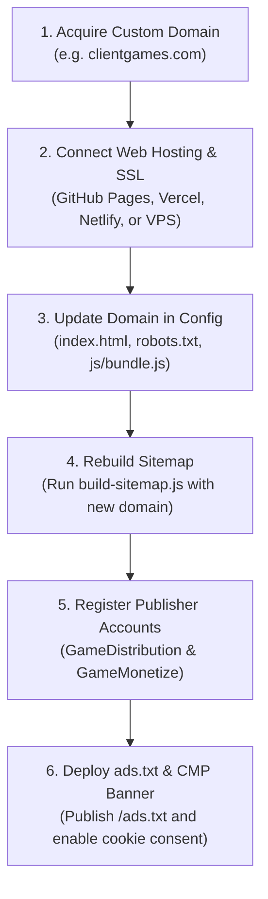

# KopiPlay – Client Handover & Post-Sale Setup Guide

**Document:** Complete Buyer Handover Package, Asset Ownership Boundaries & Setup Manual  
**Target Platform:** **KopiPlay**  
**Catalog Size:** 187 Verified Playable Games (7 First-Party In-House, 180 Third-Party Syndicated)  
**Date:** November 2026  
**Confidentiality:** Exclusively for the Acquiring Client & Technical Integration Team  

---

## 1. Executive Overview & Welcome

Congratulations on acquiring **KopiPlay**! This document provides an exhaustive, transparent handover manual detailing:
1. Exactly what assets and software code are included in your purchase.
2. What is legally and operationally excluded from the sale.
3. A step-by-step onboarding checklist to connect your own domain, establish publisher monetization accounts, and launch the platform.
4. Official registration links and compliance requirements for third-party game syndication networks.

---

## 2. What the Buyer Receives (Assets Included in Sale)

The buyer receives 100% full, unrestricted ownership and possession of the following digital assets:

### A. Platform Software & Frontend Engine
- **Core SPA Architecture:** Complete single-page application (SPA) code with client-side hash routing, glassmorphic dark gaming theme, responsive mobile drawers, and zero framework overhead.
- **Production Bundles & Source Files:** Full modular source files in `js/` (API layer, state management, components, views) and production bundle in `js/bundle.js`.
- **CSS Design System:** Complete stylesheet suite (`css/main.css`, `css/components.css`, `css/player.css`, `css/responsive.css`).
- **Brand Identity Assets:** High-resolution SVG vector logo (`assets/images/logo.svg`), responsive favicon (`assets/images/favicon.svg`), default card fallback vector (`assets/images/games/default-game.svg`), and Web App Manifest (`manifest.json`).
- **Automated Tooling:** Automated XML sitemap generation script (`scripts/build-sitemap.js`) and bundle builder script (`scripts/build-complete-bundle.js`).

### B. 100% Proprietary First-Party In-House Games (7 Games)
The seller transfers **100% exclusive intellectual property rights, copyright ownership, and source code** for the 7 original arcade games located in `games/`:
1. **Neon Horizon: Cyber Racer** (`neon-racer-02` / Car): 3D Synthwave highway racer with procedural Web Audio SFX and particle traffic.
2. **Space Nebula Defender** (`space-def-03` / Action): Classic arcade space shooter with alien formations and particle blasters.
3. **Pulse 2048: Cyber Edition** (`pulse-2048-04` / Puzzle): Kinetic sliding number puzzle with swipe gesture support.
4. **Cyber Snake: Neon Overdrive** (`cyber-snake-05` / Arcade): Particle serpent score-chaser with time-warp mechanics.
5. **Neon Breaker DX** (`neon-breakout-06` / Arcade): Holographic brick-breaker with multi-ball physics and paddle deflection.
6. **Hyper Hoops: Street Dunk** (`hyper-hoops-07` / Sports): Physics timing basketball game with combo streaks and net swish effects.
7. **Chrono Dungeon: Crystal Quest** (`dungeon-quest-08` / Adventure): Procedural top-down dungeon crawler with crystal collection and combat.

*Note:* All 7 games are self-contained HTML5 Canvas / Web Audio applications with zero third-party runtime scripts, zero external dependencies, and zero royalties.

### C. Curated Third-Party Syndication Integration (180 Games)
- Fully verified integration metadata, official CDN thumbnails, and embed configurations in [data/games.json](file:///c:/online%20game/data/games.json) and [data/catalogData.js](file:///c:/online%20game/data/catalogData.js) for 180 games:
  - **121 Games via HTMLGames / Zygomatic B.V.**
  - **47 Games via GameDistribution / Azerion B.V.**
  - **12 Games via GameMonetize Inc.**
- **Asset Integrity:** 100% free of broken links, with zero unauthorized hotlinks to third-party portals (all lupzogames hotlinks completely eliminated).

---

## 3. What is Excluded from the Sale

To ensure legal clarity and prevent future disputes, the following items are **expressly excluded** from the transaction:

1. **Third-Party Intellectual Property:**
   - The buyer does **not** acquire intellectual property, trademarks, or copyrights to the 180 third-party syndicated games. These remain the exclusive property of their respective creators and syndication platforms (Azerion, GameMonetize, and Zygomatic).
2. **Seller's Monetization & Publisher Accounts:**
   - Publisher monetization accounts with GameDistribution, GameMonetize, or ad networks are personal legal contracts tied to the seller's corporate identity, banking details, and tax registrations. **They cannot be assigned or transferred.**
3. **The Temporary Staging Domain (`kipo.in`):**
   - The seller does not own or warrant `kipo.in`. The buyer is solely responsible for purchasing and connecting their own custom domain.
4. **Guaranteed Revenue or Traffic:**
   - The seller makes no representation or warranty regarding future ad impression earnings, CPM rates, search engine rankings, or visitor traffic volumes.

---

## 4. Buyer Setup Checklist (Post-Sale Roadmap)



- [ ] **Step 1: Acquire Custom Domain:** Purchase your chosen domain name (e.g. `clientgames.com`) through any ICANN-accredited registrar.
- [ ] **Step 2: Web Hosting & SSL Setup:** Upload the website files to your hosting platform (GitHub Pages, Netlify, Vercel, Cloudflare Pages, or traditional Apache/Nginx hosting) and enable HTTPS.
- [ ] **Step 3: Update Domain References:** Update canonical tags and sitemap directives following Section 5 of this guide.
- [ ] **Step 4: Rebuild XML Sitemap:** Execute the sitemap generation script to point all 220 URLs to your new domain.
- [ ] **Step 5: Register Publisher Accounts:** Apply for publisher accounts at GameDistribution and GameMonetize to receive ad revenue payouts.
- [ ] **Step 6: Deploy Consolidated `ads.txt`:** Create and publish your root `ads.txt` file containing your approved publisher lines.
- [ ] **Step 7: Deploy European CMP (Cookie Banner):** Implement a Google-certified Consent Management Platform for GDPR/ePrivacy compliance.

---

## 5. Domain Configuration Steps (Perform ONLY After Supplying Your Domain)

Once your custom domain (e.g., `https://clientgames.com`) is registered, perform these 4 quick configuration updates:

### Step 1: Update [index.html](file:///c:/online%20game/index.html)
Open `index.html` and replace all 4 occurrences of `https://kipo.in/` with your production domain:
- Line 17: `<link rel="canonical" href="https://clientgames.com/">`
- Line 25: `<meta property="og:url" content="https://clientgames.com/">`
- Line 33: `<meta property="twitter:url" content="https://clientgames.com/">`
- Line 59 (JSON-LD Schema): `"url": "https://clientgames.com/",`

### Step 2: Update [robots.txt](file:///c:/online%20game/robots.txt)
Open `robots.txt` and update the sitemap directive on line 4:
```txt
User-agent: *
Allow: /

Sitemap: https://clientgames.com/sitemap.xml
```

### Step 3: Update `productionDomain` in Bundle Builder
Open [scripts/build-complete-bundle.js](file:///c:/online%20game/scripts/build-complete-bundle.js) and update line 280:
```javascript
productionDomain: 'https://clientgames.com'
```
Then run the bundle builder:
```powershell
node scripts/build-complete-bundle.js
```

### Step 4: Rebuild [sitemap.xml](file:///c:/online%20game/sitemap.xml)
Run the automated sitemap builder passing your domain via the environment variable:
```powershell
# Windows PowerShell
$env:SITE_URL="https://clientgames.com"; node scripts/build-sitemap.js

# Linux / macOS Bash
SITE_URL="https://clientgames.com" node scripts/build-sitemap.js
```
This automatically updates all 220 URLs in `sitemap.xml` in under 1 second.

---

## 6. Official Third-Party Provider Registration Links

Use **only official provider portals** to register publisher accounts:

| Provider | Purpose | Official Portal Link | Notes |
|---|---|---|---|
| **GameDistribution (Azerion B.V.)** | Monetizes 47 games via pre-roll & interstitial ads | [publisher.gamedistribution.com](https://publisher.gamedistribution.com/)<br>[gamedistribution.com/publishers](https://gamedistribution.com/publishers) | Register account, add your domain under *"Publisher Properties"*, and request Google Ad Manager whitelisting. |
| **GameMonetize Inc.** | Monetizes 12 games via 50-70% ad revenue share | [gamemonetize.com](https://gamemonetize.com/) | Register account, add root domain under *"My Websites"*, and generate your custom game tags. |
| **HTMLGames (Zygomatic B.V.)** | Provides 121 free syndicated games | [htmlgames.com](https://www.htmlgames.com/)<br>[zygomatic.com](https://www.zygomatic.com/) | Standard embedding is free without registration. To apply for the 40% revenue share tier, submit the contact form once reaching 25,000 monthly unique visitors. |
| **Zygomatic Ad Partners** | Required partner lines for `ads.txt` | [cdn.htmlgames.com/ads.partners.txt](https://cdn.htmlgames.com/ads.partners.txt) | Fetch and merge these lines into your root `ads.txt`. |

---

## 7. Outstanding Licensing & Monetization Confirmations

Before commercial launch, the buyer must confirm and complete the following operational requirements:

### 1. GameDistribution Domain Whitelisting
- **Requirement:** GameDistribution must manually inspect and whitelist your domain in Google Ad Manager.
- **Timing:** Typically takes 3 to 7 business days following domain submission.
- **Interim State:** Prior to approval, games remain fully playable, but in-game ads may display default filler ads or zero ads.

### 2. GameMonetize Custom Root Domain Policy
- **Requirement:** GameMonetize requires custom top-level domains (e.g. `clientgames.com`). Free subdomains (`.blogspot.com`, `.wordpress.com`, `.github.io`) are prohibited.
- **Confirmation:** Ensure your website is deployed on a custom root domain before submitting to GameMonetize.

### 3. Deploying Root `ads.txt`
- **Requirement:** Both GameDistribution and GameMonetize require an `ads.txt` file hosted on your root domain (`https://clientgames.com/ads.txt`).
- **Template:** Consolidate:
  1. Zygomatic partner lines from `https://cdn.htmlgames.com/ads.partners.txt`.
  2. Your personalized GameDistribution lines from your publisher dashboard.
  3. Your personalized GameMonetize lines from your publisher dashboard.

### 4. European User Consent (CMP / GDPR Compliance)
- **Requirement:** European data protection laws (GDPR / ePrivacy Directive) and the EU Digital Services Act (DSA) require websites serving programmatic game ads to run an IAB TCF 2.2 certified Consent Management Platform.
- **Recommendation:** Integrate a free or low-cost CMP such as Google Funding Choices (AdSense), Cookiebot, or Didomi by placing their script tag in the `<head>` of `index.html`.

### 5. First-Party Game Trademark Clearance
- **Status:** The first-party brick breaker game (`neon-breakout-06`) has had its display title cleanly standardized to **"Neon Breaker DX"** in catalog metadata and user interface overlays, eliminating trademark confusion with Atari Interactive's registered "Breakout" mark.

---
*Guide Prepared & Verified by AntiGravity M&A Due Diligence Suite.*

