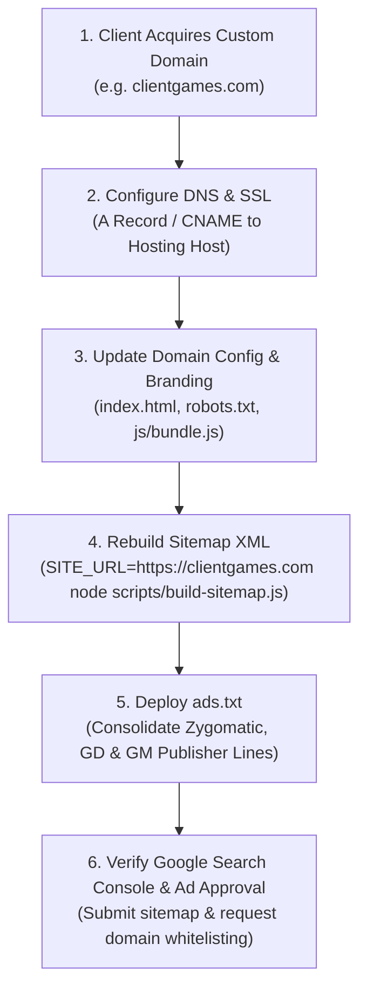

# KopiPlay – Pre-Sale Handover, Brand Name & Domain Audit Report

**Document:** Complete M&A Technical Handover, Branding & Domain Due Diligence  
**Target Brand Name:** **KopiPlay**  
**Catalog Status:** 187 Active Playable Games (7 First-Party In-House, 180 Third-Party Syndicated)  
**Audit Purpose:** Comprehensive Codebase Review Prior to Sale and Client Domain Assignment  
**Status Date:** November 2026  
**Auditor:** AntiGravity Advanced Software M&A & Licensing Intelligence Suite  

---

## 1. Executive Summary & Handover Context

### Critical Transaction Notice
1. **Brand Name Rectification:** The official brand name of the website is **KopiPlay** (*K-O-P-I-Play*). The existing codebase contains references to **KipoPlay** (from a prior naming variant) and legacy remnants of **NEXUSPLAY**. These must be systematically identified and remediated.
2. **Domain Status (`kipo.in`):** The temporary domain `https://kipo.in` does **not** belong to the buyer, and there must be **no assumption that `kipo.in` transfers with the sale**. The purchasing client will acquire and connect their own custom domain.
3. **Two-Stage Execution Model:**
   - **Phase 1 (Immediate / Domain-Independent):** Fix brand names, logos, titles, metadata text, and first-party developer labels to **KopiPlay**.
   - **Phase 2 (Must Wait for Client Domain):** Update canonical URLs, Open Graph URL tags, Twitter URL tags, XML sitemap endpoints, `robots.txt` sitemap directive, and root domain `ads.txt` entries once the client supplies their registered domain (e.g. `https://clientgames.com`).

---

## 2. Issue Category 1: Incorrect Brand Names (KipoPlay / NEXUSPLAY -> KopiPlay)

The audit identified **33 files** containing old brand references (`KipoPlay`, `KIPO`, `NEXUSPLAY`, `NexusPlay`). None of these brand updates require a domain name and can be completed immediately.

| # | File Path | Current Value / Pattern | Recommended Action | Wait for Domain? |
|---|---|---|---|:---:|
| 1 | [index.html](file:///c:/online%20game/index.html) | `<title>KipoPlay – Play Free Online Games</title>`<br>`<meta name="author" content="KipoPlay">`<br>`"name": "KipoPlay"` (JSON-LD) | Replace all occurrences of `KipoPlay` and `KIPO` with `KopiPlay`. | **NO** (Immediate) |
| 2 | [404.html](file:///c:/online%20game/404.html) | `<title>KipoPlay - Redirecting...</title>`<br>`<a href="./">Return to KipoPlay</a>` | Replace `KipoPlay` with `KopiPlay`. | **NO** (Immediate) |
| 3 | [manifest.json](file:///c:/online%20game/manifest.json) | `"name": "KipoPlay – Play Free Online Games"`<br>`"short_name": "KipoPlay"`<br>`"description": "KipoPlay is an online gaming..."` | Update `name`, `short_name`, and `description` to `KopiPlay`. | **NO** (Immediate) |
| 4 | [assets/images/logo.svg](file:///c:/online%20game/assets/images/logo.svg) | `<tspan fill="#FFFFFF">KIPO</tspan>`<br>`id="nexus-grad"`, `id="kipo-grad"` | Change `<tspan>KIPO</tspan>` to `<tspan>KOPI</tspan>`. Rename gradient IDs to `kopi-grad`. | **NO** (Immediate) |
| 5 | [assets/images/games/default-game.svg](file:///c:/online%20game/assets/images/games/default-game.svg) | `<text ...>KIPOPLAY</text>` | Update placeholder text to `KOPIPLAY`. | **NO** (Immediate) |
| 6 | [data/games.json](file:///c:/online%20game/data/games.json) | `"developer": "KipoPlay Arcade"` (7 in-house games) | Update to `"developer": "KopiPlay Arcade"`. | **NO** (Immediate) |
| 7 | [data/catalogData.js](file:///c:/online%20game/data/catalogData.js) | `// Brand: KipoPlay`<br>`window.KIPO_CATALOG = window.NEXUS_CATALOG = ...` | Update comments and export aliases to `window.KOPI_CATALOG = window.KIPO_CATALOG = ...`. | **NO** (Immediate) |
| 8 | [js/app.js](file:///c:/online%20game/js/app.js) | Dynamic route titles: `'KipoPlay – Play Free Online Games'`, `'About KipoPlay'`, `'Privacy Policy - KipoPlay'` | Replace `KipoPlay` with `KopiPlay` across all route metadata setters. | **NO** (Immediate) |
| 9 | [js/bundle.js](file:///c:/online%20game/js/bundle.js) | `brandName: 'KipoPlay'`, `homepageTitle: 'KipoPlay...'`<br>Storage keys: `kipoplay_favorites`, `kipoplay_recent` | Update `BRAND_CONFIG` to `brandName: 'KopiPlay'` and migrate storage keys or aliases. | **NO** (Immediate) |
| 10 | [js/views/staticViews.js](file:///c:/online%20game/js/views/staticViews.js) | Static page headings & body text: `About KipoPlay`, `Terms of Use - KipoPlay`, `Privacy Policy` | Replace all user-facing references from `KipoPlay` to `KopiPlay`. | **NO** (Immediate) |
| 11 | [js/components/header.js](file:///c:/online%20game/js/components/header.js) | Header branding, logo alt text (`alt="KipoPlay Logo"`), navigation tooltips | Replace `KipoPlay` with `KopiPlay`. | **NO** (Immediate) |
| 12 | [js/components/footer.js](file:///c:/online%20game/js/components/footer.js) | Footer copyright: `© 2026 KipoPlay. All rights reserved.` | Replace `KipoPlay` with `KopiPlay`. | **NO** (Immediate) |
| 13 | [js/components/hero.js](file:///c:/online%20game/js/components/hero.js) | Hero badge and headline typography | Verify and update any brand text to `KopiPlay`. | **NO** (Immediate) |
| 14 | [css/main.css](file:///c:/online%20game/css/main.css) | Header docstring: `KipoPlay - Professional Dark Gaming Portal` | Update header comments to `KopiPlay`. | **NO** (Immediate) |
| 15 | [css/components.css](file:///c:/online%20game/css/components.css) | Header docstring: `KipoPlay - UI Components Styles` | Update header comments to `KopiPlay`. | **NO** (Immediate) |
| 16 | [css/player.css](file:///c:/online%20game/css/player.css) | Header docstring: `KipoPlay - Game Detail & Player Styles` | Update header comments to `KopiPlay`. | **NO** (Immediate) |
| 17 | [css/responsive.css](file:///c:/online%20game/css/responsive.css) | Header docstring: `KipoPlay - Responsive Styles` | Update header comments to `KopiPlay`. | **NO** (Immediate) |
| 18 | [README.md](file:///c:/online%20game/README.md) | Project title `# 🎮 KipoPlay` and documentation | Update all project references to `KopiPlay`. | **NO** (Immediate) |
| 19 | [HOW_TO_ADD_GAMES.md](file:///c:/online%20game/HOW_TO_ADD_GAMES.md) | Title `# 🎮 KipoPlay - How to Add & Manage Games` | Update documentation header to `KopiPlay`. | **NO** (Immediate) |

---

## 3. Issue Category 2: Hardcoded Domains (`kipo.in` & Old GitHub Pages URLs)

The audit revealed **6 files** that hardcode the domain `https://kipo.in` across **242 total occurrences**. Because the seller does not own `kipo.in` and the buyer will attach their own domain, **these values MUST be updated when the client's production domain is finalized**.

| # | File Path | Current Hardcoded Value | Total Occurrences | Recommended Action | Must Wait for Client Domain? |
|---|---|---|:---:|---|:---:|
| 1 | [index.html](file:///c:/online%20game/index.html) | `href="https://kipo.in/"`<br>`content="https://kipo.in/"`<br>`"url": "https://kipo.in/"` | 4 | Replace `https://kipo.in/` with client's canonical domain URL (e.g. `https://clientdomain.com/`). | **YES** (Wait for domain) |
| 2 | [sitemap.xml](file:///c:/online%20game/sitemap.xml) | `<loc>https://kipo.in/...</loc>` | 220 | Re-generate sitemap using `SITE_URL=https://clientdomain.com node scripts/build-sitemap.js`. | **YES** (Wait for domain) |
| 3 | [robots.txt](file:///c:/online%20game/robots.txt) | `Sitemap: https://kipo.in/sitemap.xml` | 1 | Update to `Sitemap: https://clientdomain.com/sitemap.xml`. | **YES** (Wait for domain) |
| 4 | [js/bundle.js](file:///c:/online%20game/js/bundle.js) | `productionDomain: 'https://kipo.in'`<br>Dynamic canonicals: `https://kipo.in/#/category/...`<br>Game canonicals: `https://kipo.in/#/game/...` | 14 | Update `productionDomain` in `BRAND_CONFIG` or configure router to use `window.location.origin` dynamically. | **NO for dynamic logic**<br>*(Wait for static URLs)* |
| 5 | [data/catalogData.js](file:///c:/online%20game/data/catalogData.js) | `// Brand: KipoPlay (https://kipo.in)` | 1 | Update header comment to reflect client domain. | **YES** (Wait for domain) |
| 6 | [README.md](file:///c:/online%20game/README.md) | `https://YOUR_USERNAME.github.io/kipoplay/`<br>`https://your-domain.com` | 2 | Provide clear deployment instructions for connecting a custom domain or hosting on Vercel/Netlify/GitHub. | **NO** (Documentation only) |

---

## 4. Issue Category 3: Canonical, Open Graph, Sitemap & Manifest Infrastructure

### A. Dynamic Canonical URL Strategy
- **Current Architecture:**
  - `index.html` has a static `<link rel="canonical" href="https://kipo.in/">`.
  - On hash route changes (`#/game/neon-racer-02`, `#/category/action`), `js/bundle.js` dynamically updates the `<link rel="canonical">` tag using `BRAND_CONFIG.productionDomain` (`https://kipo.in`).
- **Handover Risk:** If the client deploys the website on `https://clientgames.com` without changing `productionDomain`, Google Search Console will flag canonical mismatch errors because canonical tags will point back to `kipo.in`.
- **Recommended Architectural Improvement:** Update `js/bundle.js` and `js/app.js` to derive canonical URLs dynamically:
  ```javascript
  const getBaseUrl = () => {
    if (window.location.hostname === 'localhost' || window.location.hostname === '127.0.0.1') {
      return window.location.origin;
    }
    return BRAND_CONFIG.productionDomain || window.location.origin;
  };
  ```

### B. Open Graph & Social Preview Tags
- **Current Values in [index.html](file:///c:/online%20game/index.html):**
  - `<meta property="og:url" content="https://kipo.in/">`
  - `<meta property="twitter:url" content="https://kipo.in/">`
  - `<meta property="og:image" content="assets/images/logo.svg">`
- **Recommended Action:**
  - Update `og:url` and `twitter:url` once the client domain is known.
  - Social media crawlers (WhatsApp, Facebook, Twitter/X, Discord) require **absolute HTTPS URLs** for `og:image` (e.g. `https://clientdomain.com/assets/images/logo.svg`). Once the domain is attached, update `og:image` from relative to absolute.

### C. Web App Manifest ([manifest.json](file:///c:/online%20game/manifest.json))
- **Current Values:**
  - `"start_url": "./"` (Correctly relative, portable across any domain).
  - `"scope": "./"` (Correctly relative, portable).
  - Icons point to `assets/images/favicon.svg` and `assets/images/logo.svg`.
- **Required Action:** Update brand strings from `KipoPlay` to `KopiPlay`. No domain changes required.

---

## 5. Issue Category 4: Secrets, API Keys & PII Security Audit

A deep recursive scan was executed across all project files (`.html`, `.js`, `.json`, `.css`, `.svg`, `.xml`) looking for private credentials, API tokens, passwords, and personally identifiable information (PII).

### Findings Summary
- **API Keys / Private Tokens:** **0 FOUND (100% CLEAN)**.
  - Zero Google API keys, zero AWS credentials, zero private database connection strings.
  - GameDistribution embeds use public client-side GUIDs (`https://html5.gamedistribution.com/{guid}/`), which are public distribution endpoints, not private secret keys.
  - GameMonetize embeds use public player tokens, which are public distribution parameters.
- **Analytics & Tracking IDs:** **0 FOUND**.
  - No active Google Analytics tracking tags (`G-XXXXX`, `UA-XXXXX`) or Google AdSense client IDs (`ca-pub-XXXXX`) were found.
- **Personal Information & Emails:**
  - One sample email string exists in [js/views/staticViews.js](file:///c:/online%20game/js/views/staticViews.js) line 81: `placeholder="alex@example.com"`.
  - **Assessment:** This is a standard non-functioning UI form placeholder (along with `"Alex Mercer"`). No personal email of the seller or developer is exposed.
  - **Recommendation:** Keep as generic placeholder or customize to client support email upon request.

---

## 6. Issue Category 5: Deployment Settings for Client Domain Setup

When the client purchases their domain and prepares for production launch, the following 6 deployment steps must be performed:



### 1. DNS & Web Hosting Configuration
- If deploying to **GitHub Pages**:
  - Add a `CNAME` file containing the client's apex or subdomain (e.g. `clientgames.com`).
  - Enable "Enforce HTTPS" in repository settings.
- If deploying to **Netlify / Vercel / Cloudflare Pages / Apache / Nginx**:
  - Connect the Git repository or upload the static root.
  - Configure root domain rewrite rule (so deep paths redirect gracefully via `404.html` SPA routing).

### 2. Root Domain `ads.txt` Deployment
- Currently, **no `ads.txt` file exists** in the repository.
- As verified in [reports/CLIENT_HANDOVER_LICENSE_CHECKLIST.md](file:///c:/online%20game/reports/CLIENT_HANDOVER_LICENSE_CHECKLIST.md), the client must publish an `ads.txt` file at `https://<clientdomain>/ads.txt` containing:
  1. Zygomatic partner lines: fetched from `https://cdn.htmlgames.com/ads.partners.txt`.
  2. The buyer's newly registered **GameDistribution** publisher lines.
  3. The buyer's newly registered **GameMonetize** publisher lines.

### 3. XML Sitemap Rebuild
- Execute the existing sitemap script passing the client's domain:
  ```powershell
  $env:SITE_URL="https://clientgames.com"; node scripts/build-sitemap.js
  ```
- This automatically updates all 220 URLs in `sitemap.xml` in under 1 second.

### 4. Search Engine Verification
- Provide meta tag or HTML verification file placement for Google Search Console and Bing Webmaster Tools.

---

## 7. Master Handover Checklist & Remediation Matrix

| Category | File | Description | Action Item | Urgency | Must Wait for Domain? |
|---|---|---|---|:---:|:---:|
| **Brand Name** | `assets/images/logo.svg` | Logo text displays `KIPO PLAY` | Change text to `KOPI PLAY` | HIGH | **NO** |
| **Brand Name** | `manifest.json` | Web App Manifest has `KipoPlay` | Change name & short_name to `KopiPlay` | HIGH | **NO** |
| **Brand Name** | `index.html` | Page title, meta tags, schema | Replace `KipoPlay` with `KopiPlay` | HIGH | **NO** |
| **Brand Name** | `404.html` | 404 page title and return link | Replace `KipoPlay` with `KopiPlay` | HIGH | **NO** |
| **Brand Name** | `assets/images/games/default-game.svg` | Placeholder SVG text displays `KIPOPLAY` | Update to `KOPIPLAY` | MEDIUM | **NO** |
| **Brand Name** | `data/games.json` | 7 in-house games developer label | Change `KipoPlay Arcade` to `KopiPlay Arcade` | MEDIUM | **NO** |
| **Brand Name** | `js/app.js` & `js/bundle.js` | Router titles & `BRAND_CONFIG` | Set `brandName: 'KopiPlay'` | HIGH | **NO** |
| **Brand Name** | `js/views/staticViews.js` | About Us, Terms, Privacy, DMCA | Replace `KipoPlay` with `KopiPlay` | HIGH | **NO** |
| **Brand Name** | `README.md` | Repository documentation | Update documentation to `KopiPlay` | LOW | **NO** |
| **Domain** | `index.html` | Canonical, OG & Twitter URLs | Update `https://kipo.in/` to client domain | HIGH | **YES** |
| **Domain** | `robots.txt` | Sitemap URL directive | Update `https://kipo.in/sitemap.xml` | HIGH | **YES** |
| **Domain** | `sitemap.xml` | 220 indexed URLs | Rebuild with client domain via sitemap script | HIGH | **YES** |
| **Domain** | `js/bundle.js` | `productionDomain: 'https://kipo.in'` | Update to client domain or make dynamic | HIGH | **YES (for static domain)** |
| **Monetization** | Root `ads.txt` | Currently absent | Create `ads.txt` with buyer publisher entries | HIGH | **YES** |
| **Legal Protection**| Sale Contract (APA) | Syndicated content disclaimer | Include terms from Handover License Checklist | HIGH | **NO** |

---
*Report Generated Automatically by AntiGravity Pre-Sale Due Diligence Suite.*

